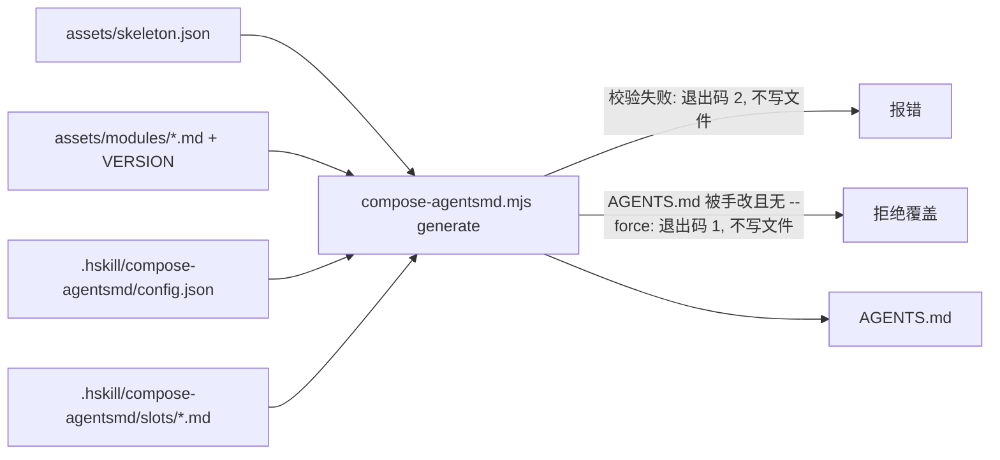

# Spec：compose-agentsmd —— AGENTS.md 标准骨架与生成

- **版本：** v0.3，送审稿（未批准）；v0.2 按构建者检查补全 5.4 对照表与兜底规则；v0.3 写入 D21（5.4a）并收紧 V2
- **决定记录：** `2026-11-11-compose-agentsmd-record.md`（下文以 D 编号引用）
- **分支：** `feature/devflow-agents-snippet`
- **未决事项：** 见第 9 节

## 1. 意图与目标

各项目的 AGENTS.md 里有大段相同的开发流程（devflow：question-me → init-spec → develop-plan → manage-worktree → handoff）和 Agent Canvas 框架约定。现在这些内容只在 Agent Canvas 的 `AGENTS.md` 里手写维护，其他项目只能复制，复制后就和源头分叉（D1、D2）。

目标：harveyz-skill 提供一套 **AGENTS.md 标准骨架**。骨架由固定顺序的槽组成：

- **标准槽**：由 harveyz-skill 维护的标准模块填充，按项目参数代入后原样生成，带版本，可整体升级（D5、D6、D19）。
- **描述槽**：由项目自己写个性化内容（D6）。

项目的 AGENTS.md 由 `compose-agentsmd` 从项目配置生成，不手改；升级标准模块时重新生成即可（D7）。

## 2. 范围

**本轮做（D10）：**

- 新 skill `skills/devflow/compose-agentsmd/`（D11）：`SKILL.md`、标准模块、生成脚本、测试。
- 从 Agent Canvas `AGENTS.md` 提炼出的标准模块初版（模块集 v1.0.0），提炼规则见 5.4（D3）。
- 用 Agent Canvas 现有 `AGENTS.md` 写一份配置，在临时目录生成并与原文逐节对照（验收 V3）。
- 注册到 `skills-index.json` 的 devflow bundle，更新 `bundleMeta.devflow` 描述，重新生成 `package.json` 的 `files`。

**本轮不做：**

- 不改 Agent Canvas 仓库；不迁移 harveyz-skill 自身的 AGENTS.md / CLAUDE.md（D16）。
- 不生成 `CLAUDE.md` 或其他宿主的指令文件。
- 不支持项目新增骨架之外的槽（骨架外的内容写进「其他约定」槽）。

## 3. 不可接受的结果

- 生成结果因运行环境不同而不同（同一配置、同一模块版本必须逐字节一致）。
- 生成时静默覆盖手改过的 AGENTS.md。
- 模板错误（未知参数、未闭合条件）被静默放过，生成出带残留语法的文件。
- `agent_canvas: false` 的项目生成结果里残留画布相关内容（`describe-node`、`capture-requirement`、`relate-node`、`observe-node-quality`、`judge-release`、“Agent Canvas”）。
- 标准模块里残留 Agent Canvas 项目本身的内容（D3 列出的那些）。
- hskill 安装时的变量替换改写模块里的模板语法（见 4 节第 3 条）。

## 4. 现状（实施前提，已核实）

1. Agent Canvas `AGENTS.md`（394 行）结构：通用约定（指令源与能力检测、平台能力替代表、Claude Code 适配、术语查阅、设计判断、仓库环境）→ 流程简述 → 上游 skill 优先级 → Step 1–8 → 版本验收。出处 `~/Projects/agent-canvas/AGENTS.md`，提交 `14dbe3e0b`。
2. `## 验收标准` 的条目格式只定义在 Agent Canvas 内部 spec `docs/superpowers/specs/2026-10-13-requirement-acceptance-design.md` §3.1，原文注明“项目无关”。
3. hskill 安装 skill 时，`lib/installer.js` 的 `copyDir` 在变量表非空时对文本文件执行 `substituteVars`，把 `{{\w+}}` 替换为同名变量（`lib/vars.js:19`）。模块若用 `{{name}}` 语法，名字与安装变量撞上就会被改写。
4. skill 自带测试的发现规则：`scripts/run-skill-tests.sh` 跑 `skills/*/*/tests/*.bats`；Node 测试在 `tests/*.test.mjs`（`npm test` 统一运行）。
5. `package.json` 的 `files` 由 `scripts/generate-npmignore.js` 按 `skills-index.json` 生成。
6. harveyz-skill 没有现成的“可嵌入片段”机制；`scripts/sync-skill-platform-standard.mjs` 的 check/write 模式与 sha256 标记可作参考。

## 5. 方案

### 5.1 整体结构

```
skills/devflow/compose-agentsmd/            (harveyz-skill，随 npm 发布)
  SKILL.md
  assets/skeleton.json                      槽的顺序、id、类型、标题
  assets/modules/VERSION                    模块集版本，如 1.0.0
  assets/modules/<槽id>.md                  每个标准槽一份正文
  assets/config.template.json               init 写入项目的配置模板
  scripts/compose-agentsmd.mjs              init / generate / check
  tests/...

<项目>/.hskill/compose-agentsmd/            (项目配置，D17)
  config.json                               参数与槽开关
  slots/<槽id>.md                           每个描述槽一个文件
<项目>/AGENTS.md                            生成物（D7）
```



### 5.2 骨架（D8）

`assets/skeleton.json` 定义槽，顺序即生成顺序：

| # | id | 类型 | 生成的标题 | 内容来源 |
|---|---|---|---|---|
| 1 | `overview` | 描述 | `# <title>`（`title` 取自配置） | 项目是什么、技术栈 |
| 2 | `flow-summary` | 标准 | 模块自带 `## 流程简述` | 8 步、闸门、槽位约定 |
| 3 | `principles` | 描述 | `## 项目原则` | 设计判断、术语等项目规矩 |
| 4 | `instruction-sources` | 标准 | 模块自带 `## 指令源与能力检测` | 共享 skill 跨平台、缺失时报告、禁用通用 worktree/收尾 skill |
| 5 | `platform-fallbacks` | 标准 | 模块自带 `## 平台专属能力的通用替代` | 原生能力 / 兜底对照表 |
| 6 | `platform-adaptation` | 描述 | `## 平台适配` | 如 Claude Code 加载条件、`skillOverrides` |
| 7 | `repo-env` | 描述 | `## 仓库环境` | 克隆后命令、hooks、合并设置 |
| 8 | `flow-steps` | 标准 | 模块自带（`## 上游 skill 与本文件的优先级`、`## Step 1`…`## Step 8`） | devflow 优先级与各步细则 |
| 9 | `release-acceptance` | 标准 | 模块自带 `## 版本验收` | Agent Canvas 版本验收；仅 `agent_canvas: true` 时生成（D9） |
| 10 | `other` | 描述 | `## 其他约定` | 骨架外的其余内容 |

规则：

- 描述槽文件不存在、或去掉空白后为空 → 该槽（含标题）不生成。`overview` 例外：标题 `# <title>` 总是生成。
- 描述槽文件只写正文，可以用 `###` 及更深的标题；生成器负责写该槽的 `##` 标题。
- 标准槽可在配置 `disabled_slots` 里关掉；`flow-summary` 与 `flow-steps` 互相引用，只能一起关（否则校验报错）。

### 5.3 项目配置（D13、D17）

`config.json` 字段：

| 字段 | 类型 | 必填 | 默认 | 用在 |
|---|---|---|---|---|
| `title` | string | 是 | — | `overview` 的一级标题 |
| `integration_branch` | string | 是 | — | Step 3 基线说明、Step 7 合并判定命令 |
| `merge_command` | string | 是 | — | Step 7 合并方式（如 `scripts/merge-to-staging.sh`） |
| `e2e` | string | 否 | 空 | Step 6 高档或涉及前端那一行；为空时该行写“端到端测试，方式由「仓库环境」或「其他约定」规定” |
| `complexity_signals` | string | 否 | 空 | Step 2 高档判定信号后追加的项目补充信号 |
| `spec_dir` | string | 否 | `docs/superpowers/specs` | spec 与测试清单落点 |
| `plan_dir` | string | 否 | `docs/superpowers/plans` | plan 落点 |
| `record_dir` | string | 否 | `.hskill/spec` | 决定记录落点 |
| `agent_canvas` | boolean | 否 | `false` | 画布内容开关（D9） |
| `disabled_slots` | string[] | 否 | `[]` | 关闭的标准槽 id |

校验（任何一项不过 → 退出码 2，不写文件）：

- 缺必填字段、类型不符、出现未知字段。
- `disabled_slots` 含非标准槽 id，或只关了 `flow-summary` / `flow-steps` 中的一个。
- `agent_canvas: true` 且 `spec_dir` 不以 `docs/superpowers/specs` 开头：`describe-node` 的 spec 自动发现只认这个前缀（4 节第 1 条，D3 依据）。

### 5.4 标准模块的内容（D3、D9）

模块正文以 Agent Canvas `AGENTS.md`（`14dbe3e0b`）为蓝本，逐节按下表处理：

| 原文 | 处理 |
|---|---|
| 标题、技术栈 | 不进模块（进 `overview` 描述槽） |
| 开头说明“本文件只写流程……不要在两处重复维护同一套细则” | 前半句（只写流程）删去，与骨架含项目原则矛盾；后半句（skill 细则以 skill 说明为准、不重复维护）进 `flow-summary` 开头 |
| 指令源：共享 skill 跨平台、只认实际可用能力、平台个人配置不能替代、禁用通用 worktree/收尾 skill、worktree 交给 `manage-worktree` | 进 `instruction-sources`；“本文件是唯一正本、不维护 `CLAUDE.md`”、“Codex 读取…/见下文「Claude Code 适配」”、`sync-design`、`simulate-user` 等项目 skill 名删去；“画布 skill”一词包在 `agent_canvas` 条件里；“按本文及 `docs/reference/git-workflow.md` 执行”改为“按本文及项目的分支规则执行”；`rg` 一条保留 |
| 平台能力替代表 | 进 `platform-fallbacks`；“关闭画布节点”一行包在 `agent_canvas` 条件里 |
| Claude Code 适配、术语查阅、设计判断、仓库环境 | 不进模块（分别进 `platform-adaptation`、`principles`、`principles`、`repo-env`） |
| 流程简述 + 槽位约定 | 进 `flow-summary`；Step 8 那一项按 `agent_canvas` 条件给两种写法 |
| 上游 skill 优先级 | 进 `flow-steps`；落点用 `spec_dir` / `plan_dir` / `record_dir`；“闸门后动作”一条包在 `agent_canvas` 条件里；删去 `AGENTS.pre-init-spec.md` 一行 |
| Step 1 | 保留 `rephrase`/`question-me` 分流；删 `.design-scratch/` 与 `sync-design` 段 |
| Step 2 | 高档判定信号改为通用：跨进程或跨模块、修改数据模型或持久化格式、修改协议/状态机/生命周期、多方案需取舍、可拆成 3 个以上任务；后接 `complexity_signals`（非空时）；琐碎档“不调用画布 skill”包在 `agent_canvas` 条件里 |
| Step 3 | 分支类型写通用默认（`feature`/`doc`/`fix`）；基线写 `integration_branch`，路径与基线由 `manage-worktree` 推断；删 `.claude/worktrees` 遗留句 |
| Step 4 | 保留；`## 验收标准` 的处理见 5.4a；4.2 中“测试清单与 spec 同目录……`describe-node` 只认前缀”一段、4.3 第 4 条、4.4 中 `describe-node` 与画布相关特例包在 `agent_canvas` 条件里；“前端设计稿”一行保留为通用表述（不点名 `sync-design`） |
| Step 5 | 原样保留 |
| Step 6 | 高档或涉及前端那一行代入 `e2e` |
| Step 7 | 合并判定命令用 `integration_branch`，合并方式用 `merge_command`；删 `git-workflow.md` 链接；7.1“随后直接进入 Step 8”包在 `agent_canvas` 条件里；集成责任中节点角色相关句子包在 `agent_canvas` 条件里，`else` 分支写“由当前 agent 负责；handoff 接手方不合并，由交出方在 `accept` 后负责” |
| Step 8 | 整节包在 `agent_canvas` 条件里；`else` 分支：流程简述写“7 步”，不生成 Step 8 |
| 版本验收 | 进 `release-acceptance`；删指向 Agent Canvas 内部 spec 的两条链接 |

**兜底规则（表未逐条列出的句子）：** 指向项目自身路径或文件的句子删去或改为通用表述；指向描述槽（可能为空）的“见下文某节”删去；提及画布、节点、Agent Canvas 的句子包在 `agent_canvas` 条件里。按兜底规则做的改动在实施汇报中逐条列出，供 V3 对照。

`agent_canvas: false` 时流程为 7 步：`flow-summary` 的步数、闸门描述与“节点收尾”项随条件变化，正文不得残留“Step 8”引用。

### 5.4a `## 验收标准` 随 `agent_canvas` 的处理（D21）

原文 Step 4 要求 spec 与测试清单含 `## 验收标准`，并称它是“第二道关（版本验收）”的依据；上游 skill 优先级第 5 条要求按 V 格式写。

- **`agent_canvas: true`：** 原样保留：V 格式（内联）、“第一道关 / 第二道关”与判据（J 编号）的区分、优先级第 5 条。
- **`agent_canvas: false`：** 仍要求 spec 与测试清单含 `## 验收标准`，作为 handoff 验收与完成判定的依据，写法按 init-spec 的默认写法；不生成 V 格式、“第二道关 / 版本验收”、判据与验收标准分关的说法，优先级第 5 条不生成（其后条目不重新编号也不留空号：第 5 条本就是最后一条）。

### 5.5 模板语法（D18）

- **参数：** `@{name}`。不用 `{{name}}`，因为 hskill 安装时会替换 `{{\w+}}`（4 节第 3 条）。
- **条件：** 独占一行的 `<!-- @if name -->`、可选的 `<!-- @else -->`、`<!-- @endif -->`；`name` 必须是布尔参数，或写成 `<!-- @if name -->` 时对字符串参数判非空。条件只允许单层，不可嵌套。
- **报错（退出码 2，指出模块文件与行号）：** 未知参数名；`@if` 未闭合、`@else`/`@endif` 无对应 `@if`、嵌套 `@if`；条件用在不存在的参数上。
- 条件指令行本身不出现在输出里；条件块前后的空行规则：去掉指令行后，连续空行压成一行。

### 5.6 生成文件格式与版本（D12、D19、D20）

AGENTS.md 第一行固定为：

```
<!-- compose-agentsmd: modules=1.0.0 sha256=<64位hex>; generated from .hskill/compose-agentsmd/, do not edit -->
```

- `sha256` 是第一行之后全部内容的哈希。
- 每个生成的槽前加一行 `<!-- slot:<id> -->`，便于定位来源；标准槽写成 `<!-- slot:<id> modules=1.0.0 -->`。
- 换行统一 `\n`，文件以单个换行结尾；槽之间空一行。

### 5.7 脚本接口

```
node <skill 目录>/scripts/compose-agentsmd.mjs <init|generate|check> [--root <项目根>] [--force]
```

`--root` 默认当前目录。

| 子命令 | 行为 | 退出码 |
|---|---|---|
| `init` | 配置目录不存在时，写入 `config.json`（模板，必填项留空字符串）与空的描述槽文件；已存在 → 不动任何文件，报告 | 0 已建；1 已存在 |
| `generate` | 校验配置与模块 → 拼装 → 写 AGENTS.md。目标文件存在且（无首行标记，或首行 `sha256` 与正文不符）→ 视为手改，拒绝覆盖，除非 `--force` | 0 已写；1 拒绝覆盖；2 配置或模板错误 |
| `check` | 只读。重新拼装，与磁盘逐字节比较，报告：`ok` / `missing`（无 AGENTS.md）/ `hand-edited`（首行缺失或哈希不符）/ `outdated`（首行 `modules` 低于已安装版本）/ `stale`（其余不一致：配置改后未生成）。可同时报多项 | 0 ok；1 其他；2 配置或模板错误 |

标准输出每行一个 `key=value`（`status=`、`modules_installed=`、`modules_generated=`、`path=`），便于 agent 解析；错误信息走 stderr。只用 Node 内置模块（D15）。

### 5.8 SKILL.md 的职责（D14）

- **初始化：** 运行 `init`。项目已有手写 AGENTS.md 时，由 agent 按 5.2 的槽、按 5.4 的对照表把现有内容拆进描述槽与参数；属于标准模块的内容不抄进描述槽。拆完运行 `generate`（需 `--force`，因为原文件无标记），向用户展示原文与生成结果的差异，由用户确认后才算完成；用户不确认则恢复原文件。
- **生成 / 升级：** 改配置或描述槽后运行 `generate`；装了新版 skill 后运行 `check`，`outdated` 时运行 `generate` 并汇报模块版本变化。
- **检查：** 运行 `check`，按 `status` 汇报；`hand-edited` 时提示用户把手改内容移回配置目录，不自行 `--force`。
- 边界：不提交 git（交给项目流程）；不改其他宿主指令文件。

### 5.9 注册与版本

- `skills-index.json`：`path: devflow/compose-agentsmd`，`bundle: devflow`，`installScope: global`；`bundleMeta.devflow` 描述追加“compose-agentsmd — 从标准骨架生成 AGENTS.md”。
- skill `version` 从 `0.1.0` 起；模块集 `VERSION` 从 `1.0.0` 起，两者独立（D15）。
- 运行 `node scripts/generate-npmignore.js` 更新 `package.json` 的 `files`。

## 6. 状态与异常路径

| 情形 | 结果 |
|---|---|
| 配置目录不存在时 `generate` / `check` | 退出码 2，提示先 `init` |
| 必填参数为空字符串 | 退出码 2，指出字段 |
| 描述槽文件含 `<!-- slot:` 或首行标记文本 | 退出码 2（防止伪造标记） |
| 目标 AGENTS.md 无标记（首次接入） | `generate` 拒绝，需 `--force`；`check` 报 `hand-edited` |
| 已安装模块版本低于生成时版本（降级安装） | `check` 报 `stale`，不报 `outdated` |
| 同时 `outdated` 与 `hand-edited` | 两项都报；`generate` 仍按手改拒绝 |

## 7. 验收标准

1. **V1 确定性：** 同一配置连续 `generate` 两次，AGENTS.md 逐字节一致；随后 `check` 输出 `status=ok`，退出码 0。
2. **V2 开关：** 用同一份最小配置，`agent_canvas: false` 生成的文件不含 `describe-node`、`capture-requirement`、`relate-node`、`observe-node-quality`、`judge-release`、`Agent Canvas`、`Step 8`、`画布`、`节点`、`第二道关`、`版本验收`、`V<n>｜`，但仍含 `## 验收标准` 的写作要求；`agent_canvas: true` 生成的文件含 Step 8、`## 版本验收` 与 V 格式说明。
3. **V3 Agent Canvas 对照：** 按 5.8 把 Agent Canvas `AGENTS.md`（`14dbe3e0b`）拆成配置，在临时目录生成；逐节对照原文，每处差异都能归入 5.4 表中的某一行（项目内容移入描述槽或参数、措辞泛化），没有无法归类的丢失。对照结果写进实施汇报，不提交 Agent Canvas 的配置。
4. **V4 标准模块洁净：** `assets/modules/` 下不出现 `Electron`、`simulate-user`、`sync-design`、`.design-scratch`、`staging`、`merge-to-staging`、`main↔renderer`、`.claude/worktrees`、`AGENTS.pre-init-spec`、`2026-10-13-requirement-acceptance`。
5. **V5 拒绝覆盖：** 手改生成的 AGENTS.md 一个字后 `check` 报 `hand-edited`（退出码 1），`generate` 不加 `--force` 时退出码 1、文件不变。
6. **V6 版本落后：** 把首行 `modules` 改成低于 `VERSION`（并同步哈希）后 `check` 报 `outdated`。
7. **V7 模板报错：** 未知参数、未闭合 `@if`、嵌套 `@if`、只关 `flow-summary` 一个，各自退出码 2，且不写文件。
8. **V8 安装不改写：** 用 hskill 安装 compose-agentsmd 后，已安装的 `assets/modules/*.md` 与仓库内逐字节一致。
9. **V9 注册：** publish-skill 检查通过；`npm test` 通过。

## 8. 由 Agent 决定、随本稿送审的次要决定

- **S1** 参数语法 `@{name}`，避开 hskill 安装时对 `{{\w+}}` 的替换（4 节第 3 条）。
- **S2** 配置用 JSON 而非 YAML：脚本只用 Node 内置模块（D15），JSON 无需自写解析器。
- **S3** 描述槽的 `##` 标题由生成器写，槽文件只写正文，保证骨架标题统一。
- **S4** `flow-summary` 与 `flow-steps` 只能一起关闭（互相引用步骤编号）。
- **S5** `agent_canvas: true` 时校验 `spec_dir` 前缀（`describe-node` 依赖）。
- **S6** 版本验收槽仅在 `agent_canvas: true` 时生成；false 时流程为 7 步，不残留 Step 8 引用。
- **S7** V3 的 Agent Canvas 配置只在临时目录使用、不提交到 harveyz-skill（避免把 Agent Canvas 项目内容复制进本仓库后分叉）；测试用独立的最小合成配置。
- **S8** 生成文件首行标记 + 每槽注释标记；`check` 状态枚举 `ok/missing/hand-edited/outdated/stale`。
- **S9** `init` 的接入流程中由用户确认差异，未确认则恢复原文件；脚本不提交 git。
- **S10** 模块正文的写法沿用 Agent Canvas 原文措辞，只做 5.4 表与其兜底规则允许的删改，不顺手改写其余语句。

## 9. 未决事项

- Agent Canvas 正式迁移到生成方式，另开任务（D16）。
- harveyz-skill 自身是否迁移，以后再定（D16）。
