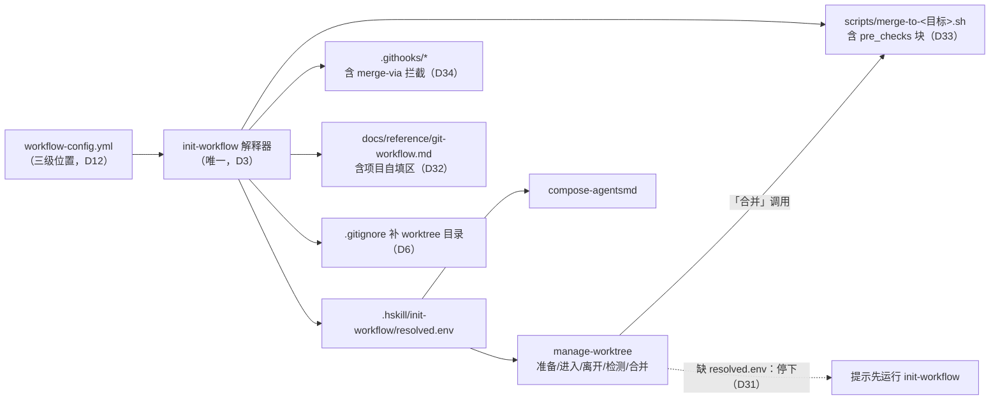

# Spec：git 工作流的规划与执行分离

- **版本：** v0.1，2026-11-12 获用户批准；批准范围为全文（第 2 节“本轮做”、第 7 节验收 1–10、第 9 节 S1–S14）
- **讲解：** `explainer/index.html`（管理机制与调用时机，供审查，非权威）
- **决定记录：** `2026-11-12-workflow-plan-exec-split-record.md`（下文以 D 编号引用；S 编号为本稿次要决定，见第 9 节）
- **分支：** `feature/workflow-plan-exec-split`
- **未决事项：** 见第 10 节

## 1. 意图与目标

git 工作流的策略现在有三个解释者：init-workflow 的 `render_docs.py`、manage-worktree 的 `inspect-worktree.sh`，以及 compose-agentsmd 里手填的 `integration_branch` / `merge_command`。worktree 路径和合并方式还没有登记为策略。结果是生成的文档、hooks 与实际行为互相不一致，且落后于最新工作流（D3、D4、D35）。

本轮按职能重划边界（D2、D3）：

- **规划侧（init-workflow）：** 拥有全部 git 策略，是唯一解释者；部署时生成解释结果文件、hooks、工作流文档、标准合并脚本。
- **执行侧（manage-worktree）：** 只做按任务的工作区操作（准备、进入、离开、检测、合并），读取规划侧的解释结果，自己不解析策略。
- **其他消费者（compose-agentsmd）：** 同样只读解释结果。

“最新工作流”以 harveyz-skill `CLAUDE.md` 的 Git 工作流与跨 session 交接两节、agent-canvas `AGENTS.md` 的 Step 3 与 Step 7 为准（D18）。

## 2. 范围

**本轮做：**

- init-workflow：配置新增字段；统一解释器；生成 `resolved.env`；新模板（含项目自填区）；标准合并脚本模板与部署；hooks 新增合并标记拦截；部署时保证 worktree 目录被忽略；首次覆盖提醒（D1、D5–D9、D11、D12、D17、D19、D30、D32–D34）。
- manage-worktree：改读 `resolved.env`；缺失时停下；新增「合并」动作（D10、D20、D21、D30、D31）。
- compose-agentsmd：删 `merge_command`，`integration_branch` 改读 `resolved.env`（D35）。
- harveyz-skill 与 agent-canvas 重新部署，并更新各自指令文件中的合并写法（D13、S4）。

**本轮不做：** manage-worktree「清理」（D26）；File Translator 及其余 16 个项目部署（D27）；发布流程标准化（D28）；新 git skill 取代 init-workflow（D29）；Codex 等宿主实测（D24）；`hooksPath` 未生效项目的修复（D15）；更新装机副本（见第 8 节风险 R1）。

## 3. 不可接受的结果

- 部署后的仓库里，文档、hooks、合并脚本、`resolved.env` 中任意两者对集成分支、基线、合并目标或 worktree 目录的说法不一致。
- manage-worktree 或 compose-agentsmd 在部署后仍自行解析 `workflow-config.yml`。
- manage-worktree 在没有 `resolved.env` 时按默认分支或任何猜测值继续（D31）。
- 「合并」在没有标准合并脚本时退回手动 `git merge`（D21）。
- 合并前项目检查（如 agent-canvas 的 token 预算）在标准化后失效（D19）。
- 项目自填区内的内容在重新渲染后丢失或改变（D32）。
- 未经用户授权写 harveyz-skill 以外的仓库（D13）。

## 4. 现状（实施前提）

- **init-workflow 4.1.5**（`skills/coding/init-workflow/`）：配置按三级位置查找（主路径 `.hskill/init-workflow/workflow-config.yml` → 项目根 → `.claude/`）。hooks 由 agent 按 `references/hook-templates.md` 生成，带 MANAGED 块与用户区；文档由 `references/render_docs.py` 套 `git-workflow-template.md` 整份覆盖生成，`render_docs.py` 自带简易 YAML 解析。lock 文件 `.githooks/.workflow-config.lock.yml` 记录原始配置快照，供下次比对。没有任何渲染测试。
- **模板旧写法（O1–O3）：** 「开始新工作」`checkout <集成分支> → pull → checkout -b`；「合并」`checkout <集成分支> && merge && push`；「发布」`checkout main && merge`。
- **配置缺项（O4）：** 无 worktree 目录、无合并方式字段。
- **manage-worktree 0.1.4**（`skills/devflow/manage-worktree/`）：`scripts/inspect-worktree.sh` 用 awk 按缩进解析 `branches.protected` 与 `merge_from`，推出 `integration` 与 `base`；`default_path` 硬编码 `.worktrees/`；命名模式由 agent 读规则文件核对。退出码 0 通过、1 不通过、2 用法错误、3 非 git。测试：`skills/devflow/manage-worktree/tests/inspect-worktree.bats`、`tests/manage-worktree-skill.test.mjs`（短语断言、版本与 hash 断言）。上一轮 Spec 的 D12 规定它不合并（D10 修订此项）。
- **compose-agentsmd 0.1.0**（`skills/devflow/compose-agentsmd/`）：devflow 包 `pack.json` 声明必填参数 `integration_branch`、`merge_command`，渲染进 `flow-steps.md` 的 Step 3（3.1、3.2）与 Step 7 第 5 条。harveyz-skill 与 agent-canvas 都未部署它。相关测试 `tests/compose-agentsmd-*.test.mjs`。
- **合并脚本：** harveyz-skill `scripts/merge-to-staging.sh`（367 行，含按 hub HEAD reflog 定位真实基线的修复，提交 `44d3ff2`）与 agent-canvas 版（355 行，多一段写死的 token 预算检查，少 reflog 修复）同源；均以 `merge-tree` + `commit-tree` + `update-ref` CAS 合并，写死 `TARGET_BRANCH="staging"`，拒绝在 `staging`、`main` 上运行，提交信息带 `Merge-Via: merge-to-staging.sh`。harveyz-skill 另有 `scripts/verify-merge-to-staging-e2e.cjs`（真实 git 子进程的并发场景测试）。
- **合并拦截（O5）：** agent-canvas 与 File Translator 在 MANAGED 块外手写 commit-msg（`MERGE_HEAD` 存在且当前在 staging、提交信息无 `Merge-Via` 行 → 拒绝）与 pre-push（推送 staging 时最新提交无该行 → 拒绝）。harveyz-skill 没有这层拦截。
- **合并来源检查（O7，D25）：** 生成的 pre-commit 用 `MERGE_MSG` 判断来源分支。依 git 文档（未实测）：干净的 `git merge` 运行 `commit-msg`；`pre-commit` 只在存在 `pre-merge-commit` hook 时被连带运行，所有项目都没有，故该检查只在冲突后手动 commit 时生效；`commit-tree` 不触发任何 hook。`core.hooksPath` 为相对路径时，按 hook 运行时的工作树根解析，即每个 worktree 用自己 checkout 中的 hooks。
- **调用面：** init-spec、develop-plan、handoff 调用 manage-worktree「准备」「进入」「离开」。harveyz-skill `CLAUDE.md` 的“合并方式”一节、archive-skill、contribute-skill 直接写 `scripts/merge-to-staging.sh`。
- **部署现状：** harveyz-skill 配置在 `.claude/workflow-config.yml`；agent-canvas 在主路径。两者合并目标都是 `staging`，`.worktrees/` 都已被忽略。

## 5. 方案

### 5.1 整体结构



一次部署由同一次解释生成全部产物，并写入同一提交范围；仓库内各产物因此对同一策略给出相同取值（第 3 节第 1 条）。

### 5.2 配置新增字段（init-workflow）

| 字段 | 类型 | 默认 | 含义 |
|---|---|---|---|
| `worktree.dir` | string | `.worktrees` | worktree 所在目录（相对主工作树根）；路径为 `<dir>/<分支名，/ 换成 +>` |
| `merge.pre_checks` | string[] | `[]` | 合并前依次执行的命令，`{target}` 替换为合并目标分支；在被合并分支的工作树根执行 |

配置模板 `references/workflow-config.yml` 补这两节并加注释。旧配置没有这两节时按默认值解释，不报错。

### 5.3 解释器与 `resolved.env`

`render_docs.py` 的配置解析与推断抽成单一解释器（S5），init-workflow 的所有生成步骤（文档、`resolved.env`、合并脚本，以及 agent 生成 hooks 时用的取值）都从它取值。配置文件的三级查找只在解释器里实现（D12）。

推断规则：

- **集成分支：** `branches.protected` 中所有分支名，按配置顺序。
- **分支类型：** 从 `branch_naming.allowed_patterns` 中形如 `^<type>/` 的模式取 `<type>`。
- **`base.<type>`：** 按配置顺序第一个 `merge_from` 含 `<type>/*` 的受保护分支；没有则不写该键。
- **合并目标：** `base.feature`。没有 `base.feature` 时不写 `merge_target` 与 `merge_script`，也不部署合并脚本（S6）。
- **合并脚本路径：** `scripts/merge-to-<合并目标>.sh`（S2）。

`resolved.env` 格式（固定路径 `.hskill/init-workflow/resolved.env`，与配置所在位置无关；提交入库；每行 `key=value`，`#` 开头为注释；值不加引号；消费者逐行读取，不得 `source`）：

```
# Generated by init-workflow <版本> from <规则文件>; do not edit, rerun init-workflow
schema=1
rule_file=.hskill/init-workflow/workflow-config.yml
integration_branches=main staging
base.feature=staging
base.fix=staging
base.chore=staging
base.doc=staging
base.release=main
merge_target=staging
merge_script=scripts/merge-to-staging.sh
merge_trailer=Merge-Via: merge-to-staging.sh
worktree_dir=.worktrees
naming.1=^feature/.+
naming.2=^fix/.+
naming_exempt=main staging
```

（取值以 harveyz-skill 配置为例；键集合为本节规定，`naming.<n>` 按配置顺序编号。）

### 5.4 init-workflow 部署产物

在现有 Step 6（hooks）与 Step 7（文档）基础上，同一次运行写出以下产物，汇报表逐项列 NEW / UPDATED / UNCHANGED。

**a. `resolved.env`：** 按 5.3 写出。

**b. 工作流文档（模板改写，D4、D5、D11、D16、D32）：**

- 「开始新工作」：调用 manage-worktree「准备」；未安装时的兜底命令 `git worktree add <worktree_dir>/<分支名，/ 换成 +> -b <分支> <base.<类型>>`，并说明不要在主工作树切分支。不复述 manage-worktree 的复用规则。
- 「合并到集成分支」：有合并目标时，写调用 manage-worktree「合并」或直接运行 `<merge_script>`，说明只更新本地分支、push 另行、禁止手动 `checkout <目标> && merge`，并列出 `merge.pre_checks`；没有合并目标时保留通用 `git merge` 写法。
- 「发布到主分支」：不切换主工作树；指向项目自己的发布流程（如 release-project）。
- 文末项目自填区：`<!-- BEGIN PROJECT NOTES -->` 与 `<!-- END PROJECT NOTES -->` 两行标记。重新渲染时，若现有文件含这对标记，把标记之间的内容原样搬入新文档；不含则生成空的自填区。
- **首次覆盖提醒（D7、D17）：** 现有文件不含标记、且内容与新渲染结果不同 → 照旧覆盖，标准输出打印一行 `WARN`，含被覆盖文件路径与找回命令 `git diff HEAD -- docs/reference/git-workflow.md`。退出码不变。
- 文件头“请勿手动编辑”改为“自填区以外请勿手动编辑”。

**c. 标准合并脚本（D8、D9、D19、D33、S1）：** 模板新增于 `references/`，以 harveyz-skill 现版为底，改动：

- `TARGET_BRANCH` 渲染为合并目标；拒绝运行的分支从写死的 `staging`、`main` 改为全部集成分支。
- 提交标记渲染为 `merge_trailer` 的值。
- 一个 MANAGED 块（`merge/pre-checks`）：按 `merge.pre_checks` 顺序执行，`{target}` 替换为合并目标；任一非 0 → 打印失败的命令、不合并、退出码 1。配置为空时块内无命令。
- 文件头注明由 init-workflow 生成、项目检查改配置的 `merge.pre_checks`。部署时整份覆盖；现有文件不含该文件头且内容不同时，同 b 打印 `WARN`（S7）。
- 退出码语义不变：0 成功或已包含；1 出错（含 pre_checks 失败）；2 真实冲突。

**d. hooks（D34）：** `hook-templates.md` 新增两个 MANAGED 块，仅在有合并目标时生成：

- `commit-msg/merge-via`：存在 `MERGE_HEAD`、当前分支是合并目标、提交信息不含 `merge_trailer` 行、且主题不是远端同步合并（`Merge branch '<目标>' of `开头）→ 拒绝，提示改用合并脚本。该块位于现有“跳过合并提交格式检查”逻辑之前。
- `pre-push/merge-via`：推送 `refs/heads/<目标>` 且非删除时，对 `remote_sha..local_sha` 的 first-parent 提交逐个检查（`remote_sha` 全零时只查 `local_sha`），每个都须含 `merge_trailer` 行或是远端同步合并，否则拒绝。
- pre-commit 中合并目标分支的 MANAGED 块：保留“禁止直接提交”；合并来源判断（`MERGE_MSG` 解析）删去，改为提示“合并请用 `<merge_script>`”。其他受保护分支（如 `main`）的块不变。

**e. `.gitignore`（D6）：** `git check-ignore -q <worktree_dir>/` 不通过时追加一行 `<worktree_dir>/`，列入写入清单。

**f. 版本：** init-workflow 升 `5.0.0`（新增必写产物、模板与 hooks 语义变化）。

### 5.5 manage-worktree（D10、D20、D21、D30、D31）

**读取解释结果：** `inspect-worktree.sh` 删除配置查找与 awk 解析，改读 `resolved.env`：

- 读取位置（S8）：以**集成分支上已提交的那份**为准，两步取得——①引导：依次取当前目录所在工作区根、主工作树根下的 `resolved.env`，取到第一份即用它得到 `base.<类型>`（「准备」用期望分支类型，其余动作用 `feature`）；②权威：读 `git show <该基线分支>:.hskill/init-workflow/resolved.env`，以它的取值输出。①两处都没有，或②该分支上没有此文件 → 视为仓库未部署。主工作树停在其他分支、或目标工作区是部署前建的分支，都不影响取值。
- 输出键：`rule_file` 改为 `resolved`（取值为文件相对路径，或 `missing`）；`integration`、`base`、`default_path` 来自文件（`default_path` = `<主工作树根>/<worktree_dir>/<分支名，/ 换成 +>`）；新增 `merge_target`、`merge_script`。命名核对改为读 `naming.<n>` 与 `naming_exempt`。
- 未部署：输出 `resolved=missing`、`verdict=n/a`、`reason=workflow-not-deployed`，**退出码 4**。所有动作遇到退出码 4 停下，提示该仓库的集成分支尚未部署新版 init-workflow，不继续。非 git 目录仍为退出码 3，先于退出码 4 判断。

**新增「合并」：** 由新脚本 `scripts/merge-worktree.sh` 完成（S9），agent 只调用、呈现结果。

| 步骤 | 行为 | 失败时 |
|---|---|---|
| 1 | 对当前目录跑检测 | 退出码 4 → 停下提示部署；当前目录不是链接 worktree 的根、detached HEAD、处于集成分支 → 报告原因，不合并 |
| 2 | 读 `merge_target`、`merge_script` | 无合并目标 → 报告“本仓库未配置合并目标”，不合并 |
| 3 | 检查 `<工作区根>/<merge_script>` 存在且可执行 | 缺失（本分支早于部署）→ 提示先把 `<merge_target>` 并入本分支再「合并」，不退回 `git merge`（D21） |
| 4 | 在工作区根执行该脚本，透传输出 | 透传脚本退出码：0 已合并或已包含；1 出错（含 pre_checks 未过）；2 冲突，标记已落在当前工作区 |

- 时机：只在用户明确说“合并”或项目指令规定时由调用方触发（D20）。
- 不 push、不移除 worktree、不删分支。SKILL.md 边界改为“不清理 worktree、不删除分支”，删除“不合并”。
- Claude Code、Codex、其他宿主下都在当前工作区执行，无需进出。

**版本：** 升 `0.2.0`；`skills-index.json` 的 `contentVersion`、`contentHash` 同步。

### 5.6 compose-agentsmd（D35）

- devflow 包 `pack.json` 删除 `merge_command`、`integration_branch` 两个参数；`config.template.json` 与 SKILL.md 字段表同步删除。
- 生成时从 `<项目根>/.hskill/init-workflow/resolved.env` 读 `merge_target`，作为模板中 `@{integration_branch}` 的值（参数名保留为内部取值名，S10）。文件缺失或没有 `merge_target` → `generate` / `check` 退出码 2，stderr 提示先运行 init-workflow。
- `flow-steps.md` Step 7 第 5 条的合并动作改为“调用 manage-worktree「合并」；未安装带「合并」的版本时直接运行合并脚本”，删除 `@{merge_command}`；脚本路径取 `resolved.env` 的 `merge_script`（S13）。
- 配置中仍出现 `merge_command` 或 `integration_branch` → 按现有“未知字段”规则报错（退出码 2），提示删除。
- 包 `VERSION` 与 skill 版本升 `0.2.0`。

### 5.7 指令文件与部署（D13、S4）

**harveyz-skill（本仓库，本分支内完成）：**

1. 配置从 `.claude/workflow-config.yml` 迁到 `.hskill/init-workflow/workflow-config.yml`（D12）。
2. 现有 `docs/reference/git-workflow.md` 中需要保留的手写内容先迁入自填区（若无则不迁）。
3. 用本分支的 init-workflow 部署：`resolved.env`、文档、hooks、`scripts/merge-to-staging.sh`（标准版，同路径覆盖）。
4. `CLAUDE.md`“合并方式”一节改为调用 manage-worktree「合并」（未安装带「合并」的版本时直接运行 `scripts/merge-to-staging.sh`）；“跨 session 交接”第 6 条中“staging 未被 checkout 时建临时工作区在上面合”改为“在交接工作区里调用「合并」”（S14）。archive-skill、contribute-skill 中的脚本路径在本仓库不变，不改（S11）。

**agent-canvas（另取用户授权，用 manage-worktree 新开 `doc/` 或 `chore/` 分支）：**

1. 现有 `docs/reference/git-workflow.md` 的手写内容（合并脚本用法、「未自动同步」警告处理、token 预算检查说明、退出码 2 处理、主工作树常驻 staging 的 Q&A）迁入自填区，删去与新模板重复的部分。
2. 配置加 `merge.pre_checks: ["node scripts/check-file-token-budget.js --changed-since {target}"]`。
3. 部署；删去 commit-msg、pre-push 中 MANAGED 块外的手写合并拦截（已由 `merge-via` 块覆盖）。
4. `AGENTS.md` Step 7 第 5 条改为调用 manage-worktree「合并」，未安装带「合并」的版本时直接运行 `scripts/merge-to-staging.sh`（S13）。

## 6. 状态与异常路径

| 情形 | 结果 |
|---|---|
| 仓库没有 `resolved.env`（未部署新版） | manage-worktree 各动作退出码 4 停下；compose-agentsmd 退出码 2；均提示运行 init-workflow |
| 配置无 `base.feature` | 不写合并目标、不部署合并脚本、不生成 `merge-via` 块；文档「合并」保留通用写法；「合并」报告未配置 |
| 被合并分支早于部署（工作区里没有标准脚本） | 「进入」「检测」照常（取值来自集成分支）；「合并」停下，提示先把集成分支并入本分支 |
| 主工作树停在别的会话的分支上 | 不影响取值：以基线分支上已提交的 `resolved.env` 为准 |
| 装机副本仍是不带「合并」的旧版 | 指令文件写明兜底：直接运行 `<merge_script>` |
| `merge.pre_checks` 某项失败 | 不合并，退出码 1，打印失败的命令 |
| 合并冲突 | 退出码 2，冲突标记落在当前工作区；解决并提交后重新「合并」 |
| 手动 `git merge` 进合并目标 | commit-msg 拒绝；若绕过本地 hook，pre-push 拒绝推送 |
| 远端同步合并（`Merge branch '<目标>' of …`） | commit-msg 与 pre-push 均放行 |
| 现有文档或合并脚本无生成标记且内容不同 | 照旧覆盖，打印 `WARN` 与找回命令 |
| 配置改了没重新部署 | 所有产物停在上次部署的取值，彼此仍一致；manage-worktree 不感知配置变化 |

## 7. 验收标准

1. **D25 实测：** 在临时仓库验证——干净 `git merge --no-ff` 触发 `commit-msg`、不触发 `pre-commit`（无 `pre-merge-commit` 时）；`commit-tree` + `update-ref` 不触发任何 hook。结论与第 4 节不符时，暂停并按「一致性检查」回到方案审查。
2. **唯一解释者：** 解释器对以下配置给出 5.3 规定的 `resolved.env`，测试覆盖：有 staging（主路径）、仅 main（项目根）、主分支为 master、配置在 `.claude/`、缺 `worktree`/`merge` 节（取默认）、无 `base.feature`。`inspect-worktree.sh` 与 compose-agentsmd 源码中不再出现对 `workflow-config.yml` 的读取（`grep` 断言）。
3. **文档：** 渲染结果不含 `checkout -b`、`git checkout <集成分支>`、`git checkout main`；「开始新工作」含 manage-worktree「准备」与兜底命令；「合并」含 `merge_script` 与 `pre_checks`；自填区内容重渲染后逐字节不变；无标记旧文档覆盖时打印 `WARN` 与找回命令。
4. **合并脚本：** 测试覆盖目标分支渲染（`staging`、`main`）、标记行渲染、在任一集成分支上拒绝运行、`pre_checks` 失败返回 1 且目标分支未移动、冲突返回 2、成功返回 0；`scripts/verify-merge-to-staging-e2e.cjs` 对部署后的 harveyz-skill 脚本全部通过。
5. **hooks：** 在临时仓库中，手动 `git merge` 进合并目标被 commit-msg 拒绝；脚本合并通过；远端同步合并通过；推送含无标记 first-parent 提交被 pre-push 拒绝。两个仓库部署后各实测一次手动合并被拒。
6. **manage-worktree：** bats 覆盖检测读取 `resolved.env`、以基线分支上已提交的那份为准（主工作树停在另一分支且其工作树中的文件取值不同时，输出仍为基线分支上的取值；目标工作区早于部署时「检测」照常）、集成分支上也没有时退出码 4、「合并」在集成分支 / detached HEAD / 非 worktree 根拒绝、缺脚本时停下、正常合并透传 0、冲突透传 2。`tests/manage-worktree-skill.test.mjs` 更新为新的短语与版本断言。
7. **compose-agentsmd：** 从 `resolved.env` 取得集成分支并渲染；缺文件退出码 2；配置含 `merge_command` 报错；Step 7 文本为 manage-worktree「合并」。
8. **两仓库实走，合并前（D14 第 5 条、D36）：** 把 harveyz-skill 与 agent-canvas 各 `git clone` 一份到 `/tmp`，在副本的 staging 上用本分支的 init-workflow 部署后：用本分支的 manage-worktree 脚本建一个 worktree、提交改动、「合并」进副本的 staging，全程成功；agent-canvas 副本改动超出 token 预算的文件时「合并」返回 1 且 staging 未移动；手动 `git merge` 进 staging 被拒；自填区内容重跑 init-workflow 后仍在；`resolved.env`、文档、hooks、脚本对合并目标与 worktree 目录取值一致。不触碰真实仓库的 staging。
9. **两仓库部署，合并后（D36）：** 功能分支合入 harveyz-skill staging 后，在真实仓库完成部署（agent-canvas 另取授权，用其自己的分支与合并流程）；只做不留痕的核对：一次手动 `git merge` 进 staging 被拒（拒绝后 `git merge --abort`），四类产物取值一致。
10. **`npm test` 通过**；`skills-index.json` 中三个 skill 的版本与 hash 已更新。

## 8. 风险

- **R1 装机即停（D31）：** 新版 manage-worktree 装到 `~/.claude/skills/` 后，未重新部署 init-workflow 的项目里 devflow 全部停下。本轮合并进 staging 后**不同步装机副本**；装机时机与 D27（批量部署）一起由用户决定。验收第 8、9 条用本分支内的脚本路径执行，不依赖装机。
- **R2 标记可伪造：** 手写一行 `Merge-Via` 即可绕过拦截；目标是防误操作，接受（D34）。
- **R3 hooks 由 agent 生成：** hooks 仍由 agent 按模板生成，取值须来自解释器输出；验收第 5 条在临时仓库按生成结果实测。

## 9. 由 Agent 决定、随本稿送审的次要决定

- **S1：** 标准脚本以 harveyz-skill 现版为底（含 reflog 修复），token 预算改走 `pre_checks`。
- **S2：** 脚本名 `scripts/merge-to-<合并目标>.sh`，标记行 `Merge-Via: merge-to-<合并目标>.sh`；staging 项目路径不变。
- **S3：** `resolved.env` 独立成文件，不并入 lock 文件；lock 文件仍只存原始配置快照供比对。
- **S4：** harveyz-skill `CLAUDE.md` 与 agent-canvas `AGENTS.md` 的合并写法改为调用 manage-worktree「合并」。
- **S5：** 解释器为 init-workflow `references/` 下的单一 Python 模块，`render_docs.py` 与新的生成步骤共用。
- **S6：** 配置没有 `base.feature` 时不部署合并脚本与 `merge-via` 拦截，文档合并一节保留通用写法。
- **S7：** 合并脚本整份由生成覆盖；无生成标记的旧脚本被覆盖时打印 `WARN`，与文档同一规则。
- **S8：** 所有动作以基线分支上已提交的 `resolved.env` 为准，先从当前工作区或主工作树取一份引导出基线分支名（见 5.5）。理由：主工作树可能停在别的会话的分支上，目标工作区可能早于部署。
- **S9：** 「合并」做成脚本 `scripts/merge-worktree.sh`（答案只取决于结构化事实，按“能固化就固化”），agent 只调用与呈现。
- **S10：** compose-agentsmd 模板保留 `@{integration_branch}` 作为内部取值名，值来自 `resolved.env` 的 `merge_target`，不再是用户参数。
- **S11：** archive-skill、contribute-skill、close-node 中的 `merge-to-staging.sh` 引用本轮不改（harveyz-skill 中脚本路径不变）。
- **S12：** 远端同步合并（`Merge branch '<目标>' of `）在 commit-msg 与 pre-push 中放行，沿用现有 pre-commit 的例外。
- **S13：** 装机副本同步前的过渡：harveyz-skill `CLAUDE.md`、agent-canvas `AGENTS.md`、compose-agentsmd 生成的 Step 7 都写明“未安装带「合并」的版本时直接运行合并脚本”。
- **S14：** harveyz-skill `CLAUDE.md`“跨 session 交接”第 6 条的合并写法改为在交接工作区里调用「合并」，否则部署后会被 `merge-via` 拦截。

## 10. 未决事项

- manage-worktree「清理」（D26）。
- File Translator 与其余 16 个项目的部署，以及装机副本同步时机（D27、R1）。
- 发布流程标准化（D28）。
- 新 git skill 是否取代 init-workflow 作为规划侧（D29）。
- Codex 等宿主实测（D24）。
- archive-skill、contribute-skill 改为调用「合并」（S11）。
