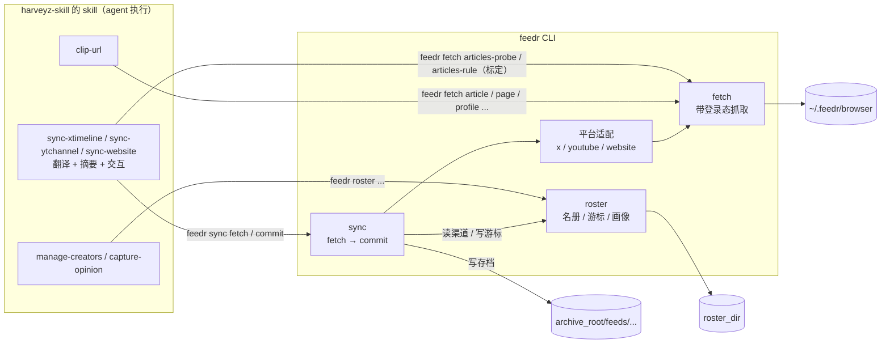
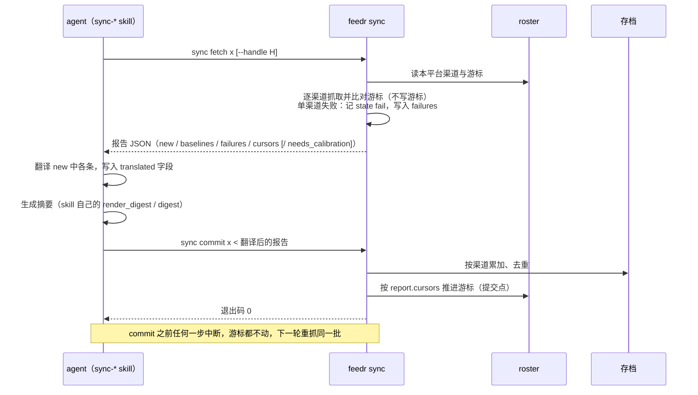
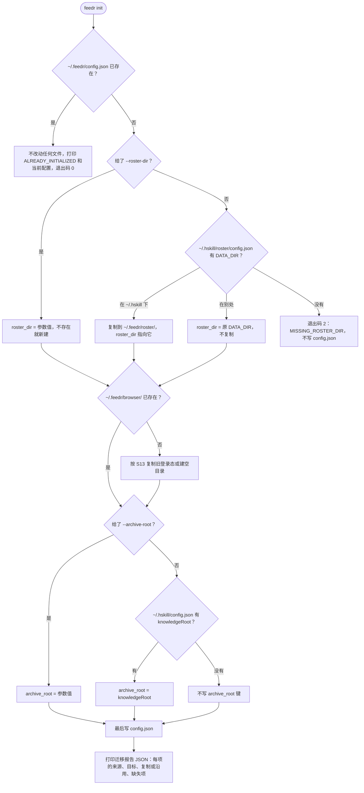

# Spec：browser-fetch + roster 拆为独立产品 feedr

- **版本：** v0.1
- **审查状态：** 送审稿，未批准
- **决定记录：** `2026-11-17-feedr-split-record.md`（当前决定 D1–D20、D24；未决 D21–D23）
- **次要决定：** 第 11 节 S1–S15，由 Agent 决定，随本 Spec 一并送审

## 1. 意图与目标

harveyz-skill（hskill）收窄为纯 skill 管理仓库；skill 依赖的独立工具迁出（D2）。本轮迁出 browser-fetch 与 roster，二者加上现散落在三个 sync-* skill 里的「按名册增量追更」编排，融合为一个独立产品 **feedr**：一个仓库、一个 Python 包、一个 CLI（D1、D3–D6）。任何 agent 宿主装上 feedr 即可直接调用，不经 hskill（D2、D15）。

feedr 的产品概念：**带登录态地追更你关注的人与渠道。**

| 命令组 | 回答的问题 | 来源 |
|---|---|---|
| `feedr roster` | 关注谁（人、渠道、游标、画像） | 原 roster |
| `feedr fetch` | 怎么拿（带 Chrome 登录态抓页面、时间线、频道、文章） | 原 browser-fetch |
| `feedr sync` | 有什么新的（按名册与游标增量追更、存档、推进游标） | 原 sync-* 的 `fetch_new_*` / `cursor` / `archive_*` |

**本轮成功 =** 拆分完成且现有 skill 对用户可见的行为不变（D7）。

## 2. 范围

**在范围内：**

1. 新建 `~/Projects/feedr`，全新 git 仓库，不带 harveyz-skill 历史（D17）；GitHub 公开仓库（D12）；用 `uv tool install git+https://…` 安装（D13）。
2. 把 browser-fetch、roster 的代码与测试迁入 feedr，重组为 `fetch`、`roster` 两个命令组。
3. 把三个 sync-* skill 的追更编排迁入 feedr 的 `sync` 命令组（D4、D24）。
4. `feedr init`：建立 feedr 自有数据目录，并把 `~/.hskill` 下的旧数据复制过去（D9、D10）。
5. 改造 harveyz-skill 的调用方：`sync-xtimeline`、`sync-ytchannel`、`sync-website`、`manage-creators`、`capture-opinion`、`clip-url`。
6. 从 harveyz-skill 移除 `tools/browser-fetch`、`tools/roster` 及其登记（D19）。

**不在范围内：**

- 收藏夹同步（D21）。本轮只保证渠道模型可以扩展（D8，见第 7 节）。
- 发布 PyPI（D22）。
- 迁出 `hub`、`sync-agent`、`skill-harness`（D3）。
- MCP 接口（D15）。
- 旧命令名 `browser-fetch`、`roster` 的兼容入口（D18）。
- hskill 检测、提示或代装 feedr（D14）。
- `learn-video` 及 clip-url 自身的 `knowledgeRoot` 读取方式。它们仍读 `~/.hskill/config.json`。

**不可接受的结果：**

- 迁移后登录态、默认 Chrome profile、站点抽取规则、名册、游标或画像丢失，或静默退回未登录状态。
- 存档位置或 JSON 格式变化（D11）。
- 追更中断后游标已推进，导致一批内容既没进摘要又不会再报（D24）。
- `~/.hskill` 下的旧数据被删除或改写（D10）。

## 3. 现状（已核实）

| 对象 | 现状 | 出处 |
|---|---|---|
| browser-fetch v0.4.0 | 约 5.4k 行（含测试），Python ≥3.11，依赖 playwright 与 pycookiecheat。子命令：`profile get/set/list`、`page`、`eval`、`article`、`timeline`、`channel`、`articles`、`articles-probe`、`articles-rule set/get/list/rm`。退出码约定：0 成功（stdout 一行 JSON），2 用法错误，1 运行时失败 | `tools/browser-fetch/browser_fetch/cli.py`、`skills/*/scripts/browser_fetch_cli.py` |
| browser-fetch 数据 | 全部位于 `~/.hskill/browser-fetch/contexts/`：各站点的 Playwright persistent context 子目录、`__anon__`、`__transform__`、`config.json`（默认 Chrome profile）、`site_rules/`、`timeline_pace.json`、`timeline_pace_log-*.jsonl`。可用 `BROWSER_FETCH_DATA_DIR` 覆盖；`BROWSER_FETCH_CHROME_BASE` 覆盖 Chrome 用户数据根 | `core.py:_data_dir`、`profiles.py` |
| roster v0.2.0 | 约 2.25k 行。命令组：`init <data_dir>`、`migrate`（从旧 watchlist.json 一次性迁移）、`migrate-schema`、`data-dir`、`registry add/remove/rename/merge/list/channels`、`state get/set/fail`、`profile append/summary/show` | `tools/roster/roster/__main__.py` |
| roster 数据 | 配置文件 `~/.hskill/roster/config.json` 的 `DATA_DIR` 指向数据目录（本机为 `~/.hskill/roster`），内含 `registry.json`、`state.json`、画像文件。可用 `HSKILL_ROSTER_CONFIG` 覆盖配置路径。画像不可重建 | `roster/config.py`、`manage-creators/SKILL.md` |
| 追更编排 | 每个 sync-* 各有一份：`fetch_new_*.py` 遍历名册中本平台的渠道，抓取后用 `cursor.compute_update` 比对游标，输出报告（不动游标）；`archive_*.py` 把翻译后的报告按渠道累加进 `<knowledgeRoot>/feeds/<子目录>/creators/<handle>.json`，去重后推进游标；`render_digest.py` / `digest.py` 生成摘要 | `skills/feed/sync-*/scripts/` |
| 游标语义 | X 用 `last_seen_id`（snowflake 可比大小，基线取最大 id，避开置顶推文）；YouTube 与 website 用 `seen_urls` | `sync-*/scripts/cursor.py`、`roster/state.py` |
| 存档子目录 | X → `feeds/tweets`；YouTube → `feeds/youtube`；website → `feeds/website` | `sync-*/scripts/config.py` |
| 报告字段 | 共有：`run_time`、`new`、`baselines`、`failures`、`cursors`；website 另有 `needs_calibration` | `fetch_new_*.py` |
| `knowledgeRoot` | `~/.hskill/config.json`，本机为 `~/knowledge`。sync-*、clip-url、learn-video 共用 | `sync-*/scripts/store_config.py` |
| 调用方 | 三个 sync-* 与 clip-url 通过 `browser_fetch_locate.py` 和 `browser_fetch_cli.py` 调用（4 份副本）；5 个 feed skill 通过 `roster_locate.py` 调用（5 份相同副本）。各 skill 的 `platforms/SKILL.*.md` 提到 browser-fetch | 同上 |
| 分发 | `package.json` 的 `files` 含 `tools/browser-fetch/`、`tools/roster/`；`skills-index.json` 的 `tools` 中有两者，bundle 为 `research-tools`，`toolBundleMeta.research-tools` 有说明 | 同名文件 |

## 4. 架构



- **单向依赖：** `sync` → `roster`、`fetch`；`fetch` 和 `roster` 互不依赖。
- **进程内调用：** `sync` 直接调用 `roster` 与 `fetch` 的 Python 函数，不再经 subprocess。这条只对 feedr 内部生效，skill 侧仍通过 CLI 调用。
- **适配层：** 平台差异集中在平台适配模块里，每个平台一个模块，见第 7 节。

## 5. CLI 接口

### 5.1 通用约定

- 机器可读输出：stdout 一行 JSON；人读的提示与进度一律写到 stderr。
- 退出码沿用 browser-fetch 的约定：0 成功，2 用法错误，1 运行时失败。
- 原有命令输出非 JSON 的（如 roster 的 `OK ...`、`EMPTY`），本轮原样保留，不改格式（D7）。
- **初始化门槛只设在 `roster` 和 `sync`：**
  - 这两组命令发现 `~/.feedr/config.json` 不存在时，以退出码 1 退出，stderr 第一行为 `NOT_INITIALIZED: run \`feedr init\``，不建任何目录。
  - `fetch` 组不需要 init（S13）：首次使用时发现 `~/.feedr/browser/` 不存在，就自动从 `~/.hskill/browser-fetch/contexts/` 复制，旧目录不存在则建空目录。这与现有 launcher 自动迁移数据目录的做法一致，clip-url 不会多出一道门槛（D7）。
  - `feedr init`、`feedr config`、`--help`、`--version` 不受门槛约束。
- **`archive_root` 缺失：** `sync fetch` 与 `sync commit` 在开始任何抓取或写入之前检查。缺失时以退出码 1 退出，stderr 第一行为 `MISSING_ARCHIVE_ROOT`。这保留了现有「抓完一整轮才在归档阶段崩掉」的防护。

### 5.2 命令映射

| 旧调用 | 新调用 |
|---|---|
| `browser-fetch <子命令> ...`（全部 9 个） | `feedr fetch <子命令> ...`，参数与输出不变 |
| `roster registry ...` / `state ...` / `profile ...` / `migrate-schema` / `data-dir` | `feedr roster <同名> ...`，参数与输出不变 |
| `roster init <data_dir>` | 由 `feedr init --roster-dir <data_dir>` 取代 |
| `roster migrate`（旧 watchlist.json） | 不迁移（S3） |
| `python3 scripts/fetch_new_tweets.py [profile] [--handle H]...` | `feedr sync fetch x [--chrome-profile P] [--handle H]...` |
| `python3 scripts/fetch_new_videos.py ...` | `feedr sync fetch youtube ...` |
| `python3 scripts/fetch_new_articles.py ...` | `feedr sync fetch website ...` |
| `python3 scripts/archive_tweets.py < report` | `feedr sync commit x < report` |
| `python3 scripts/archive_videos.py < report` | `feedr sync commit youtube < report` |
| `python3 scripts/archive_articles.py < report` | `feedr sync commit website < report` |
| `browser_fetch_locate.py` / `roster_locate.py` | 无。skill 用 `command -v feedr` 检查（S6） |

新增命令：

- `feedr init`（第 6 节）
- `feedr config show`：打印 `~/.feedr/config.json`，未初始化时输出 `{}`
- `feedr config set archive-root <path>`：只改这一个键；未初始化时退出码 1，`NOT_INITIALIZED`
- `feedr --version`

### 5.3 sync 两段式契约（D24）



- **`sync fetch <platform>` 的输出：** 与现有对应 `fetch_new_*.py` 的输出逐字段一致，另加两个字段（S7）：
  - `"next": "feedr sync commit <platform>"`：提示调用方下一步。
  - `"archive_dir": "<archive_root>/feeds/<archive_subdir>"`：skill 的摘要脚本据此计算 `digest/` 写入路径，取代原来的 `config.get_data_dir()`（S5）。commit 不读这个字段。

  其余部分保持不变：各条目的字段形状、`--handle` 指到名册外账号时写入 `failures`（值为 `"不在 roster 名册里"`）的行为、website 的 `needs_calibration` 判定（`NO_RULE`、`TRANSFORM_ERROR`、空列表），全部原样保留。
- **`sync commit <platform>` 的行为：** 与现有 `archive_*.py` 一致：先写存档（按条目 id 或 URL 去重，可重复执行），再按 `cursors` 推进游标。存档写入失败时不推进游标，以退出码 1 退出。
- **`--chrome-profile`：** 不传时读 fetch 侧持久化的默认值，与现状一致。现有脚本把它作为位置参数，新命令改为选项。
- **报告中 `platform` 与命令参数不一致时：** commit 只按命令参数 `<platform>` 解释报告，不读报告里的平台字段（现有报告也没有这个字段）。

## 6. 数据目录与 `feedr init`（D9、D10）

### 6.1 布局

```
~/.feedr/                      # 可用 FEEDR_HOME 覆盖（S4）
  config.json                  # {"archive_root": "...", "roster_dir": "..."}
  browser/                     # 原 ~/.hskill/browser-fetch/contexts/ 的全部内容
  roster/                      # 原 DATA_DIR 在 ~/.hskill 下时复制到这里，roster_dir 指向它
```

- **存档：** 落在 `<archive_root>/feeds/{tweets,youtube,website}/`，子目录与文件格式不变（D11）。
- **roster_dir 的取值：** 读 `config.json`，不再读 `~/.hskill/roster/config.json`。
- **废止的旧变量：** `BROWSER_FETCH_DATA_DIR`、`HSKILL_ROSTER_CONFIG` 不再识别，统一用 `FEEDR_HOME`（S4）。

### 6.2 `feedr init [--roster-dir D] [--archive-root R]`



- **只复制，不移动或删除旧数据：** `~/.hskill/...` 原样保留（D10）。
- **最后写 `config.json`：** `config.json` 是「已初始化」的唯一标志，复制全部成功之后才写入。中途失败时不写它，退出码 1；已复制的部分留在原地，再次运行 init 会覆盖复制（同名文件覆盖，不删除多余文件）。
- **`roster_dir` 不猜：** 推不出来时以退出码 2 失败，沿用「`DATA_DIR` 必须由用户提供」的现有规则。
- **`archive_root` 可以暂缺：** 只有 `sync` 需要它（第 5.1 节），所以只用名册的 manage-creators、capture-opinion 不会因为它被卡住。

### 6.3 谁来引导初始化（各 skill 的行为）

| skill | 遇到的情况 | 行为（与现有引导一一对应） |
|---|---|---|
| manage-creators、capture-opinion | `NOT_INITIALIZED` | 先运行 `feedr init`（有旧数据时是纯迁移，不需要问用户）；如果返回 `MISSING_ROSTER_DIR`，按现有规则请用户提供目录，再运行 `feedr init --roster-dir <目录>` |
| sync-* | `NOT_INITIALIZED` | 与现在「名册没初始化」的处理一样：让用户先运行一次 manage-creators，然后终止 |
| sync-* | `MISSING_ARCHIVE_ROOT` | 与现在 `knowledgeRoot` 缺失时的引导一样：询问「抓取产物统一存到哪个目录？（直接回车使用默认：`~/knowledge`）」，然后运行 `feedr config set archive-root <目录>` |
| clip-url | — | 不涉及 init（`fetch` 没有门槛） |

### 6.4 新旧两份配置的关系

- **init 之后各自独立：** `~/.hskill/config.json` 的 `knowledgeRoot`（clip-url、learn-video 仍在读）与 feedr 的 `archive_root` 不再同步。这是 D9 的直接结果。
- **漂移检查归 knowledgeRoot 的使用方：** vdl / scholia 的漂移检查（`store_config.py check-downstream`）只核对 `knowledgeRoot`，由 clip-url、learn-video 保留执行。sync-* 删除 `store_config.py`，不再执行这一步（S5）。这样不会出现两个基准给出相反修复命令的情况。

## 7. 平台适配与扩展点（D8）

`sync` 内部按平台注册适配器。每个适配器提供：

| 成员 | 含义 | x | youtube | website |
|---|---|---|---|---|
| `platform` | 名册中的平台名 | `x` | `youtube` | `website` |
| `archive_subdir` | 存档子目录 | `tweets` | `youtube` | `website` |
| `fetch(channel, chrome_profile)` | 抓取一个渠道的条目列表 | `fetch timeline`（URL 加 `/all`） | `fetch channel` | `fetch articles` |
| `cursor_type` | 游标类型 | `last_seen_id` | `seen_urls` | `seen_urls` |
| `compute_update(cursor, items)` | 计算基线、新增和新游标 | 现有 `cursor.py` | 现有 `cursor.py` | 共用 youtube 的 `seen_urls` 逻辑 |
| `item_key` | 存档去重键 | `tweet_id` | `video_id` | `url` |
| 额外报告字段 | — | — | — | `needs_calibration` |

- **以后加收藏夹类渠道的路径：** 新增一个适配器，并让 `roster registry add` 能把收藏夹 URL 解析成一个新平台名。`sync fetch` / `sync commit` 的契约、名册和 state 的结构都不需要变。本轮不实现任何收藏夹适配器，也不预留收藏夹专用的配置。
- **抽取公共逻辑：** 三份追更编排里重复的部分，包括渠道选择、`--handle` 过滤、失败记录、报告组装、存档读写和去重，合并为一份公共实现。

## 8. harveyz-skill 侧改动

| skill / 文件 | 改动 |
|---|---|
| `sync-xtimeline`、`sync-ytchannel`、`sync-website` | 删除 `fetch_new_*.py`、`cursor.py`、`archive_*.py`、`roster_client.py`、`roster_locate.py`、`browser_fetch_locate.py`、`browser_fetch_cli.py`、`mcp_*_client.py`、`articles_client.py`、`config.py`、`store_config.py`（S5），以及只测试这些脚本的用例。保留 `render_digest.py` / `digest.py`（改为从报告的 `archive_dir` 取路径，不再 `from config import get_data_dir`）和 `calibration_gate.py`。SKILL.md 的流程改为第 5.3 节的两段式，初始化引导按第 6.3 节执行，删除 `check-downstream` 步骤。`platforms/SKILL.*.md` 中的 browser-fetch 字样改为 feedr |
| `sync-website` 标定（`references/calibrate.md`） | `articles-probe`、`articles-rule` 改为调用 `feedr fetch ...`。标定判断和 `calibration_gate.py` 留在 skill |
| `manage-creators`、`capture-opinion` | 删除 `roster_locate.py` 和 `manage-creators/tests/test_roster_locate.py`；`<roster>` 改为 `feedr roster`；初始化引导按第 6.3 节执行；`manage-creators/references/migration.md` 中的 roster 命令改为 `feedr roster` |
| `clip-url` | 删除 `browser_fetch_locate.py`；`browser_fetch_cli.py` 改为直接调用 `feedr fetch`（模块可以保留，只换命令，S8）；`mcp_fetch_client.py`、`mcp_debug_client.py`、`chrome_profile_config.py`、`detect_xcom_chrome_profile.py` 中的 browser-fetch 字样和路径引用同步更新；`tests/conftest.py` 改用 `FEEDR_HOME` 隔离（S4）；SKILL.md 和 references 中的 browser-fetch 字样改为 feedr。`store_config.py` 不动 |
| `tools/browser-fetch`、`tools/roster` | 删除 |
| `package.json` | `files` 去掉两个 tools 目录 |
| `skills-index.json` | `tools` 去掉两条；`toolBundleMeta` 去掉 `research-tools`；改动过的 skill 更新 `contentHash` / `contentVersion` |
| `tests/install.bats`、`tests/migrate-store.bats` | 去掉或改写引用这两个工具的用例，使 `npm test` 通过 |
| `scripts/migrate-store.sh` | 不改（S14）。它是 2026-09 统一存储根时的一次性迁移，只读 `~/.hskill/roster/config.json`（D10 保证这个文件仍在）、只写 `knowledgeRoot`，与 feedr 无关 |
| `scripts/run-skill-tests.sh` | 更新注释中提到 `tools/browser-fetch`、`tools/roster` 的示例；如果脚本逻辑会遍历 `tools/*` 的测试，确认删除后不会报错 |
| `CHANGELOG.md` | 历史条目不改；新增一条记录本次迁出 |
| `docs/`（历史 spec、plan、commute、reports） | 不改（历史文档） |

**skill 找不到 feedr 时（D14）：** 在每个 skill 原来 locate 的那一步执行 `command -v feedr`。找不到就报告「feedr 未安装：`uv tool install git+https://github.com/<owner>/feedr`」，然后终止流程。仓库 owner 等建仓后填入（S9）。

## 9. 切换顺序与过渡期

1. 建 feedr 仓库并完成迁移，在 feedr 仓库内全部测试通过。
2. 本机执行 `uv tool install`，然后执行 `feedr init`，核对迁移报告。
3. 在 harveyz-skill 的 `feature/feedr-split` 上改造调用方，`npm test` 通过。
4. 合并后按 AGENTS.md 的部署方式部署改动过的 skill，部署后核对版本。

**过渡期风险：** 第 2 步到第 4 步之间，如果仍在运行旧版 skill，旧工具会继续写 `~/.hskill/roster`，而 feedr 已经在用 `~/.feedr/roster`，两边的游标会分叉。

- 缓解办法：第 2 步到第 4 步之间不运行 sync-*、manage-creators 和 capture-opinion，验收时核对一次。
- feedr 不负责回灌：init 只复制一次，之后不再从 `~/.hskill` 同步（S2）。

## 10. 异常与状态

| 场景 | 结果 |
|---|---|
| 未执行过 init 就运行 `roster` 或 `sync` | 退出码 1，`NOT_INITIALIZED`，不建任何目录 |
| 未执行过 init 就运行 `fetch` | 正常执行，首次使用时按 S13 准备 `~/.feedr/browser/` |
| init 时 `roster_dir` 推不出来 | 退出码 2，`MISSING_ROSTER_DIR`，不写 `config.json` |
| init 时 `archive_root` 推不出来 | 正常完成，`config.json` 中不含这个键 |
| `sync` 时缺少 `archive_root` | 退出码 1，`MISSING_ARCHIVE_ROOT`，不抓取也不写入 |
| init 中途复制失败 | 不写 `config.json`，退出码 1；再次运行时覆盖复制 |
| 单个渠道抓取失败 | 记入 `failures`，roster state 中标记 fail，其他渠道继续（与现状一致，D16） |
| `--handle` 不在名册中 | 记入 `failures`，不中止（与现状一致） |
| website 没有抽取规则或 transform 出错 | 记入 `needs_calibration`（与现状一致） |
| commit 时存档写入失败 | 不推进游标，退出码 1 |
| commit 重复执行 | 存档去重；游标写回同一个值，结果不变 |
| skill 找不到 feedr | 报告安装命令并终止（D14） |

## 11. 次要决定（Agent 决定，随 Spec 送审）

- **S1 摘要渲染留在 skill。** 理由：它属于翻译之后的展示层，符合 D4 中「skill 只留翻译、摘要和交互」。
- **S2 init 是一次性复制，再次运行不覆盖已初始化的状态。** 理由：避免用旧数据覆盖 feedr 已经推进的游标。
- **S3 不迁移 roster 的旧 `migrate` 命令。** 它只用于把 hskill 早期的 watchlist.json 迁入名册，本机已经完成，而且来源是 hskill 时代的文件。
- **S4 用一个 `FEEDR_HOME` 环境变量取代 `BROWSER_FETCH_DATA_DIR` 和 `HSKILL_ROSTER_CONFIG`**，供测试注入临时目录。`BROWSER_FETCH_CHROME_BASE` 保留，改名为 `FEEDR_CHROME_BASE`。
- **S5 sync-* 删除 `store_config.py` 和 `config.py`。** 摘要路径从报告的 `archive_dir` 取得；存档根的引导改用 `feedr config set archive-root`（第 6.3 节）；vdl / scholia 漂移检查只由仍在使用 `knowledgeRoot` 的 clip-url、learn-video 执行，它们的 `store_config.py` 副本不动。理由：sync-* 不再读 `knowledgeRoot`，保留检查会出现两个基准。
- **S6 删除各 skill 的 locate 脚本副本，改用 `command -v feedr`。** 开发模式也走 PATH：在 feedr 仓库里执行 `uv tool install -e .`，即可用工作区代码。
- **S7 `sync fetch` 的报告加 `next` 和 `archive_dir` 两个字段。** 旧字段不变。
- **S8 clip-url 的 `browser_fetch_cli.py` 只把调用的命令从 `browser-fetch` 换成 `feedr fetch`**，模块名不改，减少对 SKILL.md 和 references 的波及。
- **S9 GitHub owner 和仓库 URL 在建仓时确定**，填入 feedr 的 README 和 skill 的安装提示。名称是否被占用在建仓时查（D23）。
- **S10 feedr 版本从 0.1.0 起。** README 写明：cookie 只读取本机 Chrome，以及使用风险。
- **S11 feedr 仓库只保留 Python 包，不保留 `browser-fetch.sh` 这类 launcher。** venv 和 Playwright 的安装由 `uv tool install` 加上一次 `feedr fetch install-browser`（封装 `playwright install chromium`）完成；首次运行时缺少 Chromium，就提示执行这条命令。
- **S12 feedr 仓库沿用现有测试**（pytest + pytest-asyncio），迁入 browser-fetch、roster 和三个 sync-* 中追更编排部分的测试，改为适用于新的模块路径。
- **S13 `fetch` 不设初始化门槛，首次使用时自动准备 `~/.feedr/browser/`。** `~/.feedr/browser/` 不存在时：如果 `~/.hskill/browser-fetch/contexts/` 存在，就复制过来（权限 0700，复制完成后才落到最终路径，避免半成品），否则建空目录；同时在 stderr 打印一行迁移说明。理由：clip-url 现在不需要名册，不应多出一道门槛（D7）。
- **S14 `scripts/migrate-store.sh` 不改**，验收第 9 条把它列为例外。
- **S15 对照测试的基准是预先生成的标准结果（golden files）。** 在删除旧脚本之前，在 harveyz-skill 中用打桩的抓取结果（每个平台：首次基线、有新增、无新增、单渠道失败、`--handle` 不在名册；website 另加无规则、transform 出错、空列表）运行旧的 `fetch_new_*.py` 和 `archive_*.py`，把输入、报告和存档文件提交到 feedr 的 `tests/golden/`。打桩的位置是「抓取一个渠道得到的条目列表」，旧侧对应 `fetch_timeline` / `fetch_channel_videos` / `fetch_articles`，新侧对应适配器的 `fetch`。`run_time` 固定为注入值。

## 12. 验收标准

**feedr 仓库：**

1. `~/Projects/feedr` 是独立的 git 仓库，没有 harveyz-skill 的提交历史；`pytest` 全部通过；迁入的 browser-fetch、roster 和追更编排测试没有被删减。被删的用例只能是测试 launcher 的（S11），删除须在交付说明中列出。
2. `uv tool install <仓库路径>` 之后，`feedr --help` 能列出 `init`、`config`、`fetch`、`roster`、`sync`；`feedr fetch --help` 能列出原 browser-fetch 的 9 个子命令。
3. 在临时的 `FEEDR_HOME` 和伪造的 `~/.hskill` 上运行 init，第 6.2 节流程图的每条分支都有测试覆盖：已初始化、给了 `--roster-dir`、`DATA_DIR` 在 `~/.hskill` 内、`DATA_DIR` 在 `~/.hskill` 外、`roster_dir` 推不出来、`archive_root` 来自参数 / 来自 `knowledgeRoot` / 缺失、复制中途失败；另外覆盖 S13 中 `fetch` 首次使用时有旧目录和无旧目录两种情况，以及 `roster`、`sync` 的 `NOT_INITIALIZED` 和 `sync` 的 `MISSING_ARCHIVE_ROOT`。每个场景都断言 `~/.hskill` 下文件的内容和数量没有变化。
4. 用 S15 的标准结果做对照：`sync fetch` 的报告除新增的 `next`、`archive_dir` 外与标准结果逐字段相等；`sync commit` 写出的存档文件与标准结果逐字节相等，推进后的游标与标准结果一致。三个平台的全部场景都要覆盖。
5. commit 之前中断（只执行 fetch），游标不变；重复执行 commit，存档不重复，游标值不变。

**本机切换（真实数据）：**

6. 执行 `feedr init` 后，`feedr roster registry list` 的输出与切换前 `roster registry list` 的输出一致；`feedr fetch profile get` 与切换前的 `browser-fetch profile get` 一致；`feedr fetch articles-rule list` 与切换前一致。
7. 登录态保留（未核实前提，见第 13 节）：用 `feedr fetch timeline` 抓取一个需要登录才能看到完整内容的 X 账号，能拿到推文，不需要重新登录。
8. 用改造后的 sync-xtimeline、sync-ytchannel、sync-website 各完整运行一轮，生成摘要，存档写入 `<archive_root>/feeds/<子目录>/`，游标推进；clip-url 能抓取一篇文章；manage-creators 的 `list` 和 capture-opinion 的 `show` 正常工作。由人工执行（真实浏览器和登录态），记录结果。

**harveyz-skill：**

9. `npm test` 通过；仓库中（不含 `docs/`、`.hskill/spec/` 下的历史文档，`CHANGELOG.md` 的历史条目，以及 `scripts/migrate-store.sh`）没有 `browser-fetch`、`roster_locate`、`browser_fetch_locate`、`tools/roster`、`HSKILL_ROSTER_CONFIG`、`BROWSER_FETCH_DATA_DIR` 的残留引用。用 `grep` 核对，其他例外须逐条说明。
10. `npm pack --dry-run` 的输出中不含 `tools/browser-fetch`、`tools/roster`；`skills-index.json` 中不再有 `research-tools`。
11. 在 PATH 上没有 feedr 的环境里运行改造后的 skill 的检查步骤，会给出安装命令并终止。

## 13. 未核实前提与未决事项

- **未核实：** Playwright persistent context 目录复制到新路径后，登录态是否依然有效。macOS 上 Chromium 的 cookie 用钥匙串中的密钥加密，按理与路径无关，但未实测。由验收第 7 条核实；如果失败，退回方案审查，可能改为移动加软链接，或要求重新登录。
- **未核实：** `uv tool install git+https://…` 安装后，Playwright 的 Chromium 是否需要单独执行 `playwright install`。按现有 launcher 的做法推断需要，所以有了 S11。
- **未决：** 收藏夹同步（D21）、PyPI 发布（D22）、`feedr` 名称是否被占用（D23）。
