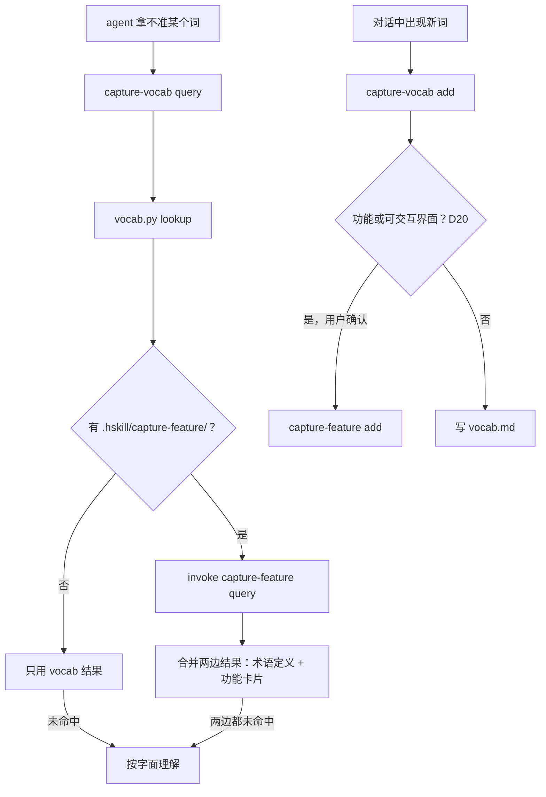

# Spec：capture-feature——跨项目通用的产品功能地图

- **版本：** v0.2（修订，待审）
- **审查状态：** v0.2 待审；v0.1 已批准（2026-11-24，用户答复“批准，写plan”），批准范围：全文，含次要决定 S1–S15（S13 已被 D19 取代）
- **修订说明：** v0.2 按 D20 把对象分为 `feature` 与 `interface` 两类、各自成树，取代 D8 与 S4；改动见第 13 节
- **决定记录：** `2026-11-24-capture-feature-record.md`（当前决定 D1–D7、D9、D11–D14、D17–D20；D8、D10 已失效；未决 D15、D16）
- **次要决定：** 第 10 节 S1–S17，由 Agent 决定，随本 Spec 一并送审

## 1. 意图与目标

capture-vocab 管的是项目领域术语，存成平铺的 Markdown；它不表达层级，代码引用写成 `文件:行号`，代码一改就漂移。本需求新建独立 skill **capture-feature**，在每个项目里维护一张**产品功能地图**（D1、D7）。它有以下特点：

- **两类对象**：`feature`（用户能做的事）与 `interface`（用户能在上面做动作的交互界面，含交互入口），命名对齐 PRO；只承担定位的视觉元素、机制、概念留在 capture-vocab（D20）。
- **单父树层级**：只有「包含」一种关系，用固定字段 `parent` 表达；两类对象各成一棵树，父节点须同类型（D12、D17、D20）。
- **代码线索**：每个功能可记多条「文件路径 + 可选符号名」，拿到称谓就能直接找到代码（D4、D13）。
- **产品发布版本**：记录每个功能在哪个版本引入、变更、废弃（D9、D11）。
- **数据化存储**：一个对象一个 JSON 文件，以后可以扩展成本体或导入 PRO（D3、D6、D14）。
- **非全量检索**：脚本在本地扫描，只把命中条目和它的邻域返回给 agent（D2）。

capture-vocab 仍是查词的唯一入口。它新增两个行为：`add` 时如果判定是功能词，就转给 capture-feature；项目有功能地图时，每次 `query` 都同时调用 capture-feature 查一遍（D7、D19）。因此 capture-feature 的 `SKILL.md` 必须精简，只留查词路径，其余内容放进 references 按需读取（D19）。首个试点项目是 agent-canvas（D13）。

**本轮成功 =** 在 agent-canvas 里，agent 用 capture-vocab 查一个功能称谓（含别名），能拿到这个功能的定义、所在层级和代码线索，全程不读整张地图；capture-vocab 现有的查词行为不变。

## 2. 范围

**本轮做：**

1. 新 skill `skills/coding/capture-feature/`：`SKILL.md`、`scripts/feature.py`、`references/`、`tests/`。
2. capture-vocab 改动：`add` 增加归属判断和路由，`query` 与 `add` 查重都同时调用 capture-feature；版本号升到 1.3.0。
3. `skills-index.json` 登记 capture-feature，并更新 coding bundle 的说明；`package.json` 的 `files` 加入 `skills/coding/capture-feature/`。
4. agent-canvas 试点迁移：把 `vocab.md` 里的功能词迁成功能对象，并从 vocab 删除。这一步在 agent-canvas 仓库另开分支执行，见第 8 节。

**本轮不做：**

- 接入 PRO，以及 PRO 的改造（D15）。
- 发版时自动更新版本字段（D16）。
- 「包含」以外的关系类型（D17）、多父层级（D12）。
- 代码线索失效的自动修复（D13）。
- 语义近似检索（与 capture-vocab 一样，只靠名称和别名的子串匹配）。
- 对象 id 改名（S5）。

## 3. 现状（已核实）

| 事实 | 出处 |
|---|---|
| capture-vocab v1.2.3，`installScope: project`，属于 coding bundle | `skills-index.json` |
| `vocab.py` 有 `lookup` / `list` / `refs` 三个子命令。匹配规则：归一化（全/半角括号统一、去掉反引号、casefold）后，名称或别名任一方是另一方的子串就算命中；查询词归一化后不足 2 字直接判不命中；命中超过 3 条只返回名字列表。退出码 0 命中、1 未命中、2 用法错误或找不到文件 | `skills/coding/capture-vocab/scripts/vocab.py` |
| `vocab.py` 定位文件的方式：从 cwd 向上找 `.hskill/capture-vocab/vocab.md`，遇到含 `.git` 的目录就停 | 同上 `find_vocab_file` |
| capture-vocab 的 `SKILL.md` 每次 invoke 都整份注入上下文，所以只保留查词路径；写操作的细节放在 `references/manage.md` | `SKILL.md` 维护者注 |
| capture-vocab 的测试用 pytest，以子进程调用脚本，设置 cwd 为临时目录 | `skills/coding/capture-vocab/tests/test_vocab.py` |
| agent-canvas 的 `vocab.md` 有 53 条，已纳入 git；其中「顶栏」「工作区」「Tab」「视图」「Widget」「编辑器」「Dashboard 窗口」等属于用户可感知的词；`_Reference_` 多为 `文件:行号` | `agent-canvas/.hskill/capture-vocab/vocab.md` |
| agent-canvas 的 AGENTS.md 规定「术语查阅：优先使用 `capture-vocab` 查询词条」 | `agent-canvas/AGENTS.md` |
| `.hskill/` 是隐藏目录，`rg` 默认跳过 | 实测，见 D14 |
| skill 格式规则 F1–F9：`name` 等于目录名，`description` 用英文，`version` 用 semver，正文含中文 | `docs/reference/skill-spec.md` |

## 4. 数据模型

### 4.1 存放位置

```
<project-root>/.hskill/capture-feature/
  features/
    <id>.json      # 一个功能对象一个文件，文件名 = id
```

`<project-root>` 的定位方式与 `vocab.py` 相同：从 cwd 向上找 `.hskill/capture-feature/`，遇到含 `.git` 的目录就停。写入时如果这个目录还不存在，就在那个含 `.git` 的目录下创建（S2）。整个目录纳入 git，地图的修改历史由 git 记录（D9）。

### 4.2 对象 schema（`schema: 1`）

```json
{
  "schema": 1,
  "id": "workspace",
  "type": "interface",
  "name": "工作区",
  "aliases": ["右侧面板"],
  "avoid": [
    {"name": "抽屉", "note": null},
    {"name": "Drawer", "note": null},
    {"name": "Workspace", "note": "代码内部名，不向用户暴露"}
  ],
  "description": "右侧可拖拽调宽的滑出区域，内部承载所有 Tab。",
  "parent": "app-window",
  "code": [
    {"path": "src/renderer/src/components/PanelArea.tsx", "symbol": "PanelArea"},
    {"path": "src/renderer/src/store/projectStore.ts", "symbol": "panelWorkspaces"}
  ],
  "versions": {
    "introduced": "0.3.0",
    "changed": [{"version": "0.5.0", "note": "支持多 Tab"}],
    "deprecated": null
  }
}
```

| 字段 | 类型 | 必填 | 规则 |
|---|---|---|---|
| `schema` | 整数 | 是 | 固定为 `1`。以后改结构时，迁移脚本按这个字段识别旧数据（S3） |
| `id` | 字符串 | 是 | 匹配 `^[a-z0-9]+(-[a-z0-9]+)*$`，等于文件名去掉 `.json`，创建后不可改（S5） |
| `type` | 枚举 | 是 | `feature`（功能：用户能做的事）/ `interface`（交互界面：用户能在上面做动作的页面、面板、编辑器，以及按钮、菜单项、快捷键等交互入口）（D20） |
| `name` | 字符串 | 是 | 产品侧称谓，非空；归一化后不能与其他对象的 `name` 相同 |
| `aliases` | 字符串数组 | 否，默认 `[]` | 可以通用的别称，参与匹配。每项是一个独立的叫法，不写说明文字（D18） |
| `avoid` | 对象数组 | 否，默认 `[]` | 应避免的叫法，每项 `{"name": 非空字符串, "note": 字符串或 null}`；`name` 参与匹配，`note` 说明为什么避免、该用什么。回复、文档和 commit 里不要使用这些叫法（D18） |
| `description` | 字符串 | 是 | 一到两句话的定义 |
| `parent` | 字符串或 `null` | 是 | 父对象的 id；`null` 表示根节点。根节点可以有多个；父对象的 `type` 必须与自己相同（D12、D17、D20） |
| `code` | 对象数组 | 否，默认 `[]` | 每项 `{"path": 仓库相对路径, "symbol": 可选符号名}`，不记行号（D13） |
| `versions.introduced` | 字符串 | 是 | 产品版本号，不知道时写 `"unknown"`（D11） |
| `versions.changed` | 数组 | 否，默认 `[]` | 每项 `{"version", "note"}` |
| `versions.deprecated` | 字符串或 `null` | 否，默认 `null` | 废弃所在的版本。废弃的功能保留在地图里，不删除（S6） |

脚本写文件的格式：UTF-8、`ensure_ascii=False`、缩进 2、键按上表顺序、末尾带换行。这样 git diff 稳定（S7）。

### 4.3 层级不变式

- 每个对象最多一个父节点；`parent` 必须指向一个存在的 id，或为 `null`。
- 父节点与自己的 `type` 相同：`feature` 只挂在 `feature` 下，`interface` 只挂在 `interface` 下（D20）。
- 沿 `parent` 往上走不能回到自己，即不能有环。
- 这两条在写入时由脚本强制，`check` 时再查一遍，用来兜住手工改文件的情况。

## 5. 脚本接口 `feature.py`

调用方式：`python3 SKILL_DIR/scripts/feature.py <子命令> [参数]`。只依赖 Python 标准库（S1）。

退出码统一为：`0` 成功或命中；`1` 未命中、校验不通过或有问题；`2` 用法错误、找不到数据目录或 JSON 解析失败。

| 子命令 | 用途 | 输出与退出码 |
|---|---|---|
| `lookup <词或整句>` | 按 `name`、`aliases`、`avoid[].name` 查找。匹配规则与 `vocab.py` 相同（3 节） | 命中 1–3 条：逐条输出卡片（见 5.1），exit 0。命中超过 3 条：`N matches: 名1, 名2, …`，exit 0。未命中：`no match: <词>`，exit 1。数据目录不存在：`no feature map`，exit 2 |
| `show <id>` | 按 id 精确取卡片 | 卡片，exit 0；不存在时 `no such id: <id>`，exit 1 |
| `tree [<id>] [--depth N]` | 输出子树，每行只有缩进、`name`、`[type]`、`id`，不含定义。不给 id 时从所有根节点开始；`--depth` 默认 1 | exit 0 |
| `list [--type T] [--at VERSION]` | 每行 `id \| name \| type \| parent \| 别名,…`。`--at` 只列该版本存在的功能：引入版本 ≤ VERSION（或为 `unknown`），且未废弃或废弃版本 > VERSION | exit 0。这是 O(N) 的，只给查重兜底和版本查询用 |
| `refs <path>` | 反查哪些功能的代码线索指向这个路径，分档规则与 `vocab.py refs` 相同（same-file / dir-contains） | 每行 `id \| name \| 档 \| path#symbol`，exit 0；没有时 `no refs: <path>`，exit 1 |
| `dupcheck <name> [--alias A …]` | `add` 第 1 步的查重：(a) 名称、别称或避免叫法与已有对象的这三项之一完全相同；(b) 互为子串的已有对象；(c) `.hskill/capture-vocab/vocab.md` 里有同名的 `## ` 标题（只读标题行） | 每行 `exact\|fuzzy\|vocab \| id-or-name`，有任何一行就 exit 1，都没有就 exit 0（S9） |
| `suggest-parent --name N [--path P …]` | 给出候选父节点：代码路径 same-file / dir-contains 的对象，以及名称或别名是 N 子串的对象；按「路径相近优先、再按名称」排序，最多 5 个 | 每行 `id \| name \| reason`，exit 0；没有候选时 `no candidates`，exit 1（D12） |
| `put --new\|--replace` | 从 stdin 读一个 JSON 对象，校验后写入。`--new` 要求 id 不存在，`--replace` 要求 id 已存在 | 成功时 `wrote features/<id>.json`，exit 0；校验失败时每行一条 `error: …`，exit 1，并且不写入任何东西 |
| `remove <id>` | 删除对象文件。还有子节点时拒绝 | 成功时 `removed <id>`，exit 0；有子节点时 `has children: …`，exit 1 |
| `check [--code]` | 全图体检：schema 不合法、id 与文件名不一致、`parent` 指向不存在的 id、父节点类型不同（`parent-type-mismatch`）、有环、名称重复；加 `--code` 时再验证每条代码线索的路径存在，且文件内容包含 `symbol` 字符串 | 每行 `<类别> \| id \| 详情`，有问题就 exit 1，没有就输出 `ok`、exit 0。只报告，不修改（D13） |
| `project-version` | 读项目版本，依次尝试 `package.json` 的 `version`、`pyproject.toml` 的 `version`、`git describe --tags --abbrev=0` | 版本号，exit 0；都取不到时输出 `unknown`，exit 1（D11、S10） |

`put` 的校验项：4.2 的全部字段规则、4.3 的不变式（含父节点同类型）、`name` 不重复。`aliases` 或 `avoid` 与其他对象的名称、别称、避免叫法重叠时**不拒绝**，只在 stdout 输出 `warn: …`，因为父子对象在别名上重叠很常见（S8）。

版本号比较（`list --at`）：按非数字字符切开，逐段当整数比较；`unknown` 视为一直存在；版本号无法解析时 exit 2（S11）。

### 5.1 卡片格式

```
## 工作区  [interface]  id=workspace
右侧可拖拽调宽的滑出区域，内部承载所有 Tab。
别称: 右侧面板
避免: 抽屉；Drawer；Workspace（代码内部名，不向用户暴露）
位置: 应用窗口 > 工作区
子项: Tab, 视图
代码: src/renderer/src/components/PanelArea.tsx#PanelArea; src/renderer/src/store/projectStore.ts#panelWorkspaces
版本: 引入 0.3.0；变更 0.5.0（支持多 Tab）；废弃 —
```

「位置」是从根节点到自己的完整父链，「子项」只列直接子节点的名称。没有内容的行（如没有别称、没有子项）省略不输出。agent 拿到卡片后，按「代码」一行直接打开文件，或在文件里 `rg` 符号名，不用全仓搜索（D4）。

## 6. skill 流程

### 6.1 capture-feature `SKILL.md`

因为每次查词都会注入（D19），`SKILL.md` 只保留：调用格式、`query` 的完整步骤，以及一张「要做什么 → 读哪份 reference」的表。`add` / `update` / `remove` / `check` 的流程、对象格式和迁移办法全部放进 `references/`，用到时才读（S12）。篇幅上限见验收 9。

```
/capture-feature query <term>
/capture-feature add <term>
/capture-feature update <term>
/capture-feature remove <term>
/capture-feature check
```

**query**：跑 `lookup`。exit 0 时按卡片回答；命中超过 3 条时挑最相关的一条再 `lookup`；exit 1 时说明没有这个功能；exit 2 或脚本不可用时，说明功能地图不可用，不去读整个目录。

**add**（细节在 `references/manage.md`）：

1. `dupcheck`。
   - 有 `exact`：报「已存在」，建议改用 `update`。
   - 有 `vocab`：说明这个词还在术语表里，建议按迁移办法处理（迁过来，再从 vocab 删除），由用户决定。
   - 只有 `fuzzy`：逐个 `show` 候选，必须明确说出判断，三选一：同一实体的另一个名字（并入别名，走 `update`）/ 父子关系 / 无关。
2. 先判归属与类型（D20）：是用户能做的事 → `feature`；是用户能在上面做动作的界面或交互入口 → `interface`；只承担定位、或是机制概念 → 不进地图，告诉用户改走 capture-vocab。再根据对话上下文推断 `name`、`aliases`、`avoid`、`description`、`code`。`code` 只写路径和符号名，不写行号。
3. `suggest-parent`，从同类型候选里选一个父节点，或判定为根节点，并说明理由（D12、D20）。
4. `project-version` 取版本号，填 `versions.introduced`；如果这是存量功能，填 `unknown`，并告诉用户（D11）。
5. 展示完整的拟写对象（JSON）、所选父节点、查重结论，等用户确认或修改。
6. `put --new`。失败时把 `error:` 逐条报给用户，修正后重新确认。

**update**：`lookup` / `show` 确定对象，名称不等时停下问是哪一个（沿用 capture-vocab 的「exit 0 ≠ 该术语存在」规则）→ 推断修改 → 如果改了 `parent`，重新跑 `suggest-parent` → 产品行为有变化时，在 `versions.changed` 追加当前项目版本 → 展示修改前后的对比，等用户确认 → `put --replace`。

**remove**：用于录错的情况。功能被产品废弃时走 `update`，填 `deprecated`，不删除（S6）。确定对象后，确认提示里写出真实名称和 id，等用户确认，再 `remove`。有子节点时，先把子节点挂到别处或一起删，逐个确认。

**check**：跑 `check --code`，把结果原样呈现给用户，逐项建议处理方式；用户同意后，走 `update` 或 `remove` 修复。

### 6.2 capture-vocab 改动（1.2.3 → 1.3.0）

**`SKILL.md` 的 query 段**：跑完 `vocab.py lookup` 之后，不管结果如何，只要项目里存在 `.hskill/capture-feature/`，就 invoke capture-feature，用同一个词或整句跑 `query`。两边的结果合起来回答：术语定义和功能卡片都可能有用。两边都没命中，才按原规则「按字面理解」（D19）。

**`references/manage.md` 的 add 段**：第 1 步查重时，项目有功能地图就同时 invoke capture-feature 跑 `query`；命中的功能也算查重候选，按第 5 步三选一判断，防止新增的术语与功能的名称或别称重名（D19）。在现有第 2 步（推断定义）之后插入归属判断。按 D20 的判据判断这个词归哪边，并把结论告诉用户：是用户能用的功能，或用户能在上面做动作的交互界面 → 功能地图；只承担定位的视觉元素、机制、概念 → 术语表。

- 归功能地图，且用户确认 → 停止 capture-vocab 的 add，invoke capture-feature 的 `add <term>`，带上已经推断出的定义和代码线索。
- 归术语表，或用户不同意 → 按原流程继续。

`update`、`remove`、`lookup` 的脚本行为，以及 `vocab.md` 格式都不变。

**`references/project-setup.md`**：补一句：要启用功能地图，只需 capture-feature 已安装，项目指令不用新增任何内容，因为查词入口仍然是 capture-vocab。



## 7. 注册与发布

- `skills-index.json` 新增 `{"path": "coding/capture-feature", "bundle": "coding", "installScope": "project", ...}`，`contentHash` 和 `contentVersion` 按仓库规则生成。
- `bundleMeta.coding` 的说明里加上 `capture-feature`；`package.json` 的 `files` 加入 `skills/coding/capture-feature/`（已核实：`files` 逐个列出 skill 目录，不加就进不了 npm 包）。
- capture-feature 初版版本号为 `0.1.0`，对应用户说的「初步版本」（S14）。capture-vocab 升到 `1.3.0`。
- `description` 用英文，要写清触发条件：查询或新增产品功能（features）与用户可交互的界面（interfaces），以及它们的层级和代码位置；由 capture-vocab 路由过来。

## 8. agent-canvas 试点迁移（D13）

前提：两个 skill 已经合入 staging，并按仓库 AGENTS.md「部署与发布」的方式（`git archive staging` 后 `rsync`）部署到同一个 skill 根目录；本机上 capture-vocab 装在 `~/.claude/skills/`，capture-feature 装在同一处。部署后核对两个 `SKILL.md` 的 `version`。迁移在 agent-canvas 仓库里另开 `chore/` 分支，按该仓库的 route-work 流程执行，属于数据和文档改动。

1. agent 逐条读 `vocab.md` 的 53 个词条，按 D20 的判据分成「迁移」和「保留」两组，迁移项标明 `feature` 或 `interface`。对每个迁移项，拟好 `id`、`type`、`parent`、`code`、`aliases`、`avoid`。`_Avoid_` 一律转入 `avoid`，括号里的说明转入 `note`；其中确实可以通用的别称，在清单里提议改放 `aliases`，由用户确认（D18）。层级需要、但 vocab 里没有的父节点（例如「应用窗口」），可以在清单里新增，标「新增」，同样逐条确认（S15）。代码线索的处理：把 `文件:行号` 改成「路径 + 符号名」，符号名从原 `_Reference_` 的文字或那一行代码里取；取不到时只留路径。`introduced` 一律填 `unknown`。
2. 一次性列出迁移清单（表格：词条、归属、新增与否、type、id、parent、aliases、avoid、code），包括判为「保留」的词条和理由，**逐条确认**。
3. 用户确认后，按父节点在前的顺序逐个 `put --new`；全部成功后，从 `vocab.md` 删掉对应的段落；最后跑 `check --code`，结果必须是 `ok`。
4. 抽查：拿 3 个只出现在 `avoid` 或 `aliases` 里的旧叫法（例如「抽屉」），用 capture-vocab 查，都应该经 capture-feature 拿到对应功能的卡片。

## 9. 异常与状态

| 情况 | 行为 |
|---|---|
| 项目没有 `.hskill/capture-feature/` | `lookup` 等只读命令 exit 2（`dupcheck`、`suggest-parent` 例外，见 S16），输出 `no feature map`；capture-vocab 不会调用 capture-feature，因为它先判断目录是否存在 |
| 有功能地图但 capture-feature 没装 | capture-vocab 只用 vocab 结果回答，并提示「功能地图存在但 capture-feature 未安装」 |
| 某个对象文件 JSON 损坏 | 只读命令跳过它，stderr 输出 `skip: <file>: <原因>`，其他对象照常；`check` 报 `invalid` |
| `put` 校验失败 | 不写入任何文件，exit 1 |
| 两个会话并行 `put` 不同对象 | 各写各的文件，没有冲突。如果是同一个 id，后写的覆盖；git 合并时这个文件会冲突，由人裁决 |
| 合并后出现重名或环（各分支单独校验都通过） | `check` 能查出来，由人修复 |
| 代码重构后线索失效 | `check --code` 报 `code-missing` / `symbol-missing`，不自动修改 |
| 迁移中途 `put` 失败 | 已经写入的对象保留，`vocab.md` 先不动；修正后继续，全部成功后才删 vocab 条目（第 8 节第 3 步的顺序保证不会出现两边都没有的词） |

## 10. 次要决定（Agent 决定，随 Spec 送审）

- **S1** 只用 Python 标准库，和 `vocab.py` 一样，跨项目零依赖。
- **S2** 数据目录的定位和创建规则与 `vocab.py` 相同，第一次 `put` 时自动创建。
- **S3** 对象带 `schema: 1` 字段，为 D17 留下的「以后迁移」提供识别依据。
- **S4** （已被 D20 取代，编号保留不复用。）
- **S5** id 用 ASCII kebab-case，创建后不可改，因为子节点靠 id 引用父节点。中文称谓放在 `name`，可以随时改。
- **S6** 功能被产品废弃时填 `deprecated`、保留对象；`remove` 只用于删除录错的数据。这样「某个版本时有哪些功能」才查得出来。
- **S7** 固定 JSON 的序列化格式，保证 diff 稳定。
- **S8** 名称重复就拒绝写入；别称、避免叫法重叠只警告。
- **S9** 跨存储查重只读 `vocab.md` 的 `## ` 标题行，不解析正文，尽量减少对 capture-vocab 格式的依赖。
- **S10** 固化 `project-version` 命令，避免 agent 每次自己猜版本号从哪里来。
- **S11** 版本号比较采用宽松规则：按非数字字符切开、逐段比较整数。
- **S12** capture-feature 的 `SKILL.md` 只保留查词路径和 reference 索引表，写操作、格式、迁移、体检的细节都放进 references。这是 D19 的直接要求。
- **S13** （已被 D19 取代，编号保留不复用。）
- **S14** capture-feature 初版版本号定为 `0.1.0`。
- **S15** 迁移时允许新建 vocab 里没有、但层级需要的父节点，在清单里标「新增」并逐条确认，与 D12「agent 提议、用户确认」一致。
- **S17** 卡片标题与 `tree` 行里的 `[type]` 照旧显示 `[feature]` / `[interface]`，不另加中文标签，保持输出稳定、与 PRO 类型名一致。
- **S16** `dupcheck` 与 `suggest-parent` 在数据目录尚不存在（但能定位到 `.git`）时按空地图处理、照常输出（`dupcheck` 仍检查 vocab 标题），不按 §9 的只读命令规则 exit 2；否则首次 `add` 与迁移时查重失效。（实施中由接手方提出，交出方验收时确认，2026-11-24 补记；不改变已批准结果。）

## 11. 验收标准

**capture-feature 脚本**（pytest，以子进程调用脚本，cwd 设为临时目录里的伪项目）：

1. `lookup`：名称命中、别称命中、避免叫法命中（卡片「避免」行带 note）、整句里包含名称时命中、查询词不足 2 字、未命中、命中超过 3 条只给名字列表，这些情况的输出和退出码都符合第 5 节。卡片里的「位置」是完整父链，「子项」只有直接子节点。
2. 没有数据目录时，所有只读命令 exit 2，输出 `no feature map`；某个 JSON 文件损坏时，其他对象照常可查。
3. `put`：缺字段、`type` 不合法、id 格式不对、id 与 `--new` / `--replace` 的要求不符、`parent` 不存在、会形成环、名称重复，这些情况都 exit 1，并且磁盘上的文件不变；合法对象写入后的字节，等于按 S7 规则序列化的结果；别名重叠时写入成功，并输出 `warn:`。
4. `remove`：有子节点时拒绝。
5. `check`：在构造好的图上能分别报出 invalid、id 与文件名不一致、父节点不存在、环、重名；`--code` 能报出路径不存在和符号不存在；干净的图输出 `ok`、exit 0。
6. `tree`、`list --type`、`list --at`（覆盖引入版本前、引入后、废弃后、`unknown` 四种情况）、`refs`、`dupcheck`（exact / fuzzy / vocab 三类，exact 覆盖名称、别称、避免叫法）、`suggest-parent`、`project-version`（package.json / pyproject / git tag / 都没有）的输出都符合第 5 节。
7. `vocab.py` 现有的测试全部原样通过（不可破坏的现有行为）。

**skill 与注册：**

8. `npm test` 通过，包括两个 `SKILL.md` 的 F1–F9 格式检查；`skills-index.json` 里登记了 capture-feature，capture-vocab 的 `contentVersion` 为 `1.3.0`。
9. 篇幅（D19）：capture-feature 的 `SKILL.md` 字节数不超过 capture-vocab 1.2.3 的 `SKILL.md`（2641 字节，42 行），正文只有调用格式、`query` 步骤和 reference 索引表；capture-vocab 的 `SKILL.md` 只新增「调用 capture-feature」这一步，篇幅增加不超过 5 行。

**agent-canvas 试点**（第 8 节执行完之后）：

10. `check --code` 输出 `ok`；`vocab.md` 里不再有被迁走的词条；判为保留的词条和理由、新增的父节点都在迁移清单里有记录，且清单已经得到用户确认；原 `_Avoid_` 的说明在对应对象的 `avoid[].note` 里都保留了。
11. 在 agent-canvas 里，用 3 个只出现在功能 `avoid` 或 `aliases` 里的旧叫法提问，其中至少 1 个问句同时包含一个 vocab 术语；agent 主动调用 capture-vocab，并经 capture-feature 拿到正确功能的卡片；整个过程没有读取 `features/` 下的全部文件，也没有 `cat` 整个目录。
12. 用 capture-vocab 查一个确定留在 vocab 的机制类词「分支/Worktree 追踪机制」，vocab 直接命中，返回的定义和改动前一样；capture-feature 未命中时不影响回答。

**v0.2 新增：**

13. （v0.2）`put`：`type` 为 `surface`、`entry` 或其他非 `feature`/`interface` 的值时 exit 1、零写入；`interface` 挂到 `feature` 下（或反之）时 exit 1、`error:` 行指明父节点类型不同、零写入。`check`：手工写入的跨类型父节点报 `parent-type-mismatch | <id> | …`。`list --type interface` 只列 interface。
14. （v0.2）capture-feature 版本 `0.2.0`、capture-vocab 版本 `1.3.1`；两个 skill 的文档里不再出现 `surface`、`entry`、「用户能不能直接看到或操作」；capture-vocab `manage.md` 第 2b 步与 capture-feature `references/manage.md`、`references/migrate.md` 的判据与 D20 一致。

## 12. 已核实前提与未决事项

- **已核实**：hskill 安装器用 `copyDir` 递归复制整个 skill 目录（`lib/installer.js`），`scripts/` 会一起装进项目。
- **已核实**：`npm test` 经 `scripts/run-skill-tests.sh` 自动发现并以 pytest 运行 `skills/*/*/tests/`，capture-feature 的测试无需另行登记。
- **未决**：D15（接入 PRO）、D16（发版时自动更新版本字段）。

## 13. 修订记录

### v0.2（2026-11-24，待审）

起因：agent-canvas 试点出迁移清单时，用户指出所列的顶栏、工作区、Tab 等是“定位的视觉元素”，不是功能；随后要求借鉴 PRO，把交互界面作为与 Feature 区分的独立对象（D20，取代 D8、S4）。

| 位置 | v0.1 | v0.2 |
|---|---|---|
| `type` 枚举 | `surface` / `feature` / `entry` | `feature` / `interface` |
| 层级 | 单父树，不限类型 | 单父树，父节点须同类型；`put` 拒绝、`check` 报 `parent-type-mismatch` |
| 归属判据（capture-vocab 2b、capture-feature add、migrate） | 用户能不能直接看到或操作 | 功能或可交互界面进地图；只承担定位的视觉元素、机制、概念留 vocab |
| 版本 | capture-feature 0.1.0 / capture-vocab 1.3.0 | 0.2.0 / 1.3.1 |

已部署的 0.1.0 数据兼容性：只有 sandbox 与本仓库测试夹具用过 `surface` / `entry`；agent-canvas 试点尚未写入任何对象，因此不需要数据迁移脚本。

