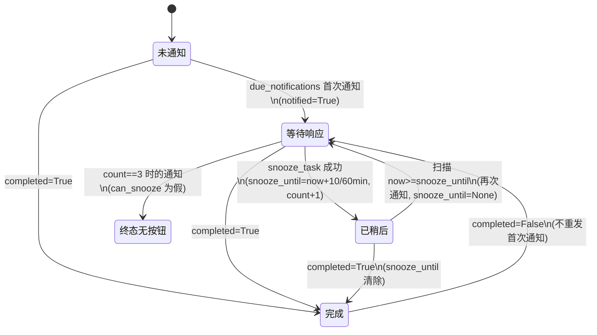

# 稍后提醒（Snooze）设计 Spec

- 项目：Pocket Tasks（内存原型，`task_service.py`）
- 日期：2026-10-17
- 状态：已获用户批准（A4，2026-10-17）
- 追溯记录：`2026-10-17-snooze-reminder-record.md`（下文方括号内为记录编号：R=原始需求，C=澄清，I=推断/决定，S=方案选择，M=次要事项，A=审批）

## 1. 意图与范围

用户收到任务到期通知后，可以选择“稍后提醒”，避免暂时忙碌时忘记任务 [R1]。任务原截止时间 `due_at` 与列表排序必须保持不变 [R2]。

**范围内：** 在 `task_service.py` 中新增稍后状态、响应函数、按钮可用性判断，并扩展到期扫描以发出到点的稍后提醒。
**范围外：** 界面、外部服务、数据库、持久化、时区处理 [R7, R9, I13]。通知响应入口只是一个供以后界面调用的函数。
**参考与反例：** 参考手机闹钟的稍后提醒，但不自动稍后：用户不响应就不再提醒 [R9]。

**不可接受的结果：** `due_at` 或 `sorted_open_tasks` 的结果因稍后而变化；任务完成后仍有旧提醒发出，包括取消完成后复活；没选稍后的任务提醒行为与现在不同；超过 3 次稍后；无效响应改变了任务状态。

## 2. 现状（已核实 task_service.py）

- `Task` 是 dataclass，字段 `id, title, due_at, completed=False, notified=False`。
- `due_notifications(tasks, now) -> list[str]`：对未完成、未通知、`due_at <= now` 的任务置 `notified=True` 并返回 id；每分钟被调用一次（README）。
- `sorted_open_tasks(tasks)`：过滤未完成，按 `due_at` 排序。
- `completed` 由调用方直接赋值，没有完成函数；没有删除函数，删除即从传入列表移除 [I2, I8]。
- 现有测试：`test_due_notifications_once`、`test_open_tasks_sort_by_due_at`，必须继续通过。

## 3. 设计

### 3.1 数据（`Task` 新增两个字段，追加在 `notified` 之后）[C4, I3]

| 字段 | 类型与默认 | 含义 |
|---|---|---|
| `snooze_until` | `datetime \| None = None` | 下次稍后提醒时间；`None` 表示没有待发稍后提醒 |
| `snooze_count` | `int = 0` | 用户已成功点击稍后的次数 |

`notified` 含义不变（首次通知已发出）[I3]；`due_at` 不被任何新增逻辑修改 [R2]。字段追加在末尾，现有位置参数构造 `Task(id, title, due_at, completed, notified)` 继续可用。

常量：`SNOOZE_OPTIONS_MINUTES = (10, 60)`，`MAX_SNOOZES = 3` [R4, R5, M1]。

### 3.2 新增函数（模块级，沿用现有风格）[S2=2A]

**`can_snooze(task) -> bool`**：同时满足以下条件才为真，供界面决定是否显示稍后按钮 [R5, I4, I5]：
1. `task.completed` 为假；
2. `task.notified` 为真（已发过通知）；
3. `task.snooze_until is None`（没有待发的稍后提醒）；
4. `task.snooze_count < MAX_SNOOZES`。

**`snooze_task(task, minutes, now) -> bool`** [R4, C2, M1–M3, I4, I11]：
- 若 `minutes` 不在 `SNOOZE_OPTIONS_MINUTES` 中，或 `can_snooze(task)` 为假：返回 `False`，任务任何字段都不变 [C4]。
- 否则：`task.snooze_until = now + timedelta(minutes=minutes)`，`task.snooze_count += 1`，返回 `True`。
- 时长从调用时刻 `now`（用户点击时刻）起算，不是从通知发出时刻起算 [C2]。

### 3.3 扩展 `due_notifications`（签名与返回类型不变）[C4, I7]

对每个任务：
1. 已完成：跳过。
2. 首次通知分支：条件与现有完全一致（未完成、`not notified`、`due_at <= now`）；动作不变（置 `notified=True`，返回 id）。没选稍后的任务只会走这个分支，行为与现状一致 [R8]。
3. 稍后到点分支（新增）：`notified` 为真且 `snooze_until` 不为 `None` 且 `snooze_until <= now`：把 `snooze_until` 置为 `None`，并把该 id 加入返回列表；`snooze_count` 不变。同一次调用对同一任务最多返回一次。

返回的 id 列表里不区分首次通知与稍后通知。界面显示通知时调用 `can_snooze(task)`：次数未满则带按钮，第 3 次稍后通知（此时 `snooze_count == 3`）不带按钮 [C3]。

### 3.4 完成与删除 [#11 v2, S1=1B, I9, I10]

- **完成：** `Task` 重写属性赋值，任何时候 `completed` 被赋为 `True`，同时把 `snooze_until` 置为 `None`；`snooze_count` 不变。因此无论调用方怎么写（`task.completed = True`），都会清除待发稍后时间。
- **构造时：** 若以 `completed=True` 构造，构造完成后 `snooze_until` 也必须为 `None`（例如在 `__post_init__` 中保证），因为 dataclass 的 `__init__` 会按字段顺序赋值，仅靠赋值拦截不足以保证这点 [I10]。
- **取消完成**（赋为 `False`）：不做任何事。旧提醒不会复活；`notified` 仍为真，所以不会重新发首次通知。此时若 `can_snooze` 为真，用户手动点击稍后仍然有效，时间从点击时刻算 [I9，用户已确认的边界]。
- **删除：** 任务从传入 `tasks` 列表中移除即不会被扫描到，无需新增代码 [C4, I2]。已被移除的任务对象若仍被传入 `snooze_task`，只会改该对象本身，不影响扫描，调用方不应这样做。

### 3.5 状态机

说明：“终态无按钮”不是单独存储的状态，它是“等待响应且 `snooze_count == 3`”的叫法，此时 `can_snooze` 为假，用户不响应则不再有后续通知 [R5, R9]。一项任务最多收到 1 次首次通知 + 3 次稍后通知 = 4 次 [C3]。

## 4. 不变量

1. `due_at` 在新增逻辑中从不被写入；`sorted_open_tasks` 不读取任何新字段 [R2, R8]。
2. `completed` 为真 ⇒ `snooze_until is None`（赋值与构造两条路径均成立）。
3. `snooze_until is not None` ⇒ `notified` 为真（`snooze_task` 只在 `notified` 时才会成功）。
4. `0 <= snooze_count <= 3`。
5. `due_notifications` 的返回类型与首次通知行为不变。

## 5. 关键决定与依据

| 决定 | 依据与归属 |
|---|---|
| 只有 10、60 分钟两档 | R4、C1，用户选择 |
| 从点击时刻起算 | C2，用户选择 |
| 最多点击 3 次，最多 4 次通知，第 3 次稍后通知无按钮 | R5、C3，用户确认 |
| 两个新字段，`notified` 不变，不改 `due_at` | C4、I3，用户确认 |
| `due_notifications` 返回值不变，并发出到点的稍后提醒 | C4 + I7，返回值不变为用户确认，复用扫描为推断 |
| 完成时由 `Task` 赋值拦截清除 | S1=1B，用户从方案中选择 |
| 逻辑放在模块级函数 | S2=2A，用户从方案中选择 |
| 传分钟数、返回布尔、传入 `now` | M1–M3，次要决定，用户已批准 |
| 构造时也保证不变量 | I10，次要决定 |
| 点击成功时计数加 1，提醒发出时不改 | I11，次要决定 |
| “准确”指 `snooze_until` 值准确；送达受每分钟扫描限制 | I12，次要决定 |
| 不处理时区，`now` 与 `due_at` 同类 | I13，次要决定 |

## 6. 验收标准 [R8]

实施时在现有测试风格下补测试，现有两个测试保持通过。至少覆盖：

1. 点击 10 分钟、60 分钟后，`snooze_until` 恰为点击时刻加对应分钟数；非 10/60 的值返回 `False`。
2. 到点前再扫描不返回该任务；到点后返回一次，再扫描不再返回。
3. 连续三次“点击、到点”后，第 3 次稍后通知时 `can_snooze` 为假；第 4 次点击返回 `False`；任务共收到 4 次通知。
4. 每次稍后后 `due_at` 不变，`sorted_open_tasks` 的结果与稍后前一致。
5. 没点稍后的任务，通知行为与现有完全一致（只通知一次）。
6. 无效响应不改状态：未通知、已完成、已有待发稍后、次数已满、非法时长。
7. 完成后 `snooze_until` 为 `None`；再取消完成，扫描不会发出旧提醒；构造时 `completed=True` 同样成立。
8. 取消完成后（次数未满、`notified` 为真）手动点击稍后有效，时间从点击时刻算（I9）。
9. 任务从列表中移除后不再被扫描到。
