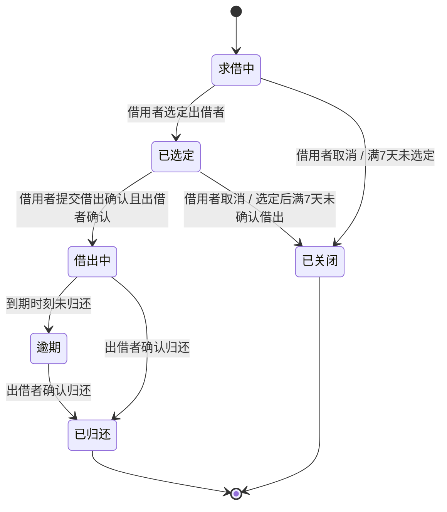
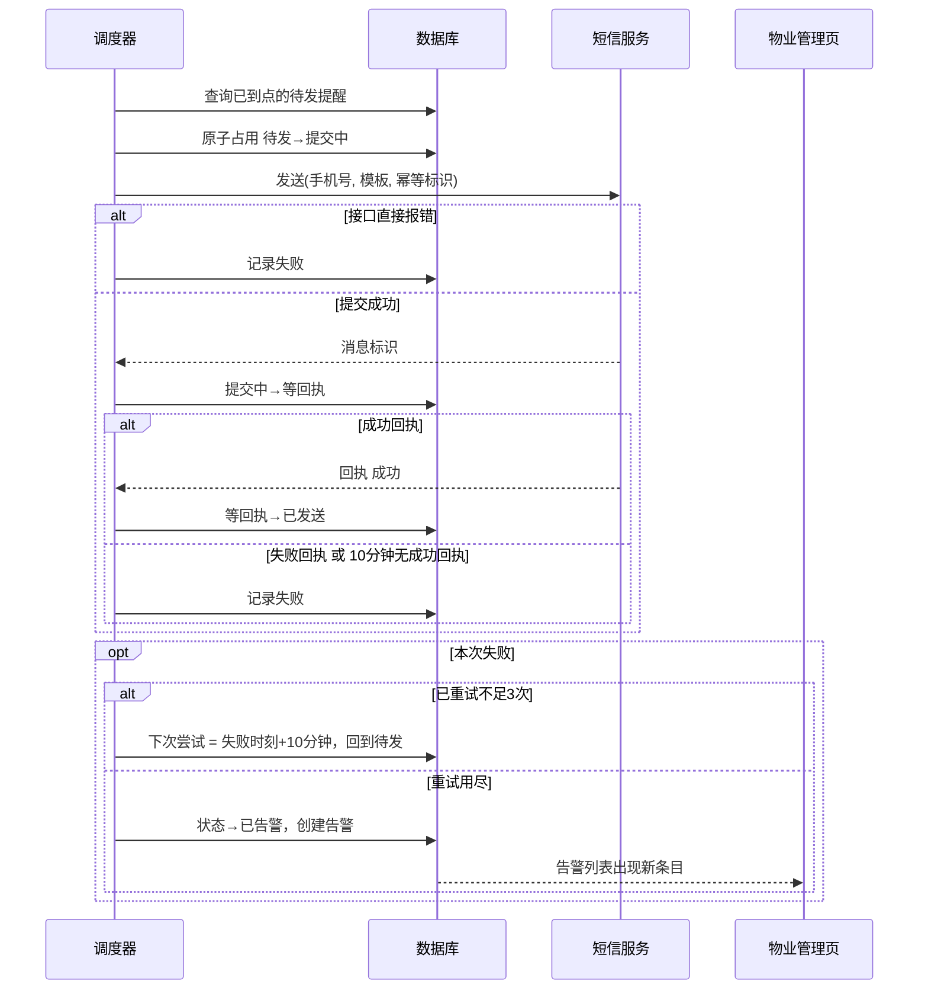

# 邻里借物（试点版）设计 Spec

- 状态：初稿 v1，待用户审核（记录 H04）
- 日期：2026-10-17
- 需求与决策记录：`2026-10-17-neighbor-lending-record.md`
- 引用约定：R 为已批准需求清单编号；U、A、D、P 为记录中的条目编号。
- 归属标记：**【用户】** 用户直接提出或确认；**【选择】** 用户从方案中选择；**【推断】** 我的推断，已获批准；**【次要】** 我决定的次要事项，D12–D25 尚待审核。
- 本项目不制作设计稿，只审核文字与流程（U31）。

## 1. 意图与目标

同一栋楼的住户想借一件偶尔才用的东西（例如电钻），却不知道该问谁；住户微信群太吵，挨家问又尴尬（U02、U03）。本产品让住户在只有本楼人的范围内发出一条求借，愿意借的邻居自己站出来，双方在产品内私聊约定交接，系统记录借出、约定归还时间和归还确认，并在到期前 24 小时用短信提醒借用者，避免双方忘记归还时间（U04）。

不可接受的结果：
- 非本楼人进入，或任何住户看到其他住户的门牌号、手机号。
- 已借出的物品，到期前的提醒既没有发出，也没有告警和人工跟进。
- 同一笔借用的提醒重复发送，造成多余的短信花费。

## 2. 范围

### 2.1 本期做
- 一栋 80 户的楼，手机网页，一户一个账号【用户 R2、R4】。
- 邀请码入住，手机号加短信验证码登录【用户 R4、选择 R5】。
- 本楼求借信息流、响应、产品内私聊、选定出借者【用户 R7、R9，选择 R8 修订】。
- 借出确认、约定归还时间、归还确认、逾期状态【用户 R10–R12】。
- 到期前短信提醒、发送失败重试、告警与物业人工跟进【用户 R13–R15】。
- 物业管理页：邀请码、告警、统计，与住户页在同一应用内【用户 R15、R20】。

### 2.2 本期不做
- 支付、押金；公开评价、信用分；损坏的认定与赔偿，损坏先线下协商【用户 R3、U08、U17】。
- 求借的短信或其他网页外通知；私聊新消息的短信通知。试点接受因此错过求借【用户 R19】。
- 物品清单与搜索（方案 B）【选择 U11】。
- 图片、语音等私聊消息类型，仅支持文本【次要 D21】。
- 试点结束后的数据清理与迁移。

## 3. 角色与对象

| 名称 | 说明 |
|---|---|
| 住户账号 | 一户一个账号，同户多人共用；有昵称，绑定一个手机号【用户 R4、R6】 |
| 借用者 | 发起某条求借的账号 |
| 出借者 | 某条求借中被借用者选定的响应者 |
| 物业管理员 | 发放邀请码、处理告警、查看统计。独立的管理员入口，管理员手机号在部署配置中设白名单【次要 D25】 |

同一账号可以同时是不同求借里的借用者和出借者。

## 4. 成功标准与验收依据

试点周期：从物业向住户开放邀请码使用之日起连续 14 天【用户 U09】。

1. 至少完成 10 笔借还，即状态进入“已归还”的借用不少于 10 笔【用户 R16，保留 U21】。
2. 每一条到期前提醒，都以以下任一结果收尾，不存在悬而未决的提醒【用户 R16，U16】：
   - 已发送：收到短信服务的成功回执；
   - 已告警：重试用尽后生成告警，且物业在管理页标记为已处理并填写跟进备注；
   - 已取消：借用在提醒发出前已归还，不计入。
3. 管理页统计展示：已完成借还数、提醒总数、已发送数、告警数、告警已处理数、累计短信发送条数【次要 D12】，供试点结束时对照上述标准和 500 元预算。

## 5. 产品能力与关键流程

### 5.1 入住与登录【R4、R5、R6，P03 选 A】

1. 物业在管理页录入一条邀请码，并附上该户的户号标注。邀请码随机生成，一次性使用；户号标注只有物业能看到，用于告警时人工联系【次要 D17】。
2. 住户首次打开网页，输入邀请码、手机号，获取短信验证码并验证（仅支持中国大陆 11 位手机号【次要 D18】）。验证通过后设置昵称，账号建立，邀请码作废并与该账号绑定。
3. 昵称在本楼内唯一，可以修改，历史记录显示最新昵称【用户 D10】。
4. 之后登录只需手机号加验证码。会话保持 30 天；同一手机号每天最多获取 5 次验证码，用于控制验证码短信花费【用户 D09】。邀请码兑换和验证码校验的失败次数需要限频，具体阈值由实现者定。
5. 换手机号或疑似冒用：由物业在管理页“重置该户”。重置会解除手机号绑定并生成新的邀请码，原账号的数据保留，进行中的借用保留，之后的提醒改发新号码【选择 P03、推断 D11】。
6. 其他住户任何页面都不会出现手机号和门牌号，只显示昵称【用户 R6】。

### 5.2 本楼求借信息流【R7、R19】

- 登录后首页是本楼信息流，按时间倒序展示状态为“求借中”的求借。
- 发起求借需填写：物品名、说明、需要使用多久【用户 D07】。
- 求借只在信息流里展示，不发任何短信或网页外通知。住户自己打开网页才能看到【用户 R19】。
- 同一住户对同一条求借只能响应一次，不能响应自己的求借【次要 D19】。
- 求借自创建起满 7 天仍未选定出借者，自动关闭，包含无人响应的情形【次要 D24，覆盖 D03】。借用者也可以主动取消。

### 5.3 响应与私聊【R8 修订、R9、P02 选 A】

1. 有意者在求借详情点“我可以借”，系统立即为该响应者与借用者建立一对一会话，双方都可以开始聊。借用者可以同时与多位响应者聊【用户 U19】。
2. 私聊交互参考闲鱼：会话列表，每个会话有未读标记，进入会话看到文本消息和系统卡片【用户 U17】。仅文本，不含图片和语音【次要 D21】。
3. 新消息的提示只有站内未读标记：底部导航上的红点和会话列表里的未读数；不发短信【用户 U28】。页面打开时每隔几秒向服务器拉取一次未读数和新消息，回到前台时立即拉取一次【选择 P02 选 A】。
4. 借用者聊过之后，在求借详情里选定一位出借者。选定后：求借状态变为“已选定”；其余响应者的会话转为只读，会话里出现一条系统消息“该求借已选定其他邻居”，并带未读标记；不发短信【推断 A08】。
5. 求借被关闭（超时或借用者取消）时，所有相关会话转为只读，并各出现一条系统消息【次要 D20】。

### 5.4 借出确认与约定归还时间【R10、R11】

1. 双方在私聊中约好交接后，由借用者在会话里点“确认借出”，填写约定归还时间，时间精确到分钟，时区固定为 Asia/Shanghai【次要 D15、D22】。
2. 出借者在会话里看到这张系统卡片，点“确认”后借用生效，状态变为“借出中”；也可以拒绝，在私聊里继续商量后由借用者重新提交【次要 D15】。
3. 借出确认前，借用者可以取消，求借变为“已关闭”；“借出中”之后不可取消，只能走归还流程【次要 D13】。“已选定”状态超过 7 天仍未确认借出，自动关闭【次要 D14】。
4. 借出中可以修改约定归还时间：借用者提交新时间，出借者确认后生效；确认前旧时间继续有效【用户 D04】。
5. 归还时，由出借者在“我的借用”或会话里点“确认归还”，状态变为“已归还”，借还结束【推断 A04】。

### 5.5 逾期【R12、D08】

- 调度器发现“借出中”的借用已过约定归还时间，自动把状态置为“逾期”，不额外发短信【用户 D08】。
- 出借者的“我的借用”里，到期后看到“逾期”标记；借用者的页面同样显示。
- 逾期的借用仍然可以由出借者确认归还。
- 不产生信用分、不公开展示【推断 A07】。

### 5.6 我的借用

一个页面，分“我借入的”和“我借出的”，列出状态、物品、对方昵称、约定归还时间。出借者在这里能看到到期和逾期状态，这是出借者了解归还情况的唯一入口（U12：到期时能看到状态即可）。

### 5.7 物业管理页【R15、R14】

仅管理员可进入，包含：
- **邀请码**：新增、作废、重置某户；列表显示户号标注、状态（未使用 / 已使用 / 已作废）。
- **告警**：列表显示借用者昵称、绑定手机号、户号标注、物品、约定归还时间、失败原因、告警时间；物业可标记为“已处理”并填写跟进备注。手机号和户号只在这里可见，仅用于人工联系【次要 D17】。
- **统计**：见第 4 节第 3 点。

## 6. 状态模型

### 6.1 求借与借用的统一状态

约束：
- 状态只会沿图中箭头变化；“借出中”之后不可取消。
- 进入“已选定”“已关闭”时，会话按 5.3 处理；进入“借出中”时创建提醒（见第 7 节）；进入“已归还”时取消尚未发出的提醒。

### 6.2 提醒状态

| 状态 | 含义 | 进入条件 |
|---|---|---|
| 待发 | 到点或到重试时间即由调度器处理 | 创建提醒；一次提交失败且还有重试额度 |
| 提交中 | 已被调度器占用，正在调用短信服务 | 调度器占用成功 |
| 等回执 | 短信服务已接收，等待送达结果 | 提交成功并拿到消息标识 |
| 已发送 | 收到成功回执 | 成功回执到达 |
| 已告警 | 重试用尽仍失败，已生成告警 | 第 4 次失败 |
| 已取消 | 提醒发出前借用已归还 | 归还确认 |

## 7. 提醒与短信机制【核心，P01 选 A】

### 7.1 创建规则
- 借出生效（进入“借出中”）时，创建一条提醒，发送时间为约定归还时间前 24 小时【用户 R13】。
- 若此时距到期已不足 24 小时，发送时间设为当前时刻，生效后立即发送【用户 D05】。
- 修改约定归还时间生效时：旧提醒还没发出则改期并重新套用上述规则；旧提醒已发出则再新建一条【次要 D16】。
- 同一笔借用任一时刻至多一条有效的未发出提醒。
- 提醒只发给借用者所在账号绑定的手机号【推断 D11】。

### 7.2 调度与发送
- 后台调度器每分钟扫描一次数据库，处理发送时间已到的“待发”提醒。试点只运行一个调度器实例。
- 占用提醒必须是原子操作（例如行锁加条件更新），避免同一条提醒被重复处理。
- 发送请求携带幂等标识（提醒编号加第几次提交），短信服务支持时用于去重。
- 重启后调度器按“发送时间已过且未发送”继续处理，不会漏掉停机期间到点的提醒。

### 7.3 回执、重试与告警

- “完成发送”的判定：提交成功，并且 10 分钟内收到成功回执【用户 D06】。
- 重试次数：首次提交之外最多重试 3 次，即一条提醒最多提交 4 次，每次失败后间隔 10 分钟再试【次要 D23，对 D02 措辞的解释】。
- 重试用尽后，提醒状态为“已告警”，同时生成一条告警，由物业人工联系借用者【用户 R14】。

### 7.4 短信内容
两类短信，具体模板在短信服务侧报备（虚构服务无此流程，实现者按其规范处理）：
- 登录验证码：包含验证码和有效时间。
- 归还提醒：包含物品名和约定归还时间，提醒按时归还，例如“【邻里借物】您借用的{物品}约定于{时间}归还，请按时归还。”

### 7.5 短信服务接口假设【用户 U23】
短信服务是虚构的云短信 API，按常见 HTTP 形态设计：
- **发送**：POST，入参为手机号、模板标识、模板参数、幂等标识；返回消息标识，或错误码和原因。
- **回执**：优先使用回调——短信服务向本应用的回执地址 POST 消息标识、结果（成功 / 失败）、时间，回调需校验签名；若回调不可用，则按消息标识主动查询。
- 实现者需把服务地址、密钥、模板标识放入配置，不写进代码。
- 500 元预算按“每笔借用一条提醒加登录验证码”估算消耗。短信单价未知，实现者需按所选服务核算，并通过管理页的累计发送条数对照预算【次要 D12】。

## 8. 数据与接口

### 8.1 主要对象（关系数据库，需事务和行级并发控制）【用户 R20】

| 对象 | 关键字段 |
|---|---|
| 账号 | 编号、昵称（唯一）、手机号（唯一，加密存储）、状态、创建时间 |
| 邀请码 | 编码、户号标注（仅物业可见）、状态（未使用 / 已使用 / 已作废）、绑定账号、创建和兑换时间 |
| 验证码记录 | 手机号、校验值、有效期、失败次数、创建时间 |
| 求借 | 编号、发起账号、物品名、说明、需要使用多久、状态、选定的出借账号、创建时间、关闭原因 |
| 响应 | 求借编号、响应账号、时间（求借加响应账号唯一） |
| 会话 | 求借编号、响应账号；各参与方的已读位置 |
| 消息 | 会话编号、发送方（含系统）、类型（文本 / 系统卡片）、内容、时间 |
| 借用 | 求借编号、出借账号、借用账号、约定归还时间、状态、确认借出时间、归还时间 |
| 归还时间修改 | 借用编号、拟定新时间、状态（待确认 / 已接受 / 已拒绝） |
| 提醒 | 借用编号、发送时间、状态、已提交次数、下次尝试时间、消息标识、最近失败原因 |
| 提交记录 | 提醒编号、第几次、提交时间、消息标识、结果、回执时间、错误信息 |
| 告警 | 提醒编号、借用编号、状态（待处理 / 已处理）、跟进备注、创建和处理时间 |

未读数 = 会话里晚于自己已读位置、且不是自己发出的消息数。

### 8.2 接口分组
- **住户页**：兑换邀请码并登录、请求验证码、信息流、发起 / 取消求借、响应、选定出借者、会话列表、读写消息、拉取未读、提交 / 确认借出、提交 / 确认修改归还时间、确认归还、我的借用。
- **管理页**：邀请码增删和重置、告警列表和处理、统计。
- **回执回调**：接收短信服务回执。
- 住户接口一律校验会话身份，且只能访问自己参与的求借、会话和借用；管理接口只允许白名单管理员。

## 9. 异常与边界

| 情形 | 处理 |
|---|---|
| 借用者同时选定两位出借者（并发） | 选定操作做条件更新，只有第一次成功，另一次返回“该求借已选定” |
| 选定出借者时，该响应者的会话已只读 | 不允许选定，提示刷新 |
| 到期前 24 小时内才确认借出 | 生效后立即发送一次提醒（D05）；若重试用尽的告警晚于到期时刻，物业照常跟进 |
| 修改归还时间时，新时间已晚于当前时间不足 24 小时 | 与创建规则相同，立即发送 |
| 归还确认时提醒处于“等回执” | 不取消，等回执完成；其余未发出的提醒取消 |
| 同户多人使用，不是绑定手机号的那位在借 | 提醒仍发往绑定号码（D11），属于已接受的限制 |
| 调度器长时间停机 | 恢复后补发所有已到点的提醒；物业管理页展示“提醒落后”的数量，便于发现 |
| 短信服务整体不可用 | 所有提醒走重试直到告警，物业按告警逐一人工联系 |
| 验证码短信失败 | 登录页提示稍后重试，不影响已登录的会话 |
| 手机号被占用 | 兑换邀请码时提示该手机号已绑定其他户，请联系物业 |

## 10. 隐私与安全

- 全站使用 HTTPS。
- 手机号加密存储；日志里的手机号做掩码。
- 对其他住户只暴露昵称；接口返回里不得带手机号、户号标注、门牌号。
- 邀请码足够随机且一次性，兑换失败限频。
- 管理页与住户页入口分开，管理员手机号只由部署配置设定。
- 数据按日备份，试点期保留全部记录，试点结束后的处理由物业决定，不在本期范围内。

## 11. 验收标准

1. 持有效邀请码的住户可以完成兑换、设置昵称、之后用手机号加验证码登录；邀请码第二次使用失败。
2. 无邀请码的人无法进入信息流和任何住户接口。
3. 住户 A 发起求借后，住户 B 在信息流里看到它；未打开网页的住户不会收到任何短信。
4. B 点“我可以借”后，A 和 B 立即能互发文本消息，对方在会话列表看到未读标记，打开后标记消失。
5. A 与多位响应者聊过后选定其中一位；其余响应者的会话变为只读，且各有一条带未读标记的系统消息。
6. A 提交借出确认和约定归还时间，出借者确认后状态变为“借出中”；出借者拒绝时状态保持“已选定”。
7. 借出生效时创建提醒，发送时间为到期前 24 小时；到期不足 24 小时时立即发送一次。
8. 到点后调度器恰好发送一次；同一提醒不会被重复发送。
9. 成功回执到达后提醒变为“已发送”；10 分钟内无成功回执，视为失败并在 10 分钟后重试，最多重试 3 次。
10. 重试用尽后提醒为“已告警”，物业管理页出现告警，含借用者昵称、手机号、户号标注；物业标记已处理并填写备注。
11. 到期时刻未归还的借用变为“逾期”，出借者能在“我的借用”看到；此时不发额外短信。
12. 出借者确认归还后状态为“已归还”，尚未发出的提醒变为“已取消”。
13. 借出中修改归还时间：出借者确认前旧时间生效；确认后提醒按新时间重建或改期。
14. 求借满 7 天仍未选定出借者自动关闭，所有会话转为只读；已选定满 7 天未确认借出同样关闭。
15. 任何其他住户可见的页面和接口响应中，不出现手机号、户号标注或门牌号。
16. 调度器重启后，停机期间已到点的提醒会被补发。
17. 管理页统计的数字与数据库中的实际记录一致。

## 12. 决定归属与追溯

| 主题 | 需求 / 决策 | 归属 |
|---|---|---|
| 目标、范围、不做的事 | R1–R3、U02–U08、U17 | 用户 |
| 邀请码、一户一账号、昵称 | R4、R6、U10、U13 | 用户 |
| 手机号登录与手机号保密 | R5、U14 | 用户（验证码方式为推断 A01，已批准） |
| 发求借 | R7、U11 | 用户选择 |
| 响应后立即私聊，聊过再选一位 | R8、U19、A08 | 用户提出，细节为推断（已批准） |
| 产品内私聊，参考闲鱼 | R9、U12、U17 | 用户 |
| 借出、归还、状态 | R10–R12、A03、A04 | 用户，细节为推断（已批准） |
| 到期前 24 小时一次短信提醒 | R13、U20、D05 | 用户 |
| 回执判定、重试与告警 | R14、D02、D06 | 用户，参数为次要决定（已批准） |
| 物业管理页 | R15、A05 | 推断（已批准） |
| 成功标准 | R16、U16、U21 | 用户 |
| 预算与短信服务 | R17、U15、U23 | 用户 |
| 求借只在信息流，未读标记，接受错过 | R19、U27–U29 | 用户 |
| 单体应用、关系数据库 | R20、U30 | 用户 |
| 提醒调度方案 | P01 | 用户选择 A |
| 私聊消息拉取方式 | P02 | 用户选择 A |
| 邀请码绑定与换号 | P03 | 用户选择 A |
| 求借内容与信息流、逾期、会话与登录参数、昵称、同户手机号 | D07–D11 | 次要决定（已批准） |
| 本 Spec 补充的次要决定 | D12–D25 | 次要决定（待审核，H04） |

## 13. 已知限制与假设

- 求借不主动通知任何人，试点期的借还数量依赖住户主动打开网页；这是 U29 已接受的风险。
- 同户多人共用账号，提醒只发绑定的一个手机号。
- 短信服务的接口形态是假设，实现者需按所选服务的实际文档对接，不得因此改变第 7 节的状态流转。
- 单实例、单楼，不考虑多楼、多物业和横向扩展。
- 500 元预算是否足够，取决于所选短信服务的单价，上线前需核算。
