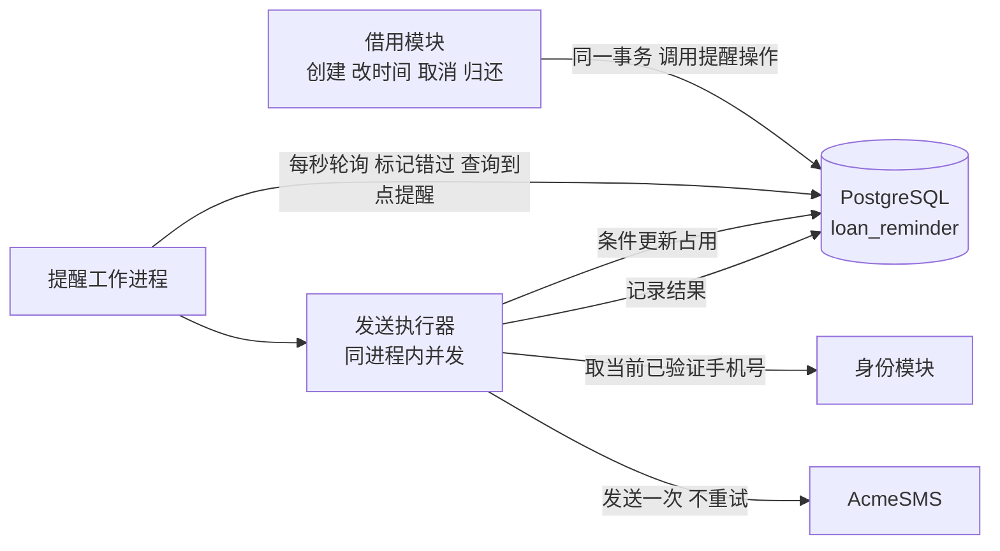
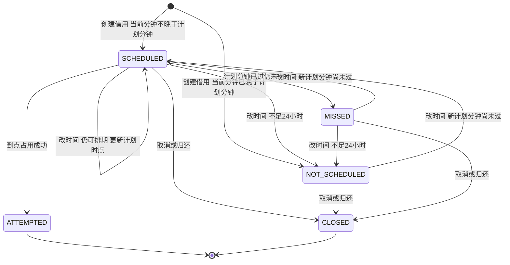
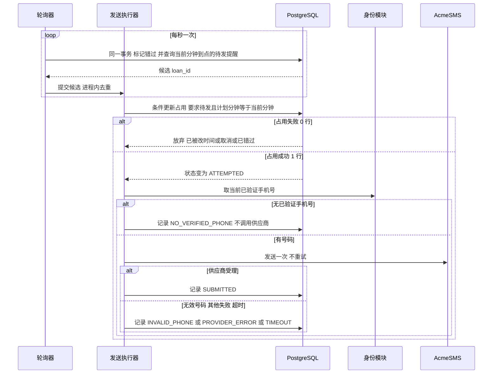

# 借用短信提醒 设计（Spec）

- 版本：v1（2026-10-17）。审查状态：**已批准（H-04）**，覆盖本文全部内容，含 D-05 至 D-12 与 AC-01 至 AC-20。B-01、B-02 仍待核实，是实施前阻塞，批准不授权更改签名或次数规则。
- 追溯：需求与决策记录见 `2026-10-17-loan-sms-reminder-record.md`。文中 R-xx 指已批准的需求清单（H-01），S-xx 指已批准的补充需求（H-02），其余编号（U、A、C、D、P、B）指记录中的条目。
- 范围声明：本文只描述设计，不含也不修改任何产品代码。文中的 SQL 与流程是设计示意。

## 1. 目的、范围与不可接受的结果

**目的。** 在新建的共享工具借用系统（Python 服务）中，为每笔借用向借用人发送至多一条归还提醒短信，时点是当前约定归还时间的前 24 小时（U-01、U-04）。

**范围内：** 提醒的排期、改时间后的重排、取消与归还后的停止、到点占用与发送、失败与错过的记录、短信内容。

**范围外：** 借用本身的创建、取消、归还、改时间的业务入口与权限校验（由借用模块负责，本设计只规定它们必须满足的接口约束，见 3.2）；除借用人以外的收件人；送达回执；重试；退订；避开夜间。

**不可接受的结果**（验收时逐条检查）：
1. 同一笔借用有多于一次发送尝试（含失败与超时）。
2. 取消或归还之后仍发出提醒。
3. 提醒发出尝试之后，因改时间而再次发出。
4. 发送尝试发生在计划时点所在分钟之后，却仍然发出。

## 2. 已批准的行为规则

| # | 规则 | 依据 | 归属 |
|---|------|------|------|
| 1 | 对每笔借用，向借用人发一条提醒，使用发送时借用人当前已验证的手机号 | R-01、R-10、S-09 | 用户直接提出 |
| 2 | 发送时点是当前约定归还时间的前 24 小时（UTC，不避夜间） | R-02、S-06 | 用户直接提出 |
| 3 | 每笔借用整个生命周期最多一次发送尝试。失败、超时的尝试也用掉这一次。预算按每笔最多一条核算 | R-03、S-01、S-02、A-01 | 用户直接提出，用户确认了我的推断 |
| 4 | 提醒发出尝试之前改归还时间：重新排期，按最新归还时间前 24 小时发送 | R-04 | 用户从选项中选择 |
| 5 | 提醒发出尝试之后改归还时间：不补发 | R-05 | 用户从选项中选择 |
| 6 | 创建借用或改时间时，若已不足 24 小时：不发，也不占用那一次机会；之后改回距今 ≥24 小时，则重新排期 | R-06、R-07、A-03 | 用户从选项中选择，推论经用户批准 |
| 7 | 距归还时间恰好 24 小时：立即发送 | S-10、A-05 | 用户直接提出 |
| 8 | 取消借用、借用已归还：不发 | R-08、R-09、A-02 | 用户直接提出，用户确认了我的推断 |
| 9 | 零宽限：计划时点所在分钟之内的尝试算准时，进入下一分钟才算错过；错过不补发 | S-03、S-04、C-04 | 用户直接提出，用户从选项中选择精度 |
| 10 | 错过的提醒（未发出尝试）之后，借用人把归还时间改到距今 ≥24 小时，重新排期，可再获得一次提醒 | D-04 | 我的次要决定，用户已批准 |
| 11 | 供应商任何失败（含超时）都不重试；无效手机号只记录失败 | R-11、S-01 | 用户直接提出 |
| 12 | “已发出”以首次发送尝试为准，不等回执 | S-02 | 用户直接提出 |
| 13 | 只有借用人能改归还时间；新时间必须晚于现在；次数不限 | S-05 | 用户直接提出 |
| 14 | 技术与规模：Python 服务、PostgreSQL、AcmeSMS，单一工作进程每秒轮询一次，每日新增借用最多 1000 笔 | S-08、U-19 | 用户直接提出 |

## 3. 现状与约束

### 3.1 现状
- 这是新系统，项目目录为空，没有可读的现有代码（U-05）。因此借用模块的数据表、接口、身份模块都尚不存在，本设计对它们只提出下面的接口约束。
- 以下事项**尚未核实**，设计不依赖任何未经核实的 AcmeSMS 能力：AcmeSMS 是否支持签名“共享工具”（B-01）；AcmeSMS 的错误码、频率限制、超时建议、是否支持去重键（B-02）。

### 3.2 对借用模块与身份模块的接口约束
1. **借用状态：** 借用至少有“进行中、已取消、已归还”三种状态，后两种是终态，不可恢复（D-09）。
2. **同事务协同：** 借用的创建、改归还时间、取消、归还，必须在**同一个数据库事务**里调用提醒模块的对应操作（4.5）。这是并发正确性的基础，不能放在事务之外。
3. **改时间校验由借用模块负责：** 调用者必须是该借用的借用人；新归还时间晚于现在；新时间精确到分钟（秒不为 0 则拒绝，不截断，D-05）。
4. **手机号读取接口：** 身份模块提供 `get_verified_phone(borrower_id) -> 号码或空`，返回调用时刻借用人当前已验证的号码。

## 4. 设计

### 4.1 组成



只有一个工作进程（S-08、U-19）。进程内分两部分：每秒一次的**轮询器**，和并发的**发送执行器**。发送执行器让慢速的 AcmeSMS 调用不会阻塞轮询（D-07）。

### 4.2 数据模型

每笔借用对应 `loan_reminder` 表中的一行，主键为 `loan_id`。一笔借用不可能有两行，所以“每笔最多一条”在结构上成立。

| 字段 | 类型 | 说明 |
|------|------|------|
| `loan_id` | 主键，外键指向借用 | 一对一 |
| `state` | 枚举 | `NOT_SCHEDULED`、`SCHEDULED`、`ATTEMPTED`、`MISSED`、`CLOSED`，见 4.4 |
| `remind_at` | `timestamptz`，UTC，精确到分钟 | 恒等于当前归还时间减 24 小时。`ATTEMPTED` 与 `CLOSED` 之后不再随改时间变化，作为历史 |
| `attempted_at` | `timestamptz`，可空 | 占用成功的时刻，仅 `ATTEMPTED` 有值 |
| `outcome` | 枚举，可空 | `SUBMITTED`、`INVALID_PHONE`、`PROVIDER_ERROR`、`TIMEOUT`、`NO_VERIFIED_PHONE`、`INTERRUPTED`，仅 `ATTEMPTED` 有值 |
| `outcome_detail` | 文本，可空 | 供应商返回的错误码或说明，不存手机号 |
| `created_at`、`updated_at` | `timestamptz` | 记录用 |

约束与索引：
- `CHECK`：`state = 'ATTEMPTED'` 当且仅当 `attempted_at` 非空；`outcome` 非空时 `state = 'ATTEMPTED'`。
- 部分索引：`CREATE INDEX ON loan_reminder (remind_at) WHERE state = 'SCHEDULED'`，使每秒的轮询查询只扫待发记录。
- 不存手机号。发送时现取现用。

### 4.3 时间规则

- **统一用 UTC。** 所有时间用 `timestamptz`；短信中的时间也以 UTC 显示（S-06、D-02）。
- **归还时间精确到分钟**（C-04）。`remind_at = due_at − 24 小时`，也精确到分钟。
- **唯一时钟是数据库时钟（D-12）。** 所有“现在”的比较都在 SQL 内通过一个函数 `reminder_now()`（默认返回 `clock_timestamp()`）取得，且**每条语句内只取一次**，避免一条语句横跨分钟边界。应用进程的时钟不参与比较。测试时可以覆盖这个函数来控制时间。
- **“准时”的判定（C-04 选 A）。** 记 `now_min = date_trunc('minute', reminder_now())`：
  - `now_min = remind_at`：在计划时点所在分钟内，算准时。
  - `now_min > remind_at`：进入下一分钟或更晚，算错过。
  - `now_min < remind_at`：还没到点。
- **排期判定**（规则 2、6、7 的统一写法）。创建借用或改时间时，用 `now_min` 与新的 `remind_at` 比较：
  - `now_min < remind_at`：距归还时间超过 24 小时，进入 `SCHEDULED`，等到点。
  - `now_min = remind_at`：视为“恰好 24 小时”，进入 `SCHEDULED`，由轮询立即占用（规则 7）。
  - `now_min > remind_at`：不足 24 小时，进入 `NOT_SCHEDULED`，不发（规则 6）。

**这个选择的实际含义（请审查时留意）：** 因为同一分钟内算同一时点，在 `remind_at` 所在分钟的 0 到 59 秒内创建或改时间，都按“恰好 24 小时”处理、立即发。但如果占用恰好落在下一分钟，就算错过、不发。这来自你选的“按整分钟比较”，不是额外加的宽限。

### 4.4 状态与转换



| 状态 | 含义 | 可否被改时间改变 | 终态 |
|------|------|------------------|------|
| `NOT_SCHEDULED` | 进行中的借用，当前不足 24 小时，不发 | 可。改到足够晚则变 `SCHEDULED` | 否 |
| `SCHEDULED` | 已排期，等待 `remind_at` 所在分钟 | 可。更新 `remind_at`，或变 `NOT_SCHEDULED` | 否 |
| `MISSED` | 计划分钟已过，没有发出尝试，也没有占用那一次机会 | 可（D-04）。改到足够晚则回到 `SCHEDULED` | 否 |
| `ATTEMPTED` | 已占用，即已有一次发送尝试，不论结果 | 不可，改时间对提醒无影响（规则 5） | 是 |
| `CLOSED` | 取消或归还，不发 | 不可 | 是 |

**不变量：** 没有任何路径把 `ATTEMPTED` 改回别的状态。这是“每笔最多一次尝试”的根。

### 4.5 流程

**所有状态变更都是对同一行的条件更新。** 占用、改时间、取消、归还都竞争这一行。PostgreSQL 在默认的 READ COMMITTED 下，后到的更新会等行锁，等到后再按已提交的新版本重新判断 `WHERE` 条件。所以它们互相排斥，不会各自读到旧状态。

**(1) 创建借用**（借用模块的同一事务内）
插入 `loan_reminder` 行：`remind_at = due_at − 24h`，按 4.3 的排期判定写入 `SCHEDULED` 或 `NOT_SCHEDULED`。

**(2) 改归还时间**（借用模块的同一事务内，在更新借用的 `due_at` 之后）
- 新旧归还时间相同：不改动提醒（D-10）。
- 否则：
  ```sql
  UPDATE loan_reminder
  SET remind_at = :new_remind_at,
      state = CASE WHEN date_trunc('minute', t.now_ts) <= :new_remind_at
                   THEN 'SCHEDULED' ELSE 'NOT_SCHEDULED' END,
      updated_at = t.now_ts
  FROM (SELECT reminder_now() AS now_ts) t
  WHERE loan_id = :id AND state IN ('NOT_SCHEDULED', 'SCHEDULED', 'MISSED');
  ```
  匹配 0 行说明状态是 `ATTEMPTED` 或 `CLOSED`，提醒保持不变（规则 5）。

**(3) 取消或归还**（借用模块的同一事务内）
```sql
UPDATE loan_reminder SET state = 'CLOSED', updated_at = reminder_now()
WHERE loan_id = :id AND state IN ('NOT_SCHEDULED', 'SCHEDULED', 'MISSED');
```
已经是 `ATTEMPTED` 的保持不变，保留发送历史。

**(4) 轮询与发送**（提醒工作进程）



轮询器每秒执行，同一事务内用同一个时间戳：
```sql
-- 1) 标记错过：计划分钟严格早于当前分钟
UPDATE loan_reminder SET state = 'MISSED', updated_at = t.now_ts
FROM (SELECT reminder_now() AS now_ts) t
WHERE state = 'SCHEDULED' AND remind_at < date_trunc('minute', t.now_ts);

-- 2) 查询候选：计划分钟等于当前分钟
SELECT loan_id FROM loan_reminder, (SELECT reminder_now() AS now_ts) t
WHERE state = 'SCHEDULED' AND remind_at = date_trunc('minute', t.now_ts);
```
发送执行器对每个候选，在调用 AcmeSMS 之前，先做**占用**：
```sql
UPDATE loan_reminder SET state = 'ATTEMPTED', attempted_at = t.now_ts, updated_at = t.now_ts
FROM (SELECT reminder_now() AS now_ts) t
WHERE loan_id = :id AND state = 'SCHEDULED'
  AND remind_at = date_trunc('minute', t.now_ts)
RETURNING loan_id;
```
- 返回 1 行：这次尝试成立，`attempted_at` 就是尝试时刻。**占用已提交之后才调用 AcmeSMS**（D-12 之外的关键顺序，依据 S-01、S-02、R-03）。
- 返回 0 行：这条已被改时间、取消、归还，或已错过，放弃，不调用。
- 占用语句自带“计划分钟等于当前分钟”的条件，所以执行器自己拖到下一分钟才抢占的，也会被拒绝并最终被标为错过。这保证规则 9 对发送执行器的排队延迟同样成立。

调用 AcmeSMS 的结果写入 `outcome`，不重试。`NO_VERIFIED_PHONE` 表示占用后发现借用人此刻没有已验证手机号，不调用供应商、不重试、这一次机会已用（D-06）。

**(5) 进程重启**
工作进程启动时，把所有 `state = 'ATTEMPTED' AND outcome IS NULL` 的记录标为 `INTERRUPTED`（D-08）。因为只有一个工作进程，这些必然是上一个进程在占用之后、记录结果之前中断的。它们**不重试**，也无法知道短信是否真的发出，只做记录。重启期间错过的计划分钟，由轮询器按 `MISSED` 处理。

### 4.6 短信内容

- 文本固定为：`【共享工具】借用将于{时间}到期`。其中 `{时间}` 是发送时刻该借用当前的归还时间，格式 `YYYY-MM-DD HH:MM UTC`。例：`【共享工具】借用将于2026-10-18 09:00 UTC到期`（U-12、D-02、D-03）。
- 不含工具名、链接、退订提示。借用人同时借多件工具时，无法从短信区分是哪一件。这是按你给的文案保持的，如需区分请告知。
- 该文本为 32 个字符，在常见的“中文短信每条 70 字符”规则下是一条。这个分段规则是 AcmeSMS 的实际规则，尚未核实（B-02）。如果 AcmeSMS 按多条计费，会影响“每笔最多一条”的预算口径，需在实施前确认。
- 签名不随供应商要求自动更改。AcmeSMS 不支持该签名时，记录为阻塞，由你决定（U-16、B-01）。

### 4.7 AcmeSMS 集成要求

- 每次占用成功后**最多调用一次**，任何失败都不重试（S-01）。
- 调用必须设置超时。超时算一次尝试，记为 `TIMEOUT`，不重试。超时数值作为配置项，待 B-02 核实供应商建议后确定，本设计不预设数值。
- 失败分类 `INVALID_PHONE`、`PROVIDER_ERROR`、`TIMEOUT` 只用于记录与排查，三者行为一致（都不重试）。AcmeSMS 错误码到类别的映射待 B-02 核实；无法识别的一律归为 `PROVIDER_ERROR`（D-11）。
- 发送执行器的并发度作为配置项，须不超过 AcmeSMS 的频率限制，数值待 B-02。轮询器不得被发送阻塞（D-07）。

### 4.8 可观测性与预算核对

- 每次状态转换写一条结构化日志，含 `loan_id`、旧状态、新状态、时间。
- 指标：各 `outcome` 的计数、`MISSED` 的计数、轮询每次耗时、从分钟起点到占用成功的延迟。
- **预算核对：** 每日统计 `state = 'ATTEMPTED'` 且 `outcome <> 'NO_VERIFIED_PHONE'` 的行数，应不超过当日新增借用数的上限。每笔借用至多一行，所以短信数每日不超过 1000 的上限（A-04、U-17）。
- 对 `MISSED` 与 `INTERRUPTED` 设置告警，因为它们意味着有借用人没有收到提醒或结果不明。

## 5. 边界与异常

| 情形 | 行为 | 依据 |
|------|------|------|
| 创建时已不足 24 小时 | `NOT_SCHEDULED`，不发 | 规则 6 |
| 创建或改时间落在计划分钟内 | `SCHEDULED`，立即占用；若占用落在下一分钟则 `MISSED`，不发 | 规则 7、9 |
| 已排期，改到不足 24 小时 | `NOT_SCHEDULED`，不占用那一次机会 | 规则 6 |
| `NOT_SCHEDULED` 或 `MISSED`，改到距今 ≥24 小时 | 回到 `SCHEDULED` | 规则 6、10 |
| 占用之后改时间 | 提醒不变，不补发 | 规则 5 |
| 占用与改时间/取消同时发生 | 行锁排斥：占用先到则改时间/取消不影响提醒，且短信照发；改时间/取消先到则占用返回 0 行 | 4.5 |
| 工作进程停机、数据库不可用、进程卡住超过计划分钟 | 该分钟的提醒错过，不补发 | 规则 9 |
| 占用后、调用前进程崩溃 | 不重发；重启后标 `INTERRUPTED` | D-08 |
| 误启动了第二个工作进程 | 条件更新仍保证最多一次尝试（但不属于支持的部署方式） | 4.5 |
| 同一分钟大量借用同时到点 | 在计划分钟内占用不上的，错过 | 规则 9；见第 7 节风险 |
| 借用已取消或已归还后又收到改时间请求 | 提醒不受影响，请求是否允许由借用模块决定 | D-09 |
| 手机号在排期后更换 | 发送时用当时已验证的号码 | S-09 |

## 6. 验收标准

下列用例使用真实 PostgreSQL 和一个可配置延迟、失败、超时的 AcmeSMS 假服务，时间通过覆盖 `reminder_now()` 控制。

| # | 场景 | 期望 | 对应 |
|---|------|------|------|
| AC-01 | 创建借用，归还时间在 25 小时后，到计划分钟 | 恰好一次调用，文本符合 4.6，状态 `ATTEMPTED`、结果 `SUBMITTED` | R-01、R-02、S-07 |
| AC-02 | 发出前改归还时间到更晚 | 旧计划分钟不发，新计划分钟发一次 | R-04 |
| AC-03 | 占用后再改归还时间 | 不再有调用 | R-05 |
| AC-04 | 创建时距归还时间不足 24 小时 | `NOT_SCHEDULED`，无调用 | R-06 |
| AC-05 | 创建时恰好落在计划分钟，轮询在同一分钟内执行 | 立即占用并发出一次 | S-10 |
| AC-06 | 同 AC-05，但轮询推迟到下一分钟 | 状态 `MISSED`，无调用 | S-03、S-04、C-04 |
| AC-07 | 已排期，改到不足 24 小时；再改回 ≥24 小时 | 先 `NOT_SCHEDULED` 无调用，再 `SCHEDULED`，到点发一次 | R-07 |
| AC-08 | 计划分钟之前取消，或已归还 | `CLOSED`，无调用 | R-08、R-09 |
| AC-09 | AcmeSMS 返回无效手机号 | `ATTEMPTED`、`INVALID_PHONE`，无重试；之后改时间也无新调用 | R-11、R-03 |
| AC-10 | AcmeSMS 超时 | `ATTEMPTED`、`TIMEOUT`，无重试 | S-01 |
| AC-11 | 工作进程停机跨过计划分钟后恢复 | `MISSED`，无调用 | S-03、S-04 |
| AC-12 | `MISSED` 后改到距今 ≥24 小时 | 回到 `SCHEDULED`，到点可发一次 | D-04 |
| AC-13 | 占用与改时间、占用与取消用两个连接并发，反复多次 | 每次最多一次调用；占用先到时改时间不影响提醒 | R-03、R-05 |
| AC-14 | 同时启动两个工作进程（压力测试，非支持方式） | 每笔借用仍最多一次调用 | 4.5 |
| AC-15 | 占用后、调用前杀进程，再启动 | 无调用；记录标 `INTERRUPTED` | D-08 |
| AC-16 | 占用时借用人没有已验证手机号 | `NO_VERIFIED_PHONE`，无调用，不重试 | D-06 |
| AC-17 | 排期后借用人换了已验证手机号 | 短信发往新号码 | S-09 |
| AC-18 | 改时间被非借用人、过去时间、带秒的时间请求 | 被借用模块拒绝，提醒不变 | S-05、D-05 |
| AC-19 | 同一分钟 1000 笔到点（每日上限全部集中），AcmeSMS 带延迟 | 轮询不被阻塞；结果取决于并发度与频率限制，须在实施前依据 B-02 确认 | D-07、第 7 节 |
| AC-20 | 预算核对：任意一天，`ATTEMPTED` 计数 | 不超过该日新增借用数 | R-03、A-04 |

## 7. 风险

1. **突发集中到点。** 如果很多借用的计划分钟相同（例如大量借用约定同一时刻归还），发送执行器必须在该分钟内逐个占用。AcmeSMS 的频率限制或延迟让占用赶不上，就会错过，且不补发。缓解：执行器并发度按 B-02 设定，并监控 `MISSED`。这是零宽限的直接代价（S-04）。
2. **单点。** 只有一个工作进程，它或数据库不可用的那一分钟，提醒全部错过。这是你选定方案和“错过不补发”的结果，不会造成多发。
3. **超时和中断的结果不明。** `TIMEOUT` 与 `INTERRUPTED` 时不知道短信是否真的发出，也不重试。借用人可能收到，也可能没收到。
4. **供应商计费口径。** 如果 AcmeSMS 的分段规则与 70 字符假设不同，预算口径可能偏离（B-02）。
5. **短信不含工具名**，同时借多件时无法区分。

## 8. 阻塞与待核实

| 编号 | 内容 | 影响 |
|------|------|------|
| B-01 | AcmeSMS 是否支持签名“共享工具”。不支持则记录阻塞，由用户决定，不自动更改（U-16） | 实施前阻塞，仍待核实。批准不授权更改签名 |
| B-02 | AcmeSMS 的错误码、频率限制、推荐超时、分段与计费规则、是否有去重键 | 决定超时与并发度配置、失败分类映射、预算口径。设计不依赖其中任何一项成立。实施前阻塞，仍待核实。批准不授权更改次数规则 |

## 9. 决定归属

**用户直接确认或选择的**：规则 1 至 9、11 至 14 的内容（见第 2 节）；方案 A（PostgreSQL 轮询，P-01）；比较精度（C-04 选 A）；D-04。

**我的次要决定，已获用户批准（H-04）**（均不改变用户已认可的结果）：

| 编号 | 决定 |
|------|------|
| D-05 | 归还时间带非零秒时由借用模块拒绝，不截断 |
| D-06 | 占用后借用人没有已验证手机号：记 `NO_VERIFIED_PHONE`，不调用供应商，这一次机会已用，不重试 |
| D-07 | 发送在同进程内的并发执行器里进行，不阻塞每秒轮询。并发度、AcmeSMS 超时为配置项，数值待 B-02 |
| D-08 | 重启时把占用后无结果的记录标 `INTERRUPTED`，不重试 |
| D-09 | 取消、归还是终态，不可恢复；对已取消或已归还借用的改时间不影响提醒 |
| D-10 | 新旧归还时间相同时，不改动提醒 |
| D-11 | 失败分类只用于记录；无法识别的错误码归为 `PROVIDER_ERROR` |
| D-12 | 以数据库时钟为唯一时间来源，每条语句内只取一次；“先占用、后调用”的顺序 |

**取舍说明（P-01）。** 候选 B 是延迟任务队列。它仍然需要数据库条件更新来保证最多一次，所以数据库状态机一样不能省，队列只是多出一套要运维的系统，在每日 1000 笔的规模下没有换来更强的保证。进程内存定时器因重启丢失、无法保证最多一条而被排除。

## 10. 审查状态

- 本 Spec v1 已获批准（H-04），范围含 D-05 至 D-12 与 AC-01 至 AC-20。
- 构建者检查：本环境没有可用的子代理工具，未派独立子代理，由我按构建者视角自查。结果：从获批需求和选定方案可推出的细节已补入文档；上面的 D-05 至 D-12 是自行决定并标明的次要事项；没有发现需要你另行决定、会改变你认可结果的缺口。
- 已批准，下一步是制定实现计划（writing-plans）。B-01、B-02 须在实施前核实。本阶段不修改产品代码。
