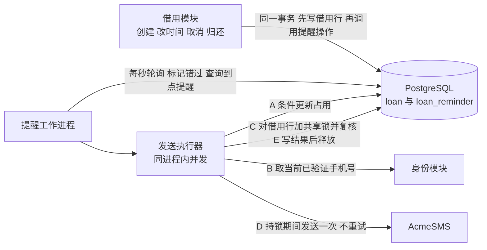
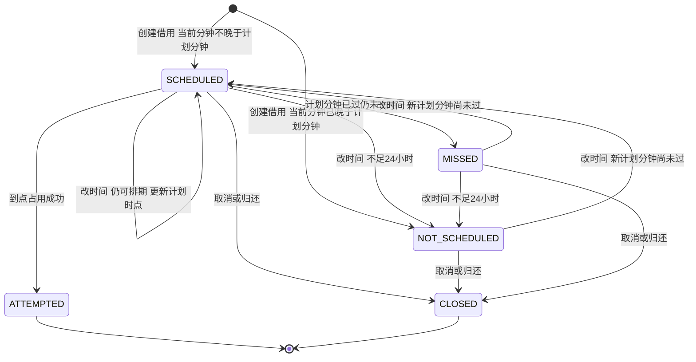
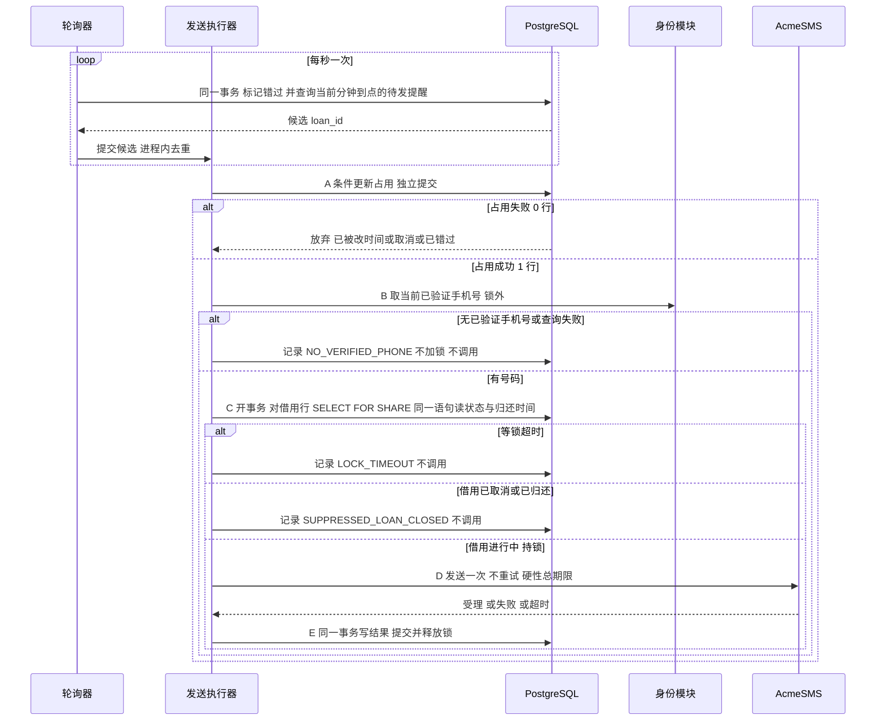
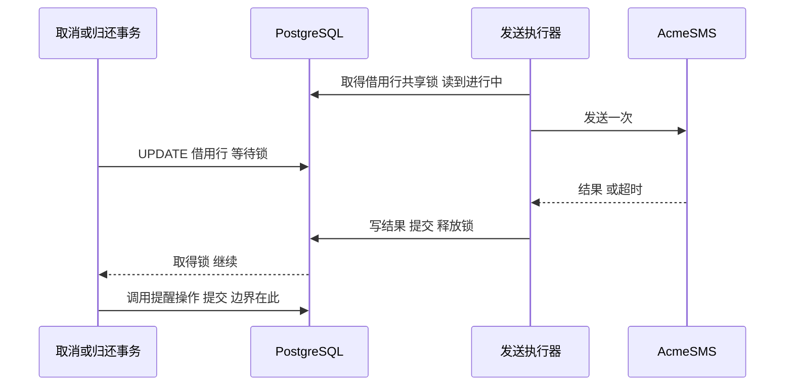

# 借用短信提醒 设计（Spec）

- 版本：v1.1（2026-10-17）。审查状态：**已批准（H-05，2026-10-17）**。v1 曾获批准（H-04），v1.1 是完整修订版，已整体重新批准，并取代 v1 中被本版修订的部分（见第 0 节）。V-01 仍待真实 PostgreSQL 验证；B-01、B-02 仍待核实，是实施前阻塞。批准不改变供应商签名，也不改变每笔最多一次尝试，不授权更改签名或次数规则。
- 追溯：需求与决策记录见 `2026-10-17-loan-sms-reminder-record.md`。文中 R-xx 指已批准的需求清单（H-01），S-xx 指已批准的补充需求（H-02），其余编号（U、A、C、D、P、B）指记录中的条目。
- 范围声明：本文只描述设计，不含也不修改任何产品代码。文中的 SQL 与流程是设计示意。

## 0. v1.1 相对 v1 的修订

| # | 修订 | 依据 | 涉及章节 |
|---|------|------|----------|
| 1 | 预算改为累计口径：每笔借用至多一次发送尝试。不设单分钟或单日到点上限，集中到点而错过的记 `MISSED`、不补发。v1 由“每日新增最多 1000 笔”推出“每日提醒最多 1000 条”的推断（A-04）失效 | U-23、A-04、A-06、C-05 | 规则 14、16；4.8；AC-19、AC-20；风险 1；第 9 节 |
| 2 | 取消语义选方案 C：发送期间持借用行锁，取消或归还等调用结束才提交；以取消或归还事务提交时点为界，已提交的借用不能再调用供应商 | U-24、P-02、C-06 | 不可接受结果 #2、#5；规则 8、15；3.2；4.1；4.2；4.5；4.6；4.7；第 5 节；AC-13、AC-15、AC-21 至 AC-29；风险 6 至 8 |
| 3 | 新增次要决定 D-13 至 D-19（见第 9 节），已随 H-05 批准，其中 D-16 为用户明确接受 | 构建者检查 | 第 9、10 节 |
| 4 | 明确锁等待与超时：配置项的大小关系、取消侧超时失败的结果、发送方挂起的兜底，均有对应验收用例 | U-25 | 4.7；AC-22 至 AC-29 |

## 1. 目的、范围与不可接受的结果

**目的。** 在新建的共享工具借用系统（Python 服务）中，为每笔借用向借用人发送至多一条归还提醒短信，时点是当前约定归还时间的前 24 小时（U-01、U-04）。

**范围内：** 提醒的排期、改时间后的重排、取消与归还后的停止、到点占用与发送、发送期间对借用行的加锁、失败与错过的记录、短信内容。

**范围外：** 借用本身的创建、取消、归还、改时间的业务入口与权限校验（由借用模块负责，本设计只规定它们必须满足的接口约束，见 3.2）；除借用人以外的收件人；送达回执；重试；退订；避开夜间；单分钟或单日的到点数量上限与限流（U-23 明确不设）。

**术语。** “发送尝试”以占用成功为准（4.5 步骤 A，时刻为 `attempted_at`）。“供应商调用”指实际向 AcmeSMS 发出的请求。一次尝试可能没有对应的供应商调用（见 4.2 的结果表）。

**不可接受的结果**（验收时逐条检查）：
1. 同一笔借用有多于一次发送尝试（含失败与超时），或多于一次供应商调用。
2. 取消或归还事务提交之后，仍开始一次供应商调用（U-24）。
3. 提醒发出尝试之后，因改时间而再次发出。
4. 发送尝试发生在计划时点所在分钟之后，却仍然发出。
5. 发送方持有借用行锁超过持锁上限仍不释放，使取消、归还、改时间被无限期阻塞；或这些请求既没有成功也没有明确失败。

## 2. 已批准的行为规则

规则 1 至 14 来自 v1，其中 3、8、14 的表述在 v1.1 中澄清；规则 15、16 是 v1.1 新增，已随 H-05 批准。

| # | 规则 | 依据 | 归属 |
|---|------|------|------|
| 1 | 对每笔借用，向借用人发一条提醒，使用发送时借用人当前已验证的手机号 | R-01、R-10、S-09 | 用户直接提出 |
| 2 | 发送时点是当前约定归还时间的前 24 小时（UTC，不避夜间） | R-02、S-06 | 用户直接提出 |
| 3 | 每笔借用整个生命周期最多一次发送尝试（占用成功即为一次尝试）。失败、超时的尝试也用掉这一次。预算按每笔最多一条核算 | R-03、S-01、S-02、A-01、U-23 | 用户直接提出，用户确认了我的推断 |
| 4 | 提醒发出尝试之前改归还时间：重新排期，按最新归还时间前 24 小时发送 | R-04 | 用户从选项中选择 |
| 5 | 提醒发出尝试之后改归还时间：不补发 | R-05 | 用户从选项中选择 |
| 6 | 创建借用或改时间时，若已不足 24 小时：不发，也不占用那一次机会；之后改回距今 ≥24 小时，则重新排期 | R-06、R-07、A-03 | 用户从选项中选择，推论经用户批准 |
| 7 | 距归还时间恰好 24 小时：立即发送 | S-10、A-05 | 用户直接提出 |
| 8 | 取消借用、借用已归还：不发。边界见规则 15 | R-08、R-09、A-02、U-24 | 用户直接提出，用户确认了我的推断；边界由用户在 U-24 选定 |
| 9 | 零宽限：计划时点所在分钟之内的尝试算准时，进入下一分钟才算错过；错过不补发 | S-03、S-04、C-04 | 用户直接提出，用户从选项中选择精度 |
| 10 | 错过的提醒（未发出尝试）之后，借用人把归还时间改到距今 ≥24 小时，重新排期，可再获得一次提醒 | D-04 | 我的次要决定，用户已批准 |
| 11 | 供应商任何失败（含超时）都不重试；无效手机号只记录失败 | R-11、S-01 | 用户直接提出 |
| 12 | “已发出”以首次发送尝试为准，不等回执 | S-02 | 用户直接提出 |
| 13 | 只有借用人能改归还时间；新时间必须晚于现在；次数不限 | S-05 | 用户直接提出 |
| 14 | 技术与规模：Python 服务、PostgreSQL、AcmeSMS，单一工作进程每秒轮询一次。“每日新增借用最多 1000 笔”只是规模信息，**不推出**每日或每分钟的发送量，也不是发送上限 | S-08、U-19、U-13、U-17、U-23 | 用户直接提出 |
| 15 | 发送期间持借用行锁。取消或归还的事务要等实际供应商调用完成或超时、结果记录后才能提交；以取消或归还事务的提交时点为界：提交之后，该借用不得再开始供应商调用；提交之前已开始的调用允许完成 | U-24、P-02、C-06 | 用户从选项中选择（v1.1 新增，已批准 H-05） |
| 16 | 预算为累计口径：每笔借用至多一次发送尝试。不设单分钟或单日到点上限。集中到点而在计划分钟内占用不上的提醒记 `MISSED`，不补发 | U-23、C-05、A-06 | 用户直接提出（v1.1 新增，已批准 H-05） |

## 3. 现状与约束

### 3.1 现状
- 这是新系统，项目目录为空，没有可读的现有代码（U-05）。因此借用模块的数据表、接口、身份模块都尚不存在，本设计对它们只提出下面的接口约束。借用行锁协议（3.2 第 5 条）须在借用模块设计时落实。
- 以下事项**尚未核实**，设计不依赖任何未经核实的 AcmeSMS 能力：AcmeSMS 是否支持签名“共享工具”（B-01）；AcmeSMS 的错误码、频率限制、超时建议、是否支持去重键（B-02）。
- 加锁相关的数据库行为（`FOR SHARE` 与 `UPDATE` 冲突、READ COMMITTED 下等锁后重读已提交的新版本）是依据 PostgreSQL 文档的设计前提，本阶段未实测，记为 V-01，仍待真实 PostgreSQL 验证；由 AC-22、AC-23、AC-26、AC-29 在实施时验证。H-05 的批准不等于已验证。

### 3.2 对借用模块与身份模块的接口约束
1. **借用状态：** 借用至少有“进行中、已取消、已归还”三种状态，后两种是终态，不可恢复（D-09）。借用行至少含 `status` 与 `due_at`。
2. **同事务协同：** 借用的创建、改归还时间、取消、归还，必须在**同一个数据库事务**里调用提醒模块的对应操作（4.5）。这是并发正确性的基础，不能放在事务之外。
3. **改时间校验由借用模块负责：** 调用者必须是该借用的借用人；新归还时间晚于现在；新时间精确到分钟（秒不为 0 则拒绝，不截断，D-05）。
4. **手机号读取接口：** 身份模块提供 `get_verified_phone(borrower_id) -> 号码或空`，返回调用时刻借用人当前已验证的号码。调用须设超时；失败或超时的处理见 D-19。
5. **借用行锁协议**（U-24、D-13、D-16）：
   - 取消、归还、改归还时间的事务，必须**先写借用行**（`UPDATE loan ...`），再调用提醒操作。这次写入会与发送方持有的行锁冲突并等待，先后顺序就是取消边界。
   - 这些事务须设置 `lock_timeout = cancel_lock_wait_max`，且该值须大于发送方持锁上限（4.7）。等锁超时则**整个事务回滚**并向调用者报告失败（可重试），借用与提醒均不变，不得出现“借用已取消、提醒仍按旧状态处理”的中间态。
   - 全部路径加锁顺序一致：先借用行，后提醒行。
   - 数据库隔离级别使用默认的 READ COMMITTED。
   - 借用模块须记录这些请求的锁等待时长与因锁超时而失败的次数（4.8）。

## 4. 设计

### 4.1 组成



只有一个工作进程（S-08、U-19）。进程内分两部分：每秒一次的**轮询器**，和并发的**发送执行器**。发送执行器让慢速的 AcmeSMS 调用不会阻塞轮询（D-07）。每个执行器工作单元按 A 到 E 顺序独占处理一个候选，持锁期间占用一条数据库连接，所以执行器并发度不得超过数据库连接池容量（4.7）。

### 4.2 数据模型

每笔借用对应 `loan_reminder` 表中的一行，主键为 `loan_id`。一笔借用不可能有两行，所以“每笔最多一条”在结构上成立。

| 字段 | 类型 | 说明 |
|------|------|------|
| `loan_id` | 主键，外键指向借用 | 一对一 |
| `state` | 枚举 | `NOT_SCHEDULED`、`SCHEDULED`、`ATTEMPTED`、`MISSED`、`CLOSED`，见 4.4 |
| `remind_at` | `timestamptz`，UTC，精确到分钟 | 恒等于当前归还时间减 24 小时。`ATTEMPTED` 与 `CLOSED` 之后不再随改时间变化，作为历史 |
| `attempted_at` | `timestamptz`，可空 | 占用成功的时刻，仅 `ATTEMPTED` 有值 |
| `outcome` | 枚举，可空 | 见下表，仅 `ATTEMPTED` 有值 |
| `outcome_detail` | 文本，可空 | 供应商返回的错误码或说明，或 `IDENTITY_ERROR`，不存手机号 |
| `created_at`、`updated_at` | `timestamptz` | 记录用 |

`outcome` 取值及其与供应商调用的关系：

| outcome | 是否发起过供应商调用 | 含义 |
|---------|----------------------|------|
| `SUBMITTED` | 是 | 供应商受理 |
| `INVALID_PHONE` | 是 | 供应商判定号码无效 |
| `PROVIDER_ERROR` | 是 | 其他供应商失败（含无法识别的错误码，D-11） |
| `TIMEOUT` | 是，结果不明 | 超过 `sms_timeout` |
| `INTERRUPTED` | 不确定 | 占用后无结果，工作进程重启时标记（D-08），或发送方挂起被数据库终止会话后标记（D-17） |
| `NO_VERIFIED_PHONE` | 否 | 占用后没有已验证手机号，或查询号码失败（D-06、D-19） |
| `SUPPRESSED_LOAN_CLOSED` | 否 | 占用后，加锁复核发现借用已取消或已归还（D-15） |
| `LOCK_TIMEOUT` | 否 | 占用后，等借用行锁超过 `send_lock_wait_max`（D-15） |

约束与索引：
- `CHECK`：`state = 'ATTEMPTED'` 当且仅当 `attempted_at` 非空；`outcome` 非空时 `state = 'ATTEMPTED'`。
- 部分索引：`CREATE INDEX ON loan_reminder (remind_at) WHERE state = 'SCHEDULED'`，使每秒的轮询查询只扫待发记录。
- 不存手机号。发送时现取现用。

### 4.3 时间规则

- **统一用 UTC。** 所有时间用 `timestamptz`；短信中的时间也以 UTC 显示（S-06、D-02）。
- **归还时间精确到分钟**（C-04）。`remind_at = due_at − 24 小时`，也精确到分钟。
- **唯一时钟是数据库时钟（D-12）。** 所有“现在”的比较都在 SQL 内通过一个函数 `reminder_now()`（默认返回 `clock_timestamp()`）取得，且**每条语句内只取一次**，避免一条语句横跨分钟边界。应用进程的时钟不参与比较。测试时可以覆盖这个函数来控制时间。
- **“准时”的判定（C-04 选 A）。** 记 `now_min = date_trunc('minute', reminder_now())`：
  - `now_min = remind_at`：在计划时点所在分钟内，算准时。
  - `now_min > remind_at`：进入下一分钟或更晚，算错过。
  - `now_min < remind_at`：还没到点。
- **“尝试”的时刻是占用成功的时刻**（`attempted_at`），“准时”按它判定。占用之后的手机号查询、等锁、供应商调用可能越过计划分钟，不构成错过，也不违反不可接受结果 #4（见风险 8）。
- **排期判定**（规则 2、6、7 的统一写法）。创建借用或改时间时，用 `now_min` 与新的 `remind_at` 比较：
  - `now_min < remind_at`：距归还时间超过 24 小时，进入 `SCHEDULED`，等到点。
  - `now_min = remind_at`：视为“恰好 24 小时”，进入 `SCHEDULED`，由轮询立即占用（规则 7）。
  - `now_min > remind_at`：不足 24 小时，进入 `NOT_SCHEDULED`，不发（规则 6）。

**这个选择的实际含义（请审查时留意）：** 因为同一分钟内算同一时点，在 `remind_at` 所在分钟的 0 到 59 秒内创建或改时间，都按“恰好 24 小时”处理、立即发。但如果占用恰好落在下一分钟，就算错过、不发。这来自你选的“按整分钟比较”，不是额外加的宽限。

### 4.4 状态与转换



| 状态 | 含义 | 可否被改时间改变 | 终态 |
|------|------|------------------|------|
| `NOT_SCHEDULED` | 进行中的借用，当前不足 24 小时，不发 | 可。改到足够晚则变 `SCHEDULED` | 否 |
| `SCHEDULED` | 已排期，等待 `remind_at` 所在分钟 | 可。更新 `remind_at`，或变 `NOT_SCHEDULED` | 否 |
| `MISSED` | 计划分钟已过，没有发出尝试，也没有占用那一次机会 | 可（D-04）。改到足够晚则回到 `SCHEDULED` | 否 |
| `ATTEMPTED` | 已占用，即已有一次发送尝试，不论是否发起供应商调用、不论结果。取消、归还、改时间对该行本身无影响；取消、归还对是否调用供应商的影响由 4.5 步骤 C 的加锁复核决定 | 不可，改时间对提醒无影响（规则 5） | 是 |
| `CLOSED` | 取消或归还，不发 | 不可 | 是 |

**不变量：** 没有任何路径把 `ATTEMPTED` 改回别的状态。这是“每笔最多一次尝试”的根。

### 4.5 流程

**所有状态变更都是对同一行的条件更新。** 占用、改时间、取消、归还都竞争这一行。PostgreSQL 在默认的 READ COMMITTED 下，后到的更新会等行锁，等到后再按已提交的新版本重新判断 `WHERE` 条件。所以它们互相排斥，不会各自读到旧状态。

**四个时点必须区分**：① 占用提交（提醒行变 `ATTEMPTED`）；② 发送方取得借用行锁并复核；③ 供应商调用（开始到结束）；④ 取消、归还的事务提交。数据库行锁只能排斥数据库内的更新，管不到事务之外的供应商调用，所以 v1 中“占用先到则短信照发”留下了 ① 与 ③ 之间无人检查的窗口。v1.1 用步骤 C 的借用行锁把 ④ 钉在 ② 之前或 ③ 之后（4.5 末尾给出完整保证）。

**(1) 创建借用**（借用模块的同一事务内）
插入 `loan_reminder` 行：`remind_at = due_at − 24h`，按 4.3 的排期判定写入 `SCHEDULED` 或 `NOT_SCHEDULED`。

**(2) 改归还时间**（借用模块的同一事务内，在更新借用的 `due_at` 之后；该更新会等待发送方持有的借用行锁，见 3.2 第 5 条）
- 新旧归还时间相同：不改动提醒（D-10）。
- 否则：
  ```sql
  UPDATE loan_reminder
  SET remind_at = :new_remind_at,
      state = CASE WHEN date_trunc('minute', t.now_ts) <= :new_remind_at
                   THEN 'SCHEDULED' ELSE 'NOT_SCHEDULED' END,
      updated_at = t.now_ts
  FROM (SELECT reminder_now() AS now_ts) t
  WHERE loan_id = :id AND state IN ('NOT_SCHEDULED', 'SCHEDULED', 'MISSED');
  ```
  匹配 0 行说明状态是 `ATTEMPTED` 或 `CLOSED`，提醒保持不变（规则 5）。

**(3) 取消或归还**（借用模块的同一事务内，先把借用状态改为终态，该更新会等待发送方持有的借用行锁，再调用下面的提醒操作）
```sql
UPDATE loan_reminder SET state = 'CLOSED', updated_at = reminder_now()
WHERE loan_id = :id AND state IN ('NOT_SCHEDULED', 'SCHEDULED', 'MISSED');
```
已经是 `ATTEMPTED` 的保持不变，保留发送历史。是否还会发出供应商调用，不由这条语句决定，而由步骤 C 的复核和锁决定。

**(4) 轮询与发送**（提醒工作进程）



轮询器每秒执行，同一事务内用同一个时间戳：
```sql
-- 1) 标记错过：计划分钟严格早于当前分钟
UPDATE loan_reminder SET state = 'MISSED', updated_at = t.now_ts
FROM (SELECT reminder_now() AS now_ts) t
WHERE state = 'SCHEDULED' AND remind_at < date_trunc('minute', t.now_ts);

-- 2) 查询候选：计划分钟等于当前分钟
SELECT loan_id FROM loan_reminder, (SELECT reminder_now() AS now_ts) t
WHERE state = 'SCHEDULED' AND remind_at = date_trunc('minute', t.now_ts);
```

发送执行器的一个工作单元对每个候选，**严格按下面顺序**执行：

**步骤 A：占用**（独立事务，立即提交，在任何加锁和调用之前）
```sql
UPDATE loan_reminder SET state = 'ATTEMPTED', attempted_at = t.now_ts, updated_at = t.now_ts
FROM (SELECT reminder_now() AS now_ts) t
WHERE loan_id = :id AND state = 'SCHEDULED'
  AND remind_at = date_trunc('minute', t.now_ts)
RETURNING loan_id;
```
- 返回 1 行：这次尝试成立，`attempted_at` 就是尝试时刻。**占用已提交之后才进入后续步骤**（D-12，依据 S-01、S-02、R-03）。占用必须先于加锁并独立提交：如果占用与持锁放在同一事务里，进程在调用后、提交前崩溃会让占用回滚，同一分钟内可能再次占用并重复调用。
- 返回 0 行：这条已被改时间、取消、归还，或已错过，放弃，不调用。
- 占用语句自带“计划分钟等于当前分钟”的条件，所以执行器自己拖到下一分钟才抢占的，也会被拒绝并最终被标为错过。这保证规则 9 对发送执行器的排队延迟同样成立。工作单元只有在能立即接着做 B 到 E 时才执行 A，不会先占用一批再排队等发送槽位。

**步骤 B：取手机号**（不持锁，D-14）：调用 `get_verified_phone`。没有已验证手机号，记 `NO_VERIFIED_PHONE`，结束，不加锁、不调用（D-06）。查询失败或超时按同样方式处理，`outcome_detail` 记 `IDENTITY_ERROR`（D-19）。取号码放在锁外，是为了让持锁时间只包含供应商调用与一次写入。

**步骤 C：加锁并复核**（新事务，D-13）
```sql
BEGIN;
SET LOCAL lock_timeout = :send_lock_wait_max;
SELECT status, due_at FROM loan WHERE id = :id FOR SHARE;
```
- 加锁与读取在**同一条语句**中完成。若此时有取消、归还或改时间的事务已持有该行的写锁，本语句等待它提交；READ COMMITTED 下等待后读到的是其提交后的最新版本，所以不会读到旧的“进行中”。
- 等锁超过 `send_lock_wait_max`：回滚，记 `LOCK_TIMEOUT`，不调用，不重试（D-15）。
- `status` 不是进行中（已取消或已归还）：回滚，记 `SUPPRESSED_LOAN_CLOSED`，不调用（D-15）。
- 进行中：保持事务和锁，进入步骤 D。读到的 `due_at` 用于短信文本（D-18）。

**步骤 D：调用 AcmeSMS**（持锁，仅一次）：只在步骤 C 持锁成功且借用进行中时调用，不重试，带硬性总期限 `sms_timeout`（4.7）。持锁期间，其他事务对该借用行的写入（取消、归还、改时间）全部等待（D-16）；不加锁的普通读取不受影响；其他借用不受影响。

**步骤 E：写结果并释放锁**
```sql
UPDATE loan_reminder SET outcome = :outcome, outcome_detail = :detail, updated_at = reminder_now()
WHERE loan_id = :id AND state = 'ATTEMPTED' AND outcome IS NULL;
COMMIT;
```
写结果与释放锁在同一次提交里，所以等待中的取消、归还只能在结果已记录之后取得锁。若调用已发生而写结果失败（含数据库终止了会话），发送方用新连接重试记录；**不重试调用**（D-17）。仍失败则 `outcome` 保持为空，由 4.8 的告警和下一次重启的 `INTERRUPTED` 标记处理。

**取消、归还、改时间与发送的先后保证**（核心，U-24）：



| 取消或归还事务提交的时点 | 结果 |
|--------------------------|------|
| 早于步骤 A | 提醒 `CLOSED`，无占用，无调用 |
| 晚于步骤 A，早于发送方取得借用行锁 | 步骤 C 读到已取消或已归还，记 `SUPPRESSED_LOAN_CLOSED`，**无调用** |
| 请求到达时发送方已持锁（步骤 C 之后） | 请求在写借用行处等待；发送方完成调用并记录结果、释放锁后，请求才提交。**调用恰好一次，且发生在取消提交之前**；提醒保持 `ATTEMPTED` 与对应结果 |
| 取消事务先取得借用行锁、尚未提交，发送方随后到达 | 发送方在步骤 C 等待，最长 `send_lock_wait_max`。取消在此之前提交：发送方读到已取消，记 `SUPPRESSED_LOAN_CLOSED`，无调用。超过：记 `LOCK_TIMEOUT`，无调用；之后取消照常提交 |
| 请求等锁超过 `cancel_lock_wait_max` | 整个请求回滚并报告失败，借用与提醒不变，调用照常完成一次；请求可重试 |
| 发送方进程崩溃或挂起 | 会话关闭或被数据库终止，锁随之释放，等待的请求得以提交；占用已提交，无二次调用；`outcome` 为空，之后标 `INTERRUPTED`（D-08、D-17） |

由此得到的边界论证：任何供应商调用都开始于持锁期间；任何取消或归还都只能在锁释放之后提交；因此**不存在调用开始于取消或归还提交之后的执行**。除了请求本身失败回滚这一种情况，取消或归还一旦成功返回，就不会再有该借用的供应商调用。

改时间的类似保证：发送方持锁期间提交的改时间请求会等待；在步骤 A 之后、步骤 C 之前提交的改时间，其新归还时间会被步骤 C 读到并写入短信（D-18），调用仍为一次，提醒状态仍为 `ATTEMPTED`（规则 5）。

**(5) 进程重启**
工作进程启动时，把所有 `state = 'ATTEMPTED' AND outcome IS NULL` 的记录标为 `INTERRUPTED`（D-08）。因为只有一个工作进程，这些必然是上一个进程在占用之后、记录结果之前中断的。它们**不重试**，也无法知道短信是否真的发出，只做记录。进程中断时它持有的借用行锁随数据库会话关闭而释放。重启期间错过的计划分钟，由轮询器按 `MISSED` 处理。

### 4.6 短信内容

- 文本固定为：`【共享工具】借用将于{时间}到期`。其中 `{时间}` 是发送方在步骤 C 加锁时读到的该借用当前归还时间，格式 `YYYY-MM-DD HH:MM UTC`（D-18）。例：`【共享工具】借用将于2026-10-18 09:00 UTC到期`（U-12、D-02、D-03）。
- 不含工具名、链接、退订提示。借用人同时借多件工具时，无法从短信区分是哪一件。这是按你给的文案保持的，如需区分请告知。
- 该文本为 32 个字符，在常见的“中文短信每条 70 字符”规则下是一条。这个分段规则是 AcmeSMS 的实际规则，尚未核实（B-02）。如果 AcmeSMS 按多条计费，会影响“每笔最多一条”的预算口径，需在实施前确认。
- 签名不随供应商要求自动更改。AcmeSMS 不支持该签名时，记录为阻塞，由你决定（U-16、B-01）。

### 4.7 AcmeSMS 集成要求与配置关系

- 每次占用成功并通过复核后**最多调用一次**，任何失败都不重试（S-01）。
- 调用必须设置**硬性总期限** `sms_timeout`（含建立连接、发送、读取响应，不是只限制其中某一段）。超时算一次尝试，记为 `TIMEOUT`，不重试。数值作为配置项，待 B-02 核实供应商建议后确定，本设计不预设数值。
- 失败分类 `INVALID_PHONE`、`PROVIDER_ERROR`、`TIMEOUT` 只用于记录与排查，三者行为一致（都不重试）。AcmeSMS 错误码到类别的映射待 B-02 核实；无法识别的一律归为 `PROVIDER_ERROR`（D-11）。
- 发送执行器的并发度作为配置项，须不超过 AcmeSMS 的频率限制，也不得超过数据库连接池容量（持锁期间每个工作单元占一条连接），数值待 B-02。轮询器不得被发送阻塞（D-07）。**不设**单分钟或单日的发送数量上限（规则 16）。

**锁与超时配置的大小关系**（数值待 B-02，关系现在就固定）：

| 配置项 | 所在 | 含义与约束 |
|--------|------|------------|
| `sms_timeout` | 发送方 | 供应商调用的硬性总期限 |
| 持锁上限（正常） | 发送方 | 步骤 C 取得锁到步骤 E 提交，约等于 `sms_timeout` 加一次写入余量 |
| `idle_tx_timeout` | 发送会话 | 数据库参数 `idle_in_transaction_session_timeout`。须大于 `sms_timeout` 加一次写入余量，否则会误杀正常调用；发送方挂起时，它是持锁的绝对上限（D-17） |
| `send_lock_wait_max` | 发送方 | 步骤 C 等借用行锁的上限。超过则 `LOCK_TIMEOUT`（D-15） |
| `cancel_lock_wait_max` | 借用模块 | 取消、归还、改时间事务的 `lock_timeout`。**须大于 `idle_tx_timeout`**，使正常或异常的发送持锁都不会让请求因超时而失败；仅在锁被异常长时间占用时才失败回滚（3.2 第 5 条） |

大小关系为：`sms_timeout` < `idle_tx_timeout` < `cancel_lock_wait_max`。工作进程启动时校验自己能看到的部分（`sms_timeout` 与 `idle_tx_timeout`），不满足则拒绝启动；`cancel_lock_wait_max` 的大小由借用模块的验收保证（AC-25）。

因此，取消、归还、改时间的请求在遇到正在发送的借用时，最长等待约一次 `sms_timeout`（发送方挂起时最长约 `idle_tx_timeout`）。这是 U-24 的直接代价（风险 6）。

### 4.8 可观测性与预算核对

- 每次状态转换写一条结构化日志，含 `loan_id`、旧状态、新状态、时间。
- 指标：各 `outcome` 的计数、`MISSED` 的计数、轮询每次耗时、从分钟起点到占用成功的延迟、发送方持锁时长分布、同时持锁的发送方数量、借用模块侧取消 / 归还 / 改时间的锁等待时长与因锁超时失败的次数。
- **预算核对（累计口径，U-23）：** 短信成本只按“每笔借用至多一次尝试”核算。可能产生计费的供应商调用数 = `outcome` 为 `SUBMITTED`、`INVALID_PHONE`、`PROVIDER_ERROR`、`TIMEOUT`、`INTERRUPTED`，或 `outcome` 为空的 `ATTEMPTED` 行数。它**不应超过累计创建的借用数**（`loan_id` 主键保证每笔至多一行），也应不少于供应商账单上的条数。`NO_VERIFIED_PHONE`、`SUPPRESSED_LOAN_CLOSED`、`LOCK_TIMEOUT` 没有供应商调用，不计入。成本上界为累计借用数乘以单价。
- **不按日、不按分钟核对上限，也不用“每日新增借用上限”推算每日或每分钟的发送量。** 某一天或某一分钟的发送量取决于当时到点的借用数，可以超过当日新增借用数（A-06）。每日、每分钟的实际量只作监控与容量参考，不构成验收上限。
- 告警：`MISSED`、`INTERRUPTED`、`LOCK_TIMEOUT` 意味着有借用人没有收到提醒或结果不明；`outcome` 为空且 `attempted_at` 早于当前时间超过 `idle_tx_timeout` 加余量的 `ATTEMPTED` 行意味着结果记录失败；借用模块因锁超时失败的次数上升意味着发送持锁异常。

## 5. 边界与异常

| 情形 | 行为 | 依据 |
|------|------|------|
| 创建时已不足 24 小时 | `NOT_SCHEDULED`，不发 | 规则 6 |
| 创建或改时间落在计划分钟内 | `SCHEDULED`，立即占用；若占用落在下一分钟则 `MISSED`，不发 | 规则 7、9 |
| 已排期，改到不足 24 小时 | `NOT_SCHEDULED`，不占用那一次机会 | 规则 6 |
| `NOT_SCHEDULED` 或 `MISSED`，改到距今 ≥24 小时 | 回到 `SCHEDULED` | 规则 6、10 |
| 占用之后改时间 | 提醒不变，不补发。步骤 C 之前提交的新时间会写入短信，持锁期间提交的改时间等待发送结束 | 规则 5；4.5 |
| 占用与改时间同时发生 | 行锁排斥：占用先到则改时间不影响提醒状态；改时间先到则占用返回 0 行（或回到 `SCHEDULED` 重新排期） | 4.5 |
| 占用之后、加锁之前取消或归还 | 步骤 C 读到已取消或已归还，记 `SUPPRESSED_LOAN_CLOSED`，**不调用供应商**，取消成功 | 规则 15 |
| 发送方持锁（调用中）时取消或归还 | 请求等待到调用与结果记录完成后才提交；调用恰好一次，发生在取消提交之前 | 规则 15 |
| 取消事务先持锁、发送方等待 | 取消在 `send_lock_wait_max` 内提交则 `SUPPRESSED_LOAN_CLOSED`；否则 `LOCK_TIMEOUT`，均无调用 | 规则 15；D-15 |
| 取消或归还等锁超过 `cancel_lock_wait_max` | 整个请求回滚并失败，借用与提醒不变，可重试 | 3.2 第 5 条；D-16 |
| 取消成功返回之后 | 该借用不再有新的供应商调用 | 规则 15 |
| 工作进程停机、数据库不可用、进程卡住超过计划分钟 | 该分钟的提醒错过，不补发 | 规则 9 |
| 占用后、调用前进程崩溃 | 不重发；重启后标 `INTERRUPTED`；锁随会话关闭释放 | D-08 |
| 持锁调用中进程崩溃或挂起 | 数据库会话关闭或被 `idle_tx_timeout` 终止，锁释放，等待的请求得以提交；不重发；`INTERRUPTED` | D-08、D-17 |
| 调用已发生、写结果失败 | 用新连接重试记录，不重试调用 | D-17 |
| 身份模块查询失败或超时 | `NO_VERIFIED_PHONE`（`IDENTITY_ERROR`），不加锁、不调用 | D-19 |
| 误启动了第二个工作进程 | 条件更新仍保证最多一次尝试（但不属于支持的部署方式） | 4.5 |
| 同一分钟大量借用同时到点（数量不设上限） | 在计划分钟内占用不上的，记 `MISSED`，不补发；已占用的按流程发送，受执行器并发度和连接池约束 | 规则 9、16；第 7 节风险 |
| 借用已取消或已归还后又收到改时间请求 | 提醒不受影响，请求是否允许由借用模块决定 | D-09 |
| 手机号在排期后更换 | 发送时用当时已验证的号码（步骤 B） | S-09 |

## 6. 验收标准

下列用例使用真实 PostgreSQL 和一个可配置延迟、失败、超时的 AcmeSMS 假服务，时间通过覆盖 `reminder_now()` 控制。涉及先后顺序的用例，在步骤 A、B、C、D、E 之间设置可控的暂停钩子，用事件序号断言先后，不依赖墙钟。涉及锁等待与超时的用例，把 `sms_timeout`、`idle_tx_timeout`、`send_lock_wait_max`、`cancel_lock_wait_max` 配置为很小的值，并满足 4.7 的大小关系（AC-25 刻意违反）。

| # | 场景 | 期望 | 对应 |
|---|------|------|------|
| AC-01 | 创建借用，归还时间在 25 小时后，到计划分钟 | 恰好一次调用，文本符合 4.6，状态 `ATTEMPTED`、结果 `SUBMITTED` | R-01、R-02、S-07 |
| AC-02 | 发出前改归还时间到更晚 | 旧计划分钟不发，新计划分钟发一次 | R-04 |
| AC-03 | 占用后再改归还时间 | 不再有调用 | R-05 |
| AC-04 | 创建时距归还时间不足 24 小时 | `NOT_SCHEDULED`，无调用 | R-06 |
| AC-05 | 创建时恰好落在计划分钟，轮询在同一分钟内执行 | 立即占用并发出一次 | S-10 |
| AC-06 | 同 AC-05，但轮询推迟到下一分钟 | 状态 `MISSED`，无调用 | S-03、S-04、C-04 |
| AC-07 | 已排期，改到不足 24 小时；再改回 ≥24 小时 | 先 `NOT_SCHEDULED` 无调用，再 `SCHEDULED`，到点发一次 | R-07 |
| AC-08 | 计划分钟之前取消，或已归还 | `CLOSED`，无占用，无调用 | R-08、R-09 |
| AC-09 | AcmeSMS 返回无效手机号 | `ATTEMPTED`、`INVALID_PHONE`，无重试；之后改时间也无新调用 | R-11、R-03 |
| AC-10 | AcmeSMS 超时 | `ATTEMPTED`、`TIMEOUT`，无重试；持锁时长不超过 `sms_timeout` 加写入余量 | S-01 |
| AC-11 | 工作进程停机跨过计划分钟后恢复 | `MISSED`，无调用 | S-03、S-04 |
| AC-12 | `MISSED` 后改到距今 ≥24 小时 | 回到 `SCHEDULED`，到点可发一次 | D-04 |
| AC-13（修订） | 占用与改时间用两个连接并发，反复多次 | 每次最多一次调用；占用先到时改时间不改变提醒状态；改时间先到时占用返回 0 行或按新时间重新排期。占用与取消、归还的并发由 AC-21 至 AC-23 覆盖 | R-03、R-05 |
| AC-14 | 同时启动两个工作进程（压力测试，非支持方式） | 每笔借用仍最多一次调用 | 4.5 |
| AC-15（修订） | 在三个时点杀进程再启动：(a) 占用后、加锁前；(b) 持锁调用中；(c) 调用返回后、写结果前。(b)(c) 时另有一个取消请求在等待 | (a) 无调用；(b)(c) 调用至多一次且不重发。三种情况都标 `INTERRUPTED`；会话关闭后锁释放，(b)(c) 中等待的取消得以提交，不无限等待 | D-08、D-17 |
| AC-16 | 占用时借用人没有已验证手机号 | `NO_VERIFIED_PHONE`，无调用，不加锁，不重试 | D-06、D-14 |
| AC-17 | 排期后借用人换了已验证手机号 | 短信发往新号码 | S-09 |
| AC-18 | 改时间被非借用人、过去时间、带秒的时间请求 | 被借用模块拒绝，提醒不变 | S-05、D-05 |
| AC-19（修订） | 同一分钟大量借用同时到点（例：1000 笔，仅作压测，不是上限），AcmeSMS 带延迟 | 轮询不被阻塞；同时持锁的发送方数量不超过执行器并发度；计划分钟内占用不上的记 `MISSED`，不补发，无任何“超限”结果；每笔借用调用次数至多 1 | 规则 9、16、D-07 |
| AC-20（修订） | 累计预算核对：任意时点统计 4.8 定义的“可能产生计费的调用数”；并构造“连续三天各创建一批、归还时间同在一天”的场景 | 调用数不超过累计创建的借用数；每个 `loan_id` 至多一行、至多一次假服务调用；**不断言**任何按日或按分钟的数量上限，同一天到点量可以超过当日新增数 | 规则 16、A-06、U-23 |
| AC-21 | 钩子暂停在步骤 A 与步骤 C 之间，此时取消（另一用例用归还）并提交，再放行 | 无供应商调用，提醒为 `ATTEMPTED`、`SUPPRESSED_LOAN_CLOSED`，取消成功 | 规则 15、D-15 |
| AC-22 | 发送方在步骤 D 持锁（假服务延迟 d，d 小于 `sms_timeout`），此时发起取消（另一用例用归还、改时间） | 请求在写借用行处阻塞；调用完成、结果记录后请求才提交；调用恰好一次，其开始事件早于取消提交事件；请求等待时长不小于调用剩余时间且不大于持锁上限；其他借用的取消不受影响；不加锁的普通读取不被阻塞；提醒保持 `ATTEMPTED`、`SUBMITTED` | 规则 15、D-16；3.1 |
| AC-23 | 取消事务先取得借用行锁并保持未提交，发送方随后进入步骤 C，之后取消提交（另一用例：取消在 `send_lock_wait_max` 之内提交） | 发送方等待，取消提交后读到已取消，记 `SUPPRESSED_LOAN_CLOSED`，无调用 | 规则 15、D-13 |
| AC-24 | 假服务延迟超过 `sms_timeout`，期间发起取消 | 调用在 `sms_timeout` 到期时中止，记 `TIMEOUT`，无重试；取消在记录结果之后提交；取消的等待不超过 `sms_timeout` 加写入余量 | 规则 15、4.7 |
| AC-25 | 刻意把 `cancel_lock_wait_max` 配得小于发送持锁时长，在持锁期间发起取消（另一用例用归还、改时间） | 请求因锁超时失败并整体回滚，借用仍为进行中，提醒状态不变；调用照常完成一次；之后重试请求成功；没有出现“借用已取消而提醒按旧状态处理”的中间态。另有一个配置校验用例：`cancel_lock_wait_max` 不大于 `idle_tx_timeout` 的组合被借用模块的验收判为不合格 | 3.2 第 5 条、D-16 |
| AC-26 | 发送方在持锁调用中挂起（连接未断开，不再发语句），期间发起取消 | 数据库在 `idle_tx_timeout` 终止该会话，锁释放，等待的取消随后成功提交（且不因 `cancel_lock_wait_max` 失败）；假服务调用至多一次；提醒 `outcome` 为空，重启或补记后为 `INTERRUPTED`；告警条件触发 | D-17、不可接受结果 #5 |
| AC-27 | 取消事务持锁不提交的时间超过 `send_lock_wait_max` | 发送方记 `LOCK_TIMEOUT`，无调用，无重试，释放自己；之后取消提交成功 | D-15 |
| AC-28 | (a) 持锁期间发起改归还时间；(b) 占用后、加锁前改归还时间已提交 | (a) 改时间等待到发送结束，短信时间为加锁时读到的旧时间；(b) 短信时间为加锁时读到的新时间，调用恰好一次；两种情况提醒都保持 `ATTEMPTED`，不补发 | 规则 5、D-18 |
| AC-29 | 性质测试：在步骤 A 至 E 之间的钩子点，随机插入取消、归还、改时间、杀进程和假服务延迟或超时，涉及多个借用并发，反复多次 | 恒成立：(a) 每笔借用供应商调用至多 1 次；(b) 任一调用的开始事件都早于该借用取消或归还事务的提交事件；(c) 数据库死锁计数为 0（加锁顺序为先借用行、后提醒行）；(d) 取消、归还、改时间要么在 `cancel_lock_wait_max` 内成功，要么整体失败且借用与提醒不变 | 规则 15、不可接受结果 #1、#2、#5 |

## 7. 风险

1. **突发集中到点。** 如果很多借用的计划分钟相同，发送执行器必须在该分钟内逐个占用。AcmeSMS 的频率限制或延迟，加上数据库连接池容量，让占用赶不上，就会错过并记 `MISSED`，不补发。数量没有上限（规则 16），某一分钟的到点量可以远超当日新增数。缓解：执行器并发度按 B-02 和连接池容量设定，并监控 `MISSED`。这是零宽限的直接代价（S-04）。
2. **单点。** 只有一个工作进程，它或数据库不可用的那一分钟，提醒全部错过。这是你选定方案和“错过不补发”的结果，不会造成多发。
3. **超时和中断的结果不明。** `TIMEOUT` 与 `INTERRUPTED` 时不知道短信是否真的发出，也不重试。借用人可能收到，也可能没收到。
4. **供应商计费口径。** 如果 AcmeSMS 的分段规则与 70 字符假设不同，预算口径可能偏离（B-02）。
5. **短信不含工具名**，同时借多件时无法区分。
6. **取消、归还、改时间可能被阻塞。** 遇到正在发送的借用，请求最长等一次 `sms_timeout`（发送方挂起时最长约 `idle_tx_timeout`）。这是选择方案 C 的直接代价（P-02）。取消 / 归还对借用人是一次较慢的请求，而不是失败。
7. **持锁期间占用数据库连接。** 并发度受连接池约束；同一时刻在途的发送越多，占用的连接越多。AcmeSMS 整体变慢时，连接占用会放大。缓解：并发度上限、`sms_timeout` 硬性总期限、监控同时持锁数。
8. **实际调用可能晚于计划分钟。** “准时”按占用时刻判定（4.3），占用之后的取号码、等锁、调用可能越过计划分钟，在极端情况下（取消事务长时间持锁）最长约 `send_lock_wait_max`。这延续了 v1 对排队延迟的处理，该风险已随 H-05 接受。
9. **正确性依赖借用模块遵守锁协议。** 如果借用模块的取消、归还、改时间事务没有先写借用行，或没有设置 `cancel_lock_wait_max`，边界会失效。借用模块尚不存在，协议须在其设计中落实并通过 AC-22、AC-25、AC-29 验收。
10. **`LOCK_TIMEOUT` 与 `IDENTITY_ERROR` 会让极少数提醒不发。** 它们都用掉那一次机会，不重试（D-15、D-19）。

## 8. 阻塞与待核实

| 编号 | 内容 | 影响 |
|------|------|------|
| B-01 | AcmeSMS 是否支持签名“共享工具”。不支持则记录阻塞，由用户决定，不自动更改（U-16） | 实施前阻塞，仍待核实。批准不授权更改签名 |
| B-02 | AcmeSMS 的错误码、频率限制、推荐超时、分段与计费规则、是否有去重键，以及能否提供含连接与读取的硬性总期限 | 决定 `sms_timeout`、并发度、`idle_tx_timeout`、`send_lock_wait_max`、`cancel_lock_wait_max` 的数值，失败分类映射，预算口径。设计不依赖其中任何一项成立。实施前阻塞，仍待核实。批准不授权更改次数规则 |
| V-01 | 加锁行为依据 PostgreSQL 文档推出，须在真实 PostgreSQL 上验证：`FOR SHARE` 与 `UPDATE` 冲突、READ COMMITTED 下等锁后重读已提交的新版本、`idle_in_transaction_session_timeout` 终止会话后锁释放、无死锁（3.1） | 待真实 PostgreSQL 验证，由 AC-22、AC-23、AC-26、AC-29 覆盖。H-05 的批准不等于已验证；你未将其列为实施前阻塞，验证方式与时机在制定计划时安排 |

## 9. 决定归属

**用户直接确认或选择的**：规则 1 至 9、11 至 16 的内容（见第 2 节）；方案 A（PostgreSQL 轮询，P-01）；取消语义方案 C（P-02，U-24）；累计预算口径（U-23）；比较精度（C-04 选 A）；D-04。其中规则 15、16、P-02、C-05、C-06 已随 H-05 批准。

**我的次要决定，v1 已获用户批准（H-04）**（内容未变，已随 H-05 整体再审并批准）：

| 编号 | 决定 |
|------|------|
| D-05 | 归还时间带非零秒时由借用模块拒绝，不截断 |
| D-06 | 占用后借用人没有已验证手机号：记 `NO_VERIFIED_PHONE`，不调用供应商，这一次机会已用，不重试 |
| D-07 | 发送在同进程内的并发执行器里进行，不阻塞每秒轮询。并发度、AcmeSMS 超时为配置项，数值待 B-02 |
| D-08 | 重启时把占用后无结果的记录标 `INTERRUPTED`，不重试 |
| D-09 | 取消、归还是终态，不可恢复；对已取消或已归还借用的改时间不影响提醒 |
| D-10 | 新旧归还时间相同时，不改动提醒 |
| D-11 | 失败分类只用于记录；无法识别的错误码归为 `PROVIDER_ERROR` |
| D-12 | 以数据库时钟为唯一时间来源，每条语句内只取一次；“先占用、后调用”的顺序 |

**v1.1 新增的次要决定，已获用户批准（H-05）**（均为落实 U-23、U-24 的实施性选择，不改变你选定的结果；你在 U-26 中明确接受 D-16，即改归还时间也等待发送结束）：

| 编号 | 决定 |
|------|------|
| D-13 | 占用先独立提交，再由同一执行器开事务，`SELECT ... FOR SHARE` 锁借用行并在同一语句读状态与归还时间；全部路径先借用行、后提醒行；借用模块事务先写借用行再调用提醒操作；READ COMMITTED |
| D-14 | 取手机号放在加锁之前；没有号码时不加锁、不调用 |
| D-15 | 新增结果 `SUPPRESSED_LOAN_CLOSED`、`LOCK_TIMEOUT`：占用后未调用供应商，不重试，这一次机会已用，不计入供应商调用数 |
| D-16 | 持锁期间对该借用行的**所有**写入（含改归还时间）都等待，不只取消和归还；借用模块侧 `cancel_lock_wait_max` 须大于发送持锁绝对上限，超时则整个请求回滚、可重试 |
| D-17 | 发送会话设 `idle_in_transaction_session_timeout` 作为挂起时的持锁上限；调用已发生而写结果失败时，用新连接重试记录，不重试调用 |
| D-18 | 短信中的 `{时间}` 取加锁时读到的归还时间 |
| D-19 | 身份模块查询失败或超时按 `NO_VERIFIED_PHONE` 处理（`IDENTITY_ERROR`），不加锁、不调用、不重试（v1 未定义的缺口） |

**取舍说明（P-01）。** 候选 B 是延迟任务队列。它仍然需要数据库条件更新来保证最多一次，所以数据库状态机一样不能省，队列只是多出一套要运维的系统，在每日 1000 笔的规模下没有换来更强的保证。进程内存定时器因重启丢失、无法保证最多一条而被排除。

**取舍说明（P-02）。** 三个候选：A 调用前复核，不持锁（我推荐：取消不被阻塞，但复核与调用之间仍有极短窗口）；B 保留 v1 行为并改写需求，承认取消后仍可能收到一条；C 发送期间持借用行锁，取消等调用结束才提交。你选了 C。C 的好处是边界精确，不存在取消提交之后才开始的调用；代价是风险 6 至 9：取消、归还、改时间最长要等一次调用，发送方持锁占用连接，正确性依赖借用模块遵守锁协议。

## 10. 审查状态

- 本 Spec v1.1 是完整修订版，已于 2026-10-17 获批准（H-05，U-26）。批准范围：全文，含规则 15、16；3.2 第 5 条；4.5 至 4.8；D-13 至 D-19（你明确接受 D-16：改归还时间也等待发送结束）；AC-01 至 AC-29；第 7 节风险 1 至 10；沿用的 v1 内容（含 D-05 至 D-12）。V-01、B-01、B-02 不在批准的解决范围内。批准不改变供应商签名，也不改变每笔最多一次尝试。
- 本版修订的 v1 条目：A-04 失效，4.8 预算核对、第 5 节原“占用与改时间/取消同时发生”一行、AC-13、AC-15、AC-19、AC-20、风险 1 已改写（第 0 节）。
- 一致性检查：已按获批需求与你在 U-23、U-24 的选择，核对正常、改时间、取消、异常、并发路径，以及图示、验收与风险。对次数、峰值与成本：计数对象是借用，窗口是累计，不再用每日新增上限推算每日或每分钟的量。对并发：区分了占用提交、加锁复核、供应商调用、取消提交四个时点，并用借用行锁与持锁顺序给出可验收的先后保证。
- 批准后核对（2026-10-17）：规则、流程、验收、风险之间未发现冲突，正文未修改。发现三处措辞级歧义，不改变获批结果，见记录 W-01，待你决定如何处理。
- 构建者检查：本环境没有可用的子代理工具，未派独立子代理，由我按构建者视角自查。结果：
  - **已有答案，已补入：** 锁等待与超时的大小关系和失败结果（4.7、3.2）；短信时间取值（D-18）；占用与持锁必须分开提交的原因（4.5 步骤 A）。
  - **自行决定并标明的次要事项：** D-13 至 D-19。其中 D-19 填补的是 v1 就存在的缺口（身份模块查询失败的结果）。
  - **没有发现需要你另行决定、会改变你选定结果的缺口。** U-24 的两处连带后果已在 H-05 中处理：改归还时间在发送持锁期间也要等待（D-16），已被你明确接受；`LOCK_TIMEOUT` 与 `IDENTITY_ERROR` 会让极少数提醒不发（D-15、D-19），随 D-13 至 D-19 一并批准。
  - 加锁行为依据 PostgreSQL 文档推出，未实测，记为 V-01（3.1、第 8 节），仍待真实 PostgreSQL 验证；由 AC-22、AC-23、AC-26、AC-29 在实施时验证。
- B-01、B-02 须在实施前核实；V-01 待真实 PostgreSQL 验证（你未将其列为实施前阻塞，在计划中安排）。Spec 已批准，下一步是制定实现计划（writing-plans）。本阶段不修改产品代码。
